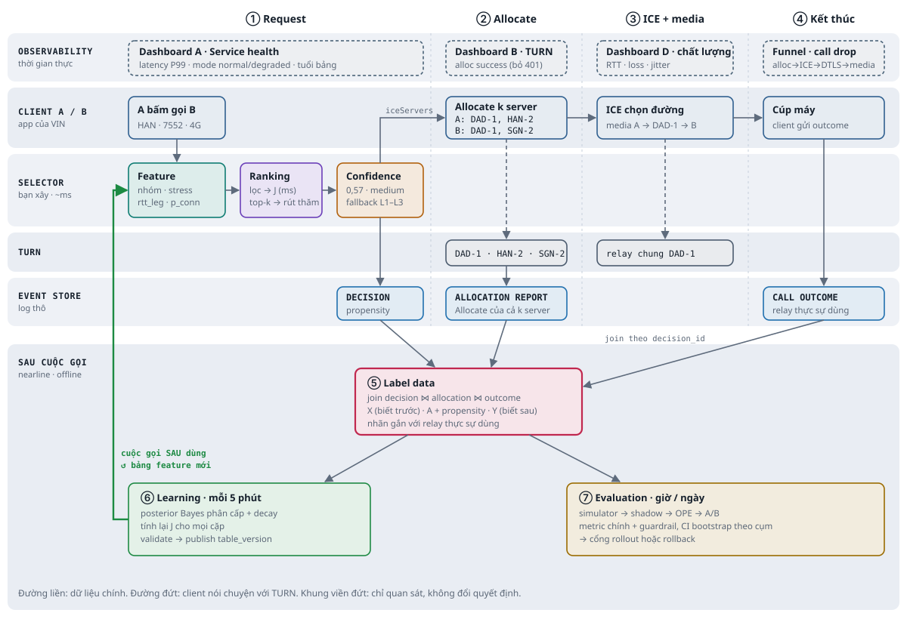
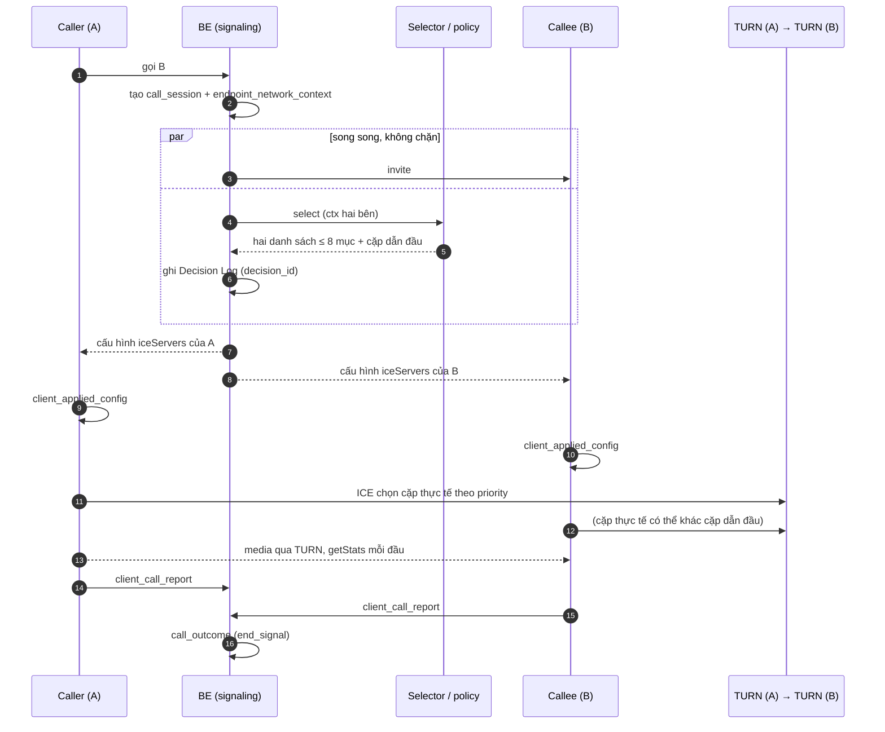
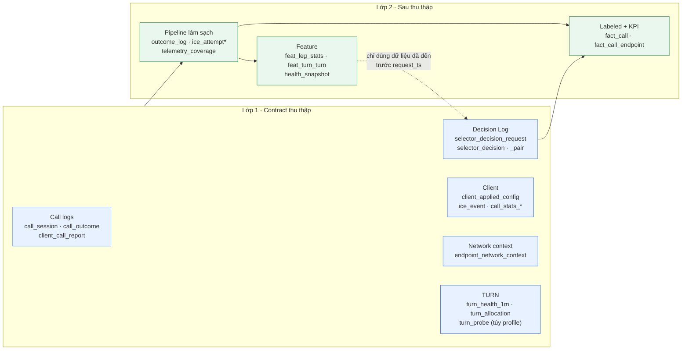
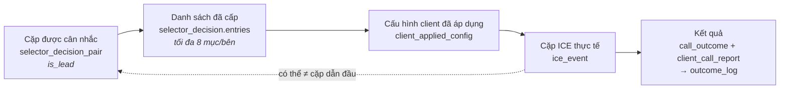
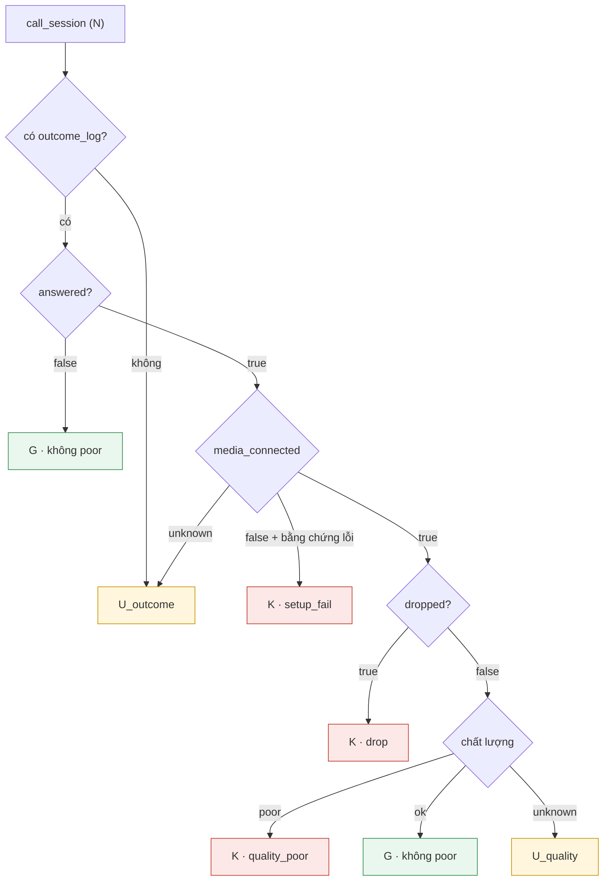
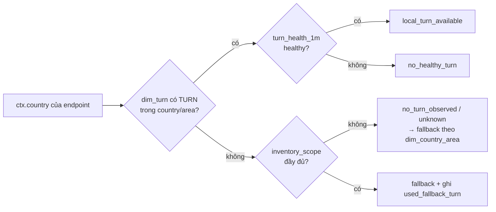

# TURN Selector Intelligence

Đề tài sáu tuần: **chọn danh sách TURN cho Caller và Callee**, rồi đánh giá kết quả kết nối. Hiện tại Hiệp làm **simulator + data model trước**; mentor chưa giao log thật hay danh sách field production, nên mọi thông số mô phỏng là *giả định có version*.

| | |
|---|---|
| **Trạng thái contract** | [Data Contract v0.5.0](docs/w2-data-contract/DATA_CONTRACT_v0.5.0.md) · `simulator_ready` · nguồn production chờ xác minh |
| **Phân công** | **Hiệp**: simulator, raw synthetic, pipeline, dashboard · **Đoàn**: thuật toán Selector, interface, đề xuất contract |
| **Đọc tiếp** | [Khảo sát nguồn dữ liệu](docs/w2-data-contract/KHAO_SAT_NGUON_DU_LIEU.md) · [Định nghĩa metric](docs/w2-data-contract/metric_config_v0.5.0.yaml) · [W1 của Hiệp](docs/W1_HIEP.md) · [Quyết định cho simulator](docs/w2-data-contract/README.md) · [KPI MVP](docs/w2-data-contract/KPI_MVP_v0.5.0.md) · [Hướng giải quyết của Đoàn](docs/w2-data-contract/Huong_giai_quyet_Smart_TURN_Selector.md) |

---

## 1. Một cuộc gọi đi qua hệ thống như thế nào

Signaling đi qua BE (Spring Boot); **media đi A → TURN(A) → TURN(B) → B**, không qua BE. Selector được gọi **song song** với invite, không chặn signaling.

> Điểm khác v0.4.0: không còn "đi rank 1 × rank 1, lỗi thì thử rank kế". Selector chọn **cặp dẫn đầu**, ICE chọn **cặp thực tế**; hai thứ được ghi riêng.

## 2. Dữ liệu chảy qua hai lớp

Một cột là **raw** khi có đúng một nguồn ghi trực tiếp. Cột tính từ nhiều dòng, nhiều nguồn hay theo cửa sổ thuộc lớp 2. Simulator giữ **network truth** ở bảng riêng và không chép thành số đo quan sát.

## 3. Quyết định → áp dụng → thực tế → kết quả

Ba đối tượng khác nhau, nối bằng `decision_id`, `decision_device_id`, `pc_id`, `ice_generation`:

## 4. KPI không biến "thiếu dữ liệu" thành "tốt"

Mọi call thuộc cohort, kể cả khi thiếu outcome hay stats. Tỷ lệ báo cả hai cận: `pcr_itt_low = K/N` và `pcr_itt_high = (K+U)/N`.

RTT, packet loss, jitter luôn đi kèm `sample_count`, `eligible_count`, `measurement_coverage`. `call_stats_*` chỉ giữ cuộc gọi relay hoặc thất bại, nên không suy rộng chất lượng sang cuộc gọi P2P.

## 5. User không có TURN tại quốc gia của mình

`no_turn_observed` **không** có nghĩa là `not_deployed`.

## 6. Bản đồ thư mục

| Đường dẫn | Nội dung |
|---|---|
| [`docs/w2-data-contract/DATA_CONTRACT_v0.5.0.md`](docs/w2-data-contract/DATA_CONTRACT_v0.5.0.md) | **Bản chốt**: quyết định, assumption, danh sách bảng, KPI |
| [`docs/w2-data-contract/`](docs/w2-data-contract/) | Đề xuất và hai schema YAML của Đoàn; KPI; lab ICE |
| [`docs/research/`](docs/research/) | Ghi chú nghiên cứu (dataset, getStats, VIA/OPE, kiến trúc media) |

