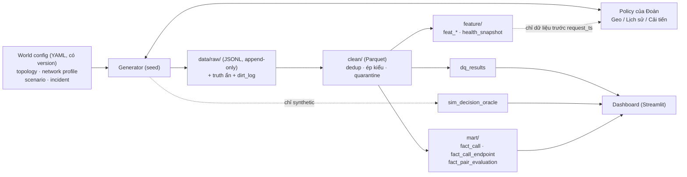

# Kế hoạch W1 → W6 của Hiệp: simulator, pipeline, dashboard

Tài liệu cá nhân (nhánh `hiep/w1-notes`), bổ sung cho phần "dữ liệu là gì" của [Data Contract v0.5.0](contracts/data-contract-v0.5.0.md). Contract nói **dữ liệu gồm những gì**; tài liệu này nói **làm ra nó thế nào, kiểm tra ra sao, theo tuần nào**.

> **Trạng thái:** đề xuất để Hiệp duyệt. Phần "đã chốt" lấy từ contract, `Huong_giai_quyet` và đề của mentor. Phần "đề xuất" là lựa chọn của tài liệu này (nhất là stack và tham số), chưa ai xác nhận. Mọi tham số mô phỏng là giả định có version, không phải số production. Các link trong `research/` chưa được mở lại để kiểm tra.

## 1. Phạm vi và nguyên tắc

| | |
|---|---|
| **Phần của Hiệp** | Simulator (raw synthetic), pipeline (clean → feature → fact), dashboard, đánh giá độc lập |
| **Phần của Đoàn** | Thuật toán Selector (Geo Baseline, Baseline lịch sử, thuật toán cải tiến), API, đề xuất contract |
| **Chưa có** | Log thật, danh sách field production, Selector đang chạy. Mentor chỉ đạo **giả lập trước**; nếu output đủ tốt mới sang dữ liệu thật (A9) |
| **Không làm** | Kết luận về production từ dữ liệu synthetic; sửa SDK; mô hình hóa đổ chuông và độ trễ tín hiệu; chạy trên traffic thật |

Nguyên tắc xuyên suốt (đều từ contract):
1. Mọi raw synthetic có `data_source = synthetic`, `sim_run_id`; truth ở bảng riêng, **không** chép thành số đo quan sát.
2. Thiếu dữ liệu không thành `0`/`false`/"tốt"; biểu diễn bằng `unknown`/`null` + `telemetry_coverage`.
3. Feature và health chỉ dùng event đã đến và đã publish **trước `request_ts`** (không đọc tương lai).
4. Cùng config + seed → cùng `call_id`, thứ tự event và outcome.
5. Dashboard chỉ đọc `fact_*`, `metric_config` và (trang synthetic-only) `sim_decision_oracle`; policy/feature không đọc oracle (I34).

## 2. Mốc thời gian

Theo mentor và `Huong_giai_quyet` §10. Hôm nay (06/11) đang ở W1.

| Mốc | Ngày | Hiệp phải có |
|---|---|---|
| W1 | 04–10/11 | Contract chốt cho simulator, khảo sát nguồn dữ liệu, một call chạy xuyên suốt |
| **Báo cáo Sprint 1** | **trước 18/11** | Contract v0.5.0, 30 metric, khảo sát nguồn, ERD, trace một call |
| **MVP** | **02/12** | Simulator + pipeline + dashboard chạy được; kịch bản 8, 9; luồng quyết định → dashboard |
| **Final** | **15/12** | Bảng so sánh đầy đủ, ≥ 3 insight có bằng chứng, mã nguồn, tài liệu, giới hạn |

## 3. Kiến trúc tổng thể



**Stack đề xuất** (từ `research/04`, chạy được trên laptop, 6 tuần):

| Việc | Chọn | Lý do ngắn |
|---|---|---|
| Lưu trữ | Parquet, partition `dt=YYYY-MM-DD` | Ghi đè nguyên partition là idempotent |
| Truy vấn | DuckDB | Có `quantile_cont`, đọc Parquet trực tiếp |
| Transform | Polars (lazy) cho clean/feature; SQL DuckDB cho mart | Schema chặt, SQL dễ review |
| DQ | pandera (schema, range) + check SQL tự viết → `dq_results` | Nhẹ; Great Expectations quá nặng |
| Điều phối | Script Python + CLI `run --date`, Makefile | Không cần Airflow |
| Dashboard | Streamlit + Plotly/Altair đọc DuckDB | Tự dựng được Decision Trace và hiển thị CI/n |

Quy mô tham chiếu: ~300k call (`research/04`), đủ để DuckDB trả lời trong mili giây.

## 4. Simulator

### 4.1. World config (có version)

Một thư mục config, mỗi file ghi `version` và được băm vào `run_manifest.config_hash`:

| File | Nội dung | Bảng contract liên quan |
|---|---|---|
| `topology` | Danh mục TURN (miền Bắc/Trung/Nam, ISP, quốc gia, tọa độ, transport, capacity, `failure_domain`), quốc gia **không** có TURN, `inventory_scope` | `dim_turn`, `dim_turn_endpoint`, `dim_country_area` (`topology_version`) |
| `network_profile` | RTT/loss/jitter theo (nhóm mạng, TURN), thành phần `exo` + `load`, biến thiên theo giờ, mobile vs fixed | `truth_leg_5m` (`network_profile_version`) |
| `scenario` | Phân bố cặp user theo 10 kịch bản; tỷ lệ quốc tế/nội địa; số call/giờ | `sim_call_tag.scenario_tag` (`scenario_version`) |
| `incident` | Sự cố TURN theo thời gian: trước/sau cấp phát, giữa call; step/ramp/spike; theo miền lỗi | `incident_truth` (`incident_schedule_version`) |
| `observation` | Profile `obs_base` (không probe) / `obs_active` (có probe) / `obs_infra`; tỷ lệ mất telemetry theo nền tảng | `run_manifest.observation_profile` |
| `dirt` | Tỷ lệ trùng, trễ, thiếu, lệch đồng hồ, orphan để thử pipeline | `dirt_log` |

### 4.2. Nguồn tham số và mức tin cậy

Mỗi tham số ghi `source ∈ {assumption, public, lab}` và nằm trong `run_manifest`. Không có tham số nào là `production`.

| Nhóm tham số | Giá trị khởi điểm | Nguồn | Ghi chú |
|---|---|---|---|
| RTT liên thành phố/quốc gia | Hà Nội–HCM ≈ 22 ms; HCM–Singapore ≈ 28 ms; Hà Nội–Singapore ≈ 55 ms; Hà Nội–Frankfurt ≈ 189 ms (xem bảng đầy đủ ở `research/01` §3) | WonderNetwork (snapshot 04/11, datacenter) | Là bảng tra theo cặp, **không** theo công thức khoảng cách (Hà Nội–Seoul 120 ms nhưng HCM–Seoul 65 ms). Người dùng cuối thường cao hơn |
| Độ trễ truy cập | Hà Nội mobile median ≈ 19 ms, fixed ≈ 4 ms (báo chí, gián tiếp từ Ookla) | `research/01` | Cộng vào backbone, không thay thế. Cần tính lại từ Ookla Open Data |
| Loss, jitter, giờ cao điểm | Chưa có số đã kiểm chứng cho mobile VN | M-Lab NDT, Cloudflare Radar (chưa kiểm schema) | **Khoảng trống**: để `assumption` và đưa vào phân tích độ nhạy |
| Peering liên ISP VN | Không có số công khai | RIPE Atlas (41 probe VN: FPT 9, VNPT 6, Viettel 5) | Tự đo giữa probe nếu kịp; nếu không, `assumption` |
| Hành vi ICE | Chọn theo priority, không theo RTT; TURN chết sau cấp phát tốn ≈ 63 ms × (vị trí TURN sống đầu tiên − 1)²; phát hiện `disconnected` sau 6,4–7,7 s; ICE restart 162–193 ms; dưới ~7 s ICE tự chuyển cặp | Lab Chromium 156 + coturn, một máy (`archive/pre-cleanup`) | Bằng chứng về cơ chế, không phải tham số production. Thời điểm gọi restart là tham số giả lập |
| Ngưỡng "poor" | VIA: 320 ms, 1,2 %, 12 ms; nội bộ cũ: 300 ms, 3 %, 30 ms | `KPI_MVP`, `Huong_giai_quyet` | Báo cáo phải nêu đang dùng ngưỡng nào (`quality_rule_version`) |

**Nguyên tắc chống tự chứng minh** (`Huong_giai_quyet` §8.3), áp cho cả generator:
- Tách thế giới khỏi thuật toán: thuật toán chỉ đọc raw quan sát, không đọc `truth_*`.
- Có ít nhất một thế giới "khoảng cách quyết định gần hết" để Geo Baseline thắng; nếu Selector vẫn thắng lớn ở đó thì nghi có lỗi.
- Tách thời gian: học giai đoạn trước, đánh giá giai đoạn sau.
- Lịch sử ban đầu do **Geo Baseline** sinh ra, nên chỉ cặp Geo từng dùng mới có dữ liệu (thiên lệch giống dữ liệu thật). Không có khám phá thì không dự đoán được cặp chưa dùng.

### 4.3. Generator

Thứ tự sinh một call (theo `W1_HIEP`):
1. `run_manifest`, catalog TURN, user; gắn `sim_run_id`, version, seed.
2. `call_session` + truth ẩn; tạo `selector_decision_request` từ context **có trước** `request_ts`.
3. Policy trả hai danh sách (tối đa **8 TURN server mỗi bên**, transport là thuộc tính). Ghi header một lần, danh sách theo bên/thiết bị, `selector_decision_pair` nếu policy có dự đoán. Chưa có Selector thì `decision_source = static_config`, `policy_version = static@1`.
4. Client: `client_applied_config`, tín hiệu mạng → BE ghi `endpoint_network_context` (có `context_version`).
5. Mô hình ICE chọn cặp thực tế theo priority → `ice_event`, `call_stats_*` từ **đường thực đi**; không điền RTT cho TURN không được đo.
6. `call_outcome` (BE), `client_call_report` (client, có thể mất).
7. Truth đi vào `truth_leg_5m`, `incident_truth`; oracle sinh `sim_decision_oracle` (đọc truth, chỉ synthetic).

Yêu cầu kỹ thuật:
- **Determinism:** một RNG tách theo luồng (`seed`, tên luồng) để thêm một bảng không làm đổi ID của bảng khác. Ghi `replicate_seed`, `git_commit`, `simulator_version`.
- **Replicate:** `benchmark_manifest` ghi số replicate, `mde_pp`, `alpha`, `power`; báo cáo kèm dao động giữa replicate.
- **Dirt:** tiêm lỗi có ghi `dirt_log` (trùng `event_id`, trễ quá lookback, thiếu event, lệch đồng hồ, orphan) để pipeline có thứ để bắt.
- **Cohort:** cuộc gọi setup thất bại và không có outcome **vẫn nằm trong dữ liệu**.

### 4.4. Mười kịch bản

Nhãn `sim_call_tag.scenario_tag`; bộ lọc tương ứng trên `fact_call` ở `KPI_MVP`.

| # | Kịch bản | Điều generator phải tạo ra |
|---|---|---|
| 1 | VN↔VN cùng miền, cùng ISP | Nhiều TURN nội mạng, chênh nhau ít |
| 2 | VN↔VN khác miền | Chặng giữa Bắc↔Nam |
| 3 | VN↔VN cùng miền, khác ISP | Peering kém giữa ISP (có hoặc không, tùy thế giới) |
| 4 | VN↔Quốc tế có TURN | Một hoặc hai relay |
| 5 | VN↔Quốc tế không có TURN | Đầu quốc tế `turn_availability_status ≠ local_turn_available`, có `used_fallback_turn` |
| 6 | Quốc tế↔Quốc tế cùng khu vực | Dữ liệu thưa |
| 7 | Quốc tế↔Quốc tế khác khu vực | Đường dài, `relay_same` vs `relay_relay` |
| 8 | TURN Failure | Ba thời điểm hỏng: trước cấp phát, sau cấp phát, giữa call (cần ICE restart); sự cố theo miền lỗi |
| 9 | Historical Cold-start | Nhóm ít lịch sử, `fallback_type = data_backoff` |
| 10 | Network Change | `network_epoch` tăng giữa call, `endpoint_network_context` có epoch mới |

## 5. Pipeline

### 5.1. Layout và quy tắc

```
data/raw/events/dt=YYYY-MM-DD/*.jsonl     # bất biến, append-only
data/clean/<bảng>/dt=.../*.parquet        # dedup, ép kiểu
data/quarantine/<bảng>/dt=.../*.parquet   # bản ghi hỏng + reason
data/feature/<bảng>/dt=.../               # feat_*, health_snapshot
data/mart/<bảng>/dt=.../                  # fact_*, kpi
data/meta/dq_results.parquet, run_log.parquet
```
- `dt` theo `event_ts` UTC; lưu thêm `ingest_ts`, `batch_id`.
- **Idempotent:** `run(date)` ghi partition tạm rồi thay nguyên partition; ghi `code_version` + `input_hash` vào `run_log`. Test: chạy hai lần, so hash.
- **Dữ liệu đến muộn:** lookback cố định (vd 3 ngày) chạy lại T-3..T; muộn hơn vào `late_beyond_window`. `fact_call` dùng `as_of_ts` + `fact_version` (I32).
- **Dedup:** theo `event_id`, giữ bản `ingest_ts` mới nhất; cùng `event_id` khác payload thì quarantine.
- **Quarantine thay vì xóa.**

### 5.2. Các bước

| Bước | Vào | Ra | Ghi chú contract |
|---|---|---|---|
| 1. Clean | raw | `clean_*`, quarantine | Ép kiểu, dedup, kiểm schema |
| 2. Outcome | `call_outcome`, `client_call_report`, `ice_attempt`, `call_stats_epoch` | `outcome_log` (có `outcome_version`) | `media_connected` ba trạng thái; placeholder sau timeout có `outcome_provenance` |
| 3. ICE attempt | `ice_event` | `ice_attempt`, `ice_attempt_endpoint` | Cặp thực tế, `path_type`, `turn_identity_status` |
| 4. Coverage | mọi nguồn | `telemetry_coverage` | Giải thích vì sao thiếu |
| 5. Feature | clean + `turn_health_1m` + `turn_probe` | `feat_leg_stats`, `feat_turn_turn`, `feat_path_history`, `health_snapshot` | Snapshot bất biến (I12, I13), cutoff trước `request_ts` |
| 6. Fact | `call_session` left join `outcome_log` + decision | `fact_call`, `fact_call_endpoint`, `fact_pair_evaluation` | `fact_call` 1 dòng/`call_id` kể cả không outcome |
| 7. KPI | fact | bảng KPI theo `metric_config` | Cùng `metric_definition_version` với simulator và dashboard |

### 5.3. Danh mục DQ (đề xuất, từ `research/04` §2.2)

Kết quả ghi vào `dq_results`; `error` chặn promote sang layer sau, `warn` chỉ hiển thị. Cột `check_id` trong contract chưa có danh mục chính thức, đây là đề xuất để gán ID.

| Nhóm | Check | Mức |
|---|---|---|
| Schema (S) | Cột bắt buộc, kiểu, enum | error |
| Null (N) | `event_id`, `call_id`, `event_ts`, `event_type` không null; null rate cột nghiệp vụ | error / warn |
| Range (R) | `rtt_ms` ≥ 0 và < 10000; loss trong [0,100]; jitter ≥ 0 | quarantine |
| Unique (U) | `event_id` duy nhất sau dedup; conflict cùng id khác payload | error |
| Referential (F) | decision ↔ allocation/ICE/outcome; `turn_id` có trong `dim_turn` | warn / error |
| Ordering (T) | decision ≤ allocation ≤ ICE ≤ outcome; clock skew | warn |
| Freshness / late (L) | tuổi dữ liệu; tỷ lệ muộn hơn lookback | warn |
| Volume / drift (V, D) | số event so với median 7 ngày; PSI > 0,2 | warn |
| Reconcile (K) | tổng clean = tổng mart | error |
| **Bất biến contract** | Theo `x-invariants` trong hai YAML (vd I3 độ dài danh sách, I7 dropped, I23, I32–I34) | FAIL theo từng I |

Kiểm tra dirt: mọi dòng trong `dirt_log` phải bị **ít nhất một** check bắt hoặc xử lý; tỷ lệ bỏ lọt là một metric của pipeline.

## 6. Dashboard

### 6.1. Các trang

| Trang | Nội dung | Nguồn |
|---|---|---|
| Call Quality | CSR, Setup Failure, Drop, CST, TTFM, RTT P50/P95, Loss, Jitter, `pcr_itt` hai cận | `fact_call`, `fact_call_endpoint` |
| TURN Performance | Allocation success/failure, Latency P50/P95 (RTT qua TURN), Stability, Health, Usage | `turn_allocation`, `turn_health_1m`, `fact_call_endpoint` |
| Service Health | Availability, API latency, Error/Fallback rate, Data freshness | `service_health_1m`, `selector_decision`, `health_snapshot` |
| Algorithm Quality | Lead match, rank used, top-k size, list churn, interval coverage | `fact_call`, `fact_pair_evaluation` |
| **Synthetic-only** | Oracle in top-k, regret (lead/actual/list), `policy_comparison_delta` | `sim_decision_oracle` — mọi biểu đồ gắn `data_source = synthetic` |
| Data Quality | `dq_results`, coverage, late/dup rate | `dq_results`, `telemetry_coverage` |
| Decision Trace | Từ `call_id`: decision → applied config → cặp ICE → stats → outcome | nhiều bảng |
| Insight | Mẫu bằng chứng 7 điểm (`KPI_MVP`) | — |

Bộ lọc chung: Country, Region, ISP, Network type, TURN, kịch bản (1–10), `data_source`, `sim_run_id`, `policy_version`, `observation_profile`.

### 6.2. Quy tắc hiển thị (từ contract)

- Luôn hiện `T`, `F`, `U`, `N`; tỷ lệ bảo thủ `T/N` và khoảng `[T/N, (T+U)/N]`. Không gọi `T/(T+F)` là tỷ lệ toàn cohort.
- RTT/loss/jitter luôn kèm `sample_count`, `eligible_count`, `measurement_coverage`. Chỉ có telemetry ở call relay/failed, nên hiển thị coverage theo call của toàn cohort.
- So sánh hai nhóm khác coverage chỉ gọi là "trên mẫu quan sát được".
- Không gán RTT cho TURN khi đường `mixed`/`unknown` hoặc danh tính chưa `identified`.
- Không trung bình các P95; tính từ giá trị mức call.

### 6.3. Thống kê (đề xuất, từ `research/04` §3–4)

| Việc | Cách | Lưu ý |
|---|---|---|
| CI cho tỷ lệ | Wilson | Làm mờ n < 30, không xếp hạng n < 100 |
| Segment ít mẫu | Empirical Bayes (Beta-Binomial) | Hiện cả p thô và n |
| So sánh TURN | Phân tầng theo (region × ISP × network × giờ) hoặc chuẩn hóa trực tiếp | Selector không ngẫu nhiên nên có nhiễu (Simpson) |
| Quét nhiều segment | Benjamini–Hochberg | Kèm effect size tối thiểu và `n_min` |
| Bất thường | Robust z (median/MAD) theo giờ + CUSUM/EWMA theo ngày | Mỗi alert lưu baseline, n, CI |
| Đánh giá detector | Tiêm incident (`incident_truth`), đo precision, recall, delay | Nhiều seed, tách tập tuning và test, so với ngưỡng tĩnh |

## 7. Giao diện với Đoàn

| Việc | Thỏa thuận cần có |
|---|---|
| Policy | Hàm nhận `select_request` → trả `select_response` (hai danh sách ≤ 8 TURN server, `lead_pair`, `topk_pair_count`, `confidence_level`, `fallback_type`, `action_propensity` nếu có). Policy chỉ được đọc dữ liệu đã publish trước `request_ts` |
| Chạy | Simulator gọi policy theo từng call; chọn phiên bản bằng `requested_policy_version` |
| Baseline | Geo Baseline từ W2; mốc so sánh chính |
| Đánh giá độc lập | Hiệp chạy cùng world + seed cho mọi policy; Đoàn không sửa metric |
| Thay đổi contract | Sửa YAML trước, sinh lại hai tài liệu (`Bang_du_lieu`, `So_do_database`), rồi mới cập nhật `data-contract-v0.5.0.md`; ghi breaking nếu đổi nghĩa |

## 8. Kế hoạch theo tuần

| Tuần | Simulator | Pipeline | Dashboard / đánh giá | Xong khi |
|---|---|---|---|---|
| **W1** 04–10/11 | Chốt contract cho simulator; khung world config; **sinh được một call có seed** | Khung thư mục, `run(date)` | — | Trace một call (`call_id` → decision → applied config → ICE → stats → outcome) có ca thành công và ca thất bại; chạy lại cùng seed cho trace giống hệt |
| **W2** 11–17/11 | Catalog TURN, `network_profile`, mô hình ICE (tham số lab); Geo Baseline chạy trong simulator | Clean, dedup, quarantine, `outcome_log`, `ice_attempt`; DQ catalog + `dq_results`; tiêm dirt | Báo cáo Sprint 1 (trước 18/11) | Mọi dòng `dirt_log` bị bắt; chạy hai lần cho cùng hash; báo cáo W1: khóa nối đúng, không dùng dữ liệu tương lai, coverage, KPI có `unknown` khi thiếu |
| **W3** 18–24/11 | 10 kịch bản có `scenario_tag`; `truth_leg_5m`, `incident_truth`; `sim_decision_oracle` | Feature (`feat_leg_stats`, `feat_turn_turn`, `health_snapshot`); `fact_call`, `fact_call_endpoint`, `fact_pair_evaluation`; 30 metric chạy từ `metric_config` | Trang Call Quality và Data Quality (bản đầu) | Test **6 loại call** (xem §9) qua; `fact_call` đúng 1 dòng/`call_id`; metric ra cùng số ở pipeline và dashboard |
| **W4** 25/11–01/12 | Gọi policy của Đoàn; sự cố trước/sau cấp phát/giữa call; `obs_active` có probe | `service_health_1m`, `health_snapshot` theo thời gian; KPI TURN Performance và Service Health | Các trang Call Quality, TURN, Service Health, Algorithm Quality, Decision Trace | **MVP 02/12:** kịch bản 8, 9 và luồng quyết định → dashboard chạy end-to-end |
| **W5** 02–08/12 | Nhiều thế giới (gồm thế giới "Geo thắng"), nhiều replicate; kịch bản 10 | Phân tích độ nhạy; so sánh theo `Huong_giai_quyet` §9.2 | Trang synthetic-only (oracle, regret); detector + đánh giá bằng incident; **≥ 3 insight** theo mẫu 7 điểm | Bảng so sánh các policy có CI giữa replicate; insight ghi rõ synthetic, n, coverage |
| **W6** 09–15/12 | Đóng băng config, ghi `git_commit` | Tài liệu pipeline, `Bang_du_lieu` đồng bộ YAML | Hoàn thiện; xuất báo cáo | **Final 15/12:** mã nguồn, tài liệu, báo cáo kết quả **và giới hạn**, Data Contract rút gọn cho bước thu thật nếu kết quả có ý nghĩa |

Nếu thiếu thời gian, cắt theo thứ tự: bộ phát hiện bất thường nâng cao (EWMA/CUSUM) → probe lệch → trang Insight tự động. **Không cắt:** trace một call, determinism, DQ bắt dirt, `fact_*`, KPI hai cận, trang so sánh policy.

## 9. Kiểm thử và nghiệm thu

| Kiểm thử | Nội dung |
|---|---|
| Determinism | Cùng config + seed → cùng `call_id`, thứ tự event, outcome (so hash) |
| Handoff một call | Một ca thành công và một ca thất bại; tắt probe hoặc thiếu getStats thì KPI chuyển `unknown`, không thành "tốt" |
| Không đọc tương lai | Mọi giá trị dùng lúc quyết định có timestamp/cutoff trước `request_ts` |
| Cách ly truth | Policy/feature/health không đọc `truth_*` hay `sim_decision_oracle` (I34); kiểm bằng test truy cập |
| Idempotent pipeline | Chạy hai lần cho cùng hash; chạy lại sau dữ liệu muộn cho `fact_version` tăng, không nhân đôi |
| Dirt | Mọi `dirt_log` bị bắt; đo tỷ lệ bỏ lọt |
| **6 loại call** (đề xuất) | (1) thành công `relay_relay`, (2) thành công `relay_same`, (3) `ice_failed`, (4) `media_setup_failed`, (5) drop giữa call, (6) thiếu outcome/stats → vào `U`. Mỗi loại kiểm `fact_call`, `fact_call_endpoint`, `pcr_group`. *Contract #8 ghi "6 loại" nhưng chưa định nghĩa; danh sách này là đề xuất cần Hiệp/Đoàn xác nhận* |
| Metric | Mỗi metric ở dashboard có một dòng `metric_config`; cùng version ở simulator, pipeline, dashboard |
| Detector | Precision/recall/delay trên incident tiêm, nhiều seed, so ngưỡng tĩnh |

## 10. Rủi ro và việc còn mở

| Rủi ro | Giảm bằng |
|---|---|
| Policy thắng chỉ vì giả định của chính generator | Thế giới "Geo thắng", nhiều biến thể danh mục, độ nhạy tham số, đánh giá độc lập |
| Tham số loss/jitter/peering VN không có nguồn | Ghi `assumption`, quét độ nhạy; tự đo bằng RIPE Atlas nếu có thời gian |
| Chỉ số "khớp cặp dẫn đầu" quá cao vì giả định candidate về kịp | Không coi là thành tích; ghi rõ giới hạn |
| Mô hình ICE sai với trình duyệt/mobile khác | Tham số lab dễ thay; báo giới hạn (lab chỉ Chromium, một máy) |
| Lịch sử chỉ có cặp của Geo Baseline | Ghép chặng; khám phá trong giả lập; hỏi mentor về biến thiên danh sách (A7) |
| Quy mô dữ liệu lớn hơn laptop | Bắt đầu 300k call; partition theo `dt`; tăng dần |
| Contract đổi giữa chừng | Sửa YAML trước; sinh lại tài liệu; ghi version |

**Việc cần xác nhận (không chặn simulator):**
- Mentor: số 8 là *tối đa* hay *đủ* 8 (A1); cách đo từng chặng (A2); danh sách có biến thiên khi thu thật (A7); tiêu chí "output đủ tốt" để sang dữ liệu thật (A9).
- Đoàn: danh sách 6 loại call (§9); giao diện hàm policy (§7); cách xử lý `selector_decision_pair` khi chưa biết Callee.
- BE / WebRTC core / hạ tầng: theo [Khảo sát nguồn dữ liệu](w2-data-contract/KHAO_SAT_NGUON_DU_LIEU.md) — chỉ cần khi chuyển sang dữ liệu thật.

## 11. Tài liệu liên quan

| Tài liệu | Dùng cho |
|---|---|
| [Data Contract v0.5.0](contracts/data-contract-v0.5.0.md) | Quyết định, bảng, bất biến |
| [YAML raw](w2-data-contract/data_contract_v0.5.0_de_xuat.schema.yaml), [YAML sau thu thập](w2-data-contract/dac_ta_sau_thu_thap_v0.5.0_de_xuat.schema.yaml) | Schema nguồn sự thật |
| [KPI MVP](w2-data-contract/KPI_MVP_v0.5.0.md), [metric_config](w2-data-contract/metric_config_v0.5.0.yaml) | Định nghĩa metric, 10 kịch bản, mẫu insight |
| [Hướng giải quyết](w2-data-contract/Huong_giai_quyet_Smart_TURN_Selector.md) | Thuật toán của Đoàn, mô hình ICE, đánh giá, lộ trình |
| [W1 của Hiệp](W1_HIEP.md) | Đầu ra W1, thứ tự một sample |
| `research/01`, `research/04` | Nguồn tham số mạng; pipeline, DQ, thống kê, dashboard |
| Nhánh `archive/pre-cleanup` | Lab ICE và bản v0.4.0 cũ |
