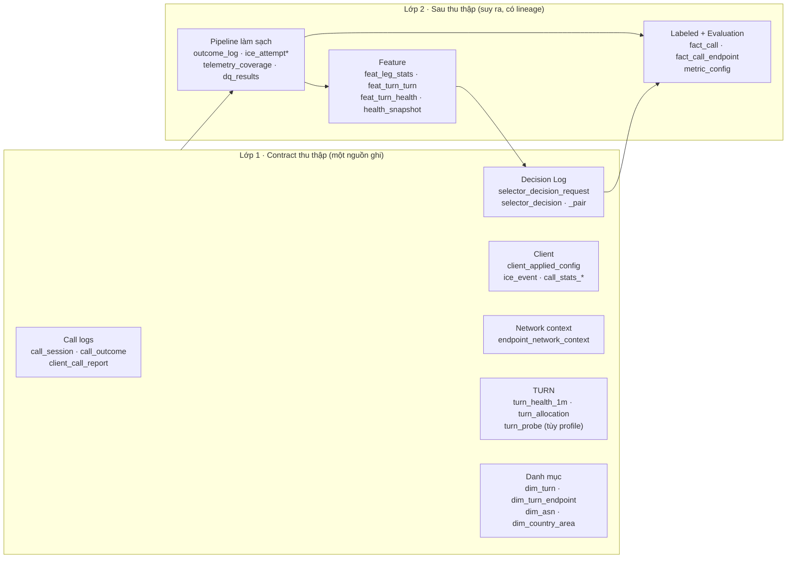
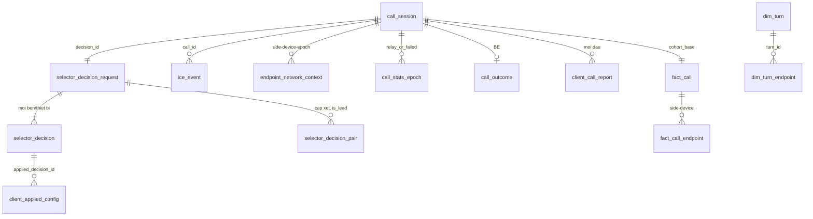
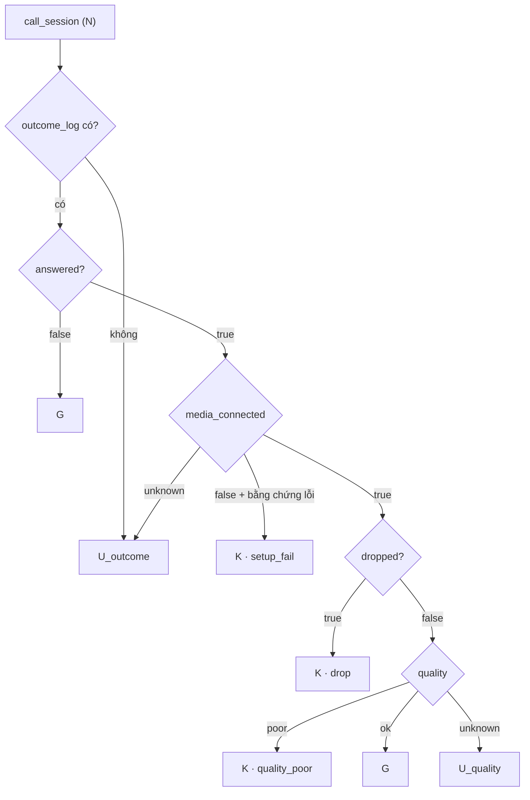

# Data Contract v0.5.0 — bản chốt cho simulator

> **Trạng thái:** `simulator_ready` · **Production:** `pending_source_verification` · **Thay thế:** [v0.4.0](data-contract.md) (phá vỡ tương thích).
> Nguồn gốc: đề xuất của Đoàn ([`docs/w2-data-contract/`](../w2-data-contract/)), phản hồi của Hiệp ở issue [#1](https://github.com/QuocHiep123/Pharse3/issues/1), và quyết định ở issues [#3](https://github.com/QuocHiep123/Pharse3/issues/3) – [#8](https://github.com/QuocHiep123/Pharse3/issues/8).
> **Khi tài liệu này khác YAML thì tin YAML:** [`data_contract_v0.5.0_de_xuat.schema.yaml`](../w2-data-contract/data_contract_v0.5.0_de_xuat.schema.yaml) (thu thập, 20 bảng) và [`dac_ta_sau_thu_thap_v0.5.0_de_xuat.schema.yaml`](../w2-data-contract/dac_ta_sau_thu_thap_v0.5.0_de_xuat.schema.yaml) (sau thu thập, 32 bảng).

**Chốt ở đây nghĩa là gì.** Hiệp và Đoàn dùng cùng một interface dữ liệu để chạy simulator. Chốt **không** có nghĩa là BE, WebRTC core hay mentor đã xác nhận field production thu được. Mọi mục ở phần 3 là *assumption của simulator*.

## 1. Cấu trúc hai lớp

Quy tắc phân lớp: một cột là **raw** khi có đúng một nguồn ghi trực tiếp, nói rõ API/log, đơn vị, đồng hồ và hành vi khi thiếu. Cột tính từ nhiều dòng, nhiều nguồn hoặc theo cửa sổ thuộc lớp 2. Decision Log nằm ở lớp 1 vì phải ghi lúc quyết định.

## 2. Quyết định đã chốt

| # | Chủ đề | Quyết định | Căn cứ |
|---|---|---|---|
| D1 | Tách contract | Tách *thu thập* và *sau thu thập*; giữ đường truy nguồn raw → clean/outcome → feature → KPI | #1 mục 1, Đoàn §2 |
| D2 | “8 TURN” | **Tối đa 8 mục `iceServers` mỗi bên**; UDP/TCP/TLS của cùng máy là mục riêng, chia chung 8 chỗ. Baseline trả đúng 8; policy cải tiến trả 1–8; thiếu thì `insufficient_candidates`, không nhân bản server | #4, Đoàn §11 câu 1–2 |
| D3 | Thời điểm biết Callee | Một request trả hai danh sách; **bỏ `refined`**, giữ `info_level` và `parent_decision_id` cho ca BE chưa có ngữ cảnh Callee | #4, Đoàn §11 câu 3 |
| D4 | Đơn vị quyết định | Selector chọn **cặp dẫn đầu**; ICE chọn cặp thực tế theo priority. Ghi riêng 3 đối tượng: cặp được cân nhắc, danh sách đã cấp, cấu hình client đã áp dụng. Bỏ `chosen_rank` | Đoàn §9, lab ICE |
| D5 | Propensity | Theo **hành động** (`action_propensity`), không nhân p_caller×p_callee; chưa ước lượng được thì `null`, không điền 1/k | Đoàn §9 |
| D6 | Probe | `turn_probe` tách khỏi `path_leg_measurement`, tùy `observation_profile` (`obs_base` không probe). Chặng user–TURN là số ước lượng, không ghi như số đo | #1 mục 4 (S13), Đoàn §7 |
| D7 | Bộ đếm getStats | Thêm bộ đếm tích lũy trên `call_stats_epoch` và dòng `selected_pair_change`; **tên/requiredness khóa sau** khi có mẫu getStats thật | #1 mục 4 (S15), #3 |
| D8 | Outcome | Tách `call_outcome` (BE) và `client_call_report` (client); `outcome_log` là view sau pipeline. `ice_connected`/`media_connected` có 3 trạng thái true/false/unknown | #1 mục 4 (S16), Đoàn §11.1 |
| D9 | Thiếu dữ liệu | Không ép thành `false`/`0`/“tốt”. `null` chỉ khi schema cho phép; thiếu dòng biểu diễn bằng `telemetry_coverage` | #1, #3, #7 |
| D10 | Network context | Bảng `endpoint_network_context`, grain `call_id × side × device_id × network_epoch`, BE ghi khi có context đầu hoặc tín hiệu đổi mạng; `context_version`; không lưu IP người dùng | #6 |
| D11 | Country không có TURN | `turn_availability_status ∈ {local_turn_available, no_healthy_turn, no_turn_observed, unknown}` + `used_fallback_turn` trên `fact_call_endpoint`; `inventory_scope` trong `run_manifest`; `dim_country_area` làm cầu nối khu vực. `no_turn_observed` ≠ `not_deployed` | #5, Đoàn §5.6 |
| D12 | KPI telemetry-aware | KPI outcome tính trên toàn cohort; KPI chất lượng (RTT/loss/jitter) luôn kèm `sample_count`, `eligible_count`, `measurement_coverage`. Không so country có/không có TURN nếu coverage không tương đương | #7, [KPI_MVP](../w2-data-contract/KPI_MVP_v0.5.0.md) |
| D13 | Fact analytic | `fact_call`: 1 dòng/`call_id` trong cohort (left join từ `call_session`). `fact_call_endpoint`: 1 dòng/`call_id × side × device_id`, giữ tham chiếu mọi epoch/attempt | #8 |
| D14 | `pcr_itt` | Hai cận: `low=K/N`, `high=(K+U_quality+U_outcome)/N`; `N=0` thì undefined | Đoàn §11.4, #3 |
| D15 | Synthetic | Mọi raw synthetic có `data_source=synthetic`, `sim_run_id`; truth nằm bảng riêng, không chép thành quan sát | #2 |
| D16 | Version | v0.5.0 là thay đổi **phá vỡ tương thích**; giữ nhãn `simulator_ready` cho tới khi hai bên duyệt và nguồn production được xác minh | #1 mục 5 |

## 3. Assumption chờ xác nhận

| # | Assumption | Ai xác nhận | Nếu sai thì |
|---|---|---|---|
| A1 | “8 TURN” = 8 mục URL/transport, đủ hoặc tối đa 8 | **Mentor** (bản phân công chỉ ghi “8 TURN mỗi bên”; cách hiểu 8 mục là của Đoàn) | Đổi `requested_max_list_size`, I3 |
| A2 | Có phương pháp đo từng chặng | **Mentor** + mẫu log thật | Chặng chỉ là ước lượng (đã là mặc định) |
| A3 | BE biết ngữ cảnh Callee ngay request đầu, kể cả offline/nhiều thiết bị | **BE** | Khôi phục `refined`/`parent_decision_id` |
| A4 | App đọc `getStats` chuẩn, không sửa SDK; có bộ đếm RTP/candidate-pair | **WebRTC core** (web/mobile) | Cột bộ đếm để null; KPI chất lượng nới cận |
| A5 | Web phát hiện đổi mạng | **WebRTC core** | `network_epoch=0` + coverage “không hỗ trợ” |
| A6 | Log TURN nối được với call (`credential_ref`/`server_session_id`) | **Hạ tầng TURN** | `match_method=ambiguous`; chỉ thống kê theo TURN |
| A7 | Khi thu thật, danh sách có biến thiên (khám phá) | **Mentor** | Dữ liệu không dự đoán được đường chưa dùng |
| A8 | Inventory TURN đủ để kết luận `not_deployed` | **Hạ tầng** | Giữ `no_turn_observed`/`unknown` |

Số liệu lab ICE (Chromium 156 + coturn 4.6.1, một máy) là bằng chứng về **cơ chế**, không phải tham số production. Kết quả synthetic không dùng để kết luận chất lượng production.

## 4. Danh sách bảng

Bảng được sinh từ YAML. *Nguồn*: A = service tự tạo; B = thu có điều kiện (getStats, exporter); C = cần phép đo/hệ thống mới; D = suy ra bằng pipeline.

### 4.1. Lớp thu thập — 20 bảng (2 hoãn)

#### Tham chiếu

| Bảng | Loại | Grain | Khóa chính | Nguồn | Cột | Thay đổi | Trạng thái |
|---|---|---|---|---|---|---|---|
| `dim_turn` | dimension | Một phiên bản hiệu lực của một turn_id | `turn_id`, `valid_from` | A | 15 | changed | active |
| `dim_turn_endpoint` | dimension | Một quan hệ IP, turn_id, vai trò trong một khoảng hiệu lực | `mapping_id` | A | 8 | changed | active |
| `dim_asn` | dimension | Một ASN | `asn` | B | 4 | unchanged | active |
| `dim_country_area` | dimension | Một quốc gia trong một phiên bản bảng | `country`, `area_map_version` | A | 3 | new | active |

#### Sự kiện và log

| Bảng | Loại | Grain | Khóa chính | Nguồn | Cột | Thay đổi | Trạng thái |
|---|---|---|---|---|---|---|---|
| `call_session` | event | Một cuộc gọi | `call_id` | A | 11 | changed | active |
| `client_applied_config` | event | Một lần áp dụng cấu hình trên một PC và generation | `applied_config_id` | B | 15 | new | active |
| `endpoint_network_context` | event | Một call_id × side × device_id × network_epoch × context_version | `call_id`, `side`, `device_id`, `network_epoch`, `context_version` | A | 18 | new | active |
| `ice_event` | event | Một sự kiện quan sát trên một endpoint | `event_id` | B | 33 | new | active |
| `call_stats_epoch` | event | Một call_id × endpoint_side × device_id × media_kind × network_epoch × sequence_no | `call_id`, `endpoint_side`, `device_id`, `media_kind`, `network_epoch`, `sequence_no` | B | 41 | changed | active |
| `call_stats_5s` | event | Một call_id × endpoint_side × device_id × media_kind × window_idx | `call_id`, `endpoint_side`, `device_id`, `media_kind`, `window_idx` | B | 21 | changed | active |
| `turn_health_1m` | event | Một turn_id × minute_ts | `turn_id`, `minute_ts` | B | 15 | changed | active |
| `turn_allocation` | event | Một session allocation trong log của một TURN, với kết quả cuối | `turn_id`, `server_session_id` | C | 12 | changed | active |
| `turn_probe` | event | Một cặp TURN có hướng × cửa sổ đo × phương pháp × giao thức | `src_turn_id`, `dst_turn_id`, `window_start_ts`, `method_version`, `protocol` | C | 19 | new | active |
| `selector_decision_request` | event | Một decision_id, dùng chung cho danh sách hai bên và dự đoán cặp | `decision_id` | A | 7 | new | active |
| `selector_decision` | event | Một decision_id × side × device_id | `decision_id`, `side`, `device_id` | A | 35 | changed | active |
| `selector_decision_pair` | event | Một decision_id × cặp × metric | `decision_id`, `turn_caller`, `turn_callee`, `transport_caller`, `transport_callee`, `metric` | A | 21 | new | active |
| `call_outcome` | event | Một cuộc gọi | `call_id` | A | 12 | changed | active |
| `client_call_report` | event | Một call_id × side × device_id | `call_id`, `side`, `device_id` | B | 10 | new | active |
| `candidate_observation` | event | Một candidate quan sát được, hoặc một dòng not_observed cho một mục cấu hình trong một chu kỳ thu | `observation_id` | B | 25 | new | deferred |
| `ice_candidate_pair` | event | Một cặp trong một attempt | `call_id`, `attempt_seq`, `pair_id` | B | 17 | unchanged | deferred |

### 4.2. Lớp sau thu thập — 32 bảng (3 hoãn)

| Bảng | Loại | Grain | Khóa chính | Nguồn | Cột | Thay đổi | Trạng thái |
|---|---|---|---|---|---|---|---|
| `outcome_log` | derived | Một phiên bản outcome của một cuộc gọi; view hiện hành có một dòng | `call_id`, `outcome_version` |  | 32 | new | active |
| `ice_attempt` | derived | Một call_id × attempt_seq | `call_id`, `attempt_seq` | B | 30 | changed | active |
| `ice_attempt_endpoint` | derived | Một call_id × attempt_seq × side × device_id | `call_id`, `attempt_seq`, `side`, `device_id` | B | 23 | new | active |
| `telemetry_coverage` | derived | Một nguồn × phạm vi × khoảng thời gian |  | D | 18 | new | active |
| `dq_results` | derived | Một lần chạy × check × bảng | `pipeline_run_id`, `check_id`, `table` | D | 11 | changed | active |
| `clean_clock_columns` | clean_columns | Đi kèm dòng event |  | D | 4 | unchanged | active |
| `clean_stats_columns` | clean_columns | Đi kèm dòng call_stats_5s hoặc call_stats_epoch |  | D | 7 | new | active |
| `clean_ice_event_columns` | clean_columns | Đi kèm dòng ice_event |  | D | 2 | new | active |
| `clean_allocation_columns` | clean_columns | Đi kèm dòng event |  | D | 7 | unchanged | active |
| `clean_leg_columns` | clean_columns | Đi kèm dòng event |  | D | 3 | unchanged | active |
| `feature_snapshot` | feature | Một snapshot | `snapshot_id` | D | 6 | unchanged | active |
| `feat_leg_stats` | feature | Một snapshot × segment × TURN × hướng × metric × giờ | `snapshot_id`, `segment_level`, `segment_key`, `turn_id`, `direction`, `metric`, `hour_bucket` | D | 26 | changed | active |
| `feat_turn_turn` | feature | Một snapshot × cặp TURN có hướng × metric × giờ | `snapshot_id`, `src_turn`, `dst_turn`, `metric`, `hour_bucket` | D | 23 | changed | active |
| `feat_turn_health` | feature | Một snapshot × TURN | `snapshot_id`, `turn_id` | D | 10 | unchanged | active |
| `feat_path_history` | feature | Một snapshot × hai segment × cặp TURN | `snapshot_id`, `caller_segment_key`, `callee_segment_key`, `turn_caller`, `turn_callee` | D | 26 | changed | active |
| `health_snapshot` | feature | Một health_snapshot_id × TURN | `health_snapshot_id`, `turn_id` | D | 13 | changed | active |
| `dim_user` | dimension | Một user_hash | `user_hash` | B | 9 | unchanged | active |
| `feat_callee_prior` | feature | Một snapshot × segment Caller × nơi Callee | `snapshot_id`, `caller_segment_key`, `callee_country`, `callee_vn_region` | D | 6 | unchanged | deferred |
| `feat_turn_alloc_latency` | feature | Một snapshot × segment × TURN × transport | `snapshot_id`, `segment_key`, `turn_id`, `transport` | D | 12 | changed | deferred |
| `feat_estimated_user_turn_rtt` | feature | Một snapshot × segment × TURN × transport × đại lượng | `snapshot_id`, `segment_level`, `segment_key`, `turn_id`, `client_turn_transport`, `estimand` | D | 19 | new | deferred |
| `fact_call` | derived | Một call_id trong cohort one_to_one; bắt đầu từ call_session và left join outcome_log phiên bản hiện hành | `call_id` | D | 54 | changed | active |
| `fact_call_endpoint` | derived | Một call_id × side × device_id | `call_id`, `side`, `device_id` | D | 30 | new | active |
| `metric_config` | manifest | Một metric × phiên bản định nghĩa | `metric_name`, `metric_definition_version` | A | 18 | new | active |
| `truth_leg_5m` | hidden | Một ts_bucket × chặng × hướng × mạng |  | D | 10 | unchanged | active |
| `incident_truth` | hidden | Một sự cố | `incident_id` | D | 8 | unchanged | active |
| `dirt_log` | hidden | Một event bị tiêm lỗi |  | D | 4 | unchanged | active |
| `run_manifest` | manifest | Một lần chạy | `sim_run_id` | A | 27 | changed | active |
| `benchmark_manifest` | manifest | Một benchmark | `benchmark_id` | A | 8 | unchanged | active |
| `sim_call_tag` | manifest | Một cuộc gọi trong một lần chạy | `sim_run_id`, `call_id` | A | 3 | new | active |
| `select_request` | api | Một request tới POST /v1/turn/select |  | A | 13 | changed | active |
| `select_response` | api | Một response của Selector |  | A | 21 | changed | active |
| `service_health_1m` | event | Một minute_ts × service × instance | `minute_ts`, `service`, `instance` | A | 13 | unchanged | active |

## 5. Khóa nối

| Khóa | Nối | Ghi chú |
|---|---|---|
| `call_id` | Mọi bảng | BE sinh; client gắn vào telemetry |
| `decision_id` (+ `decision_device_id`) | Decision Log ↔ cấu hình đã cấp ↔ attempt ICE | Một decision có nhiều thiết bị; không nối chỉ bằng `decision_id` |
| `side`, `device_id` | Hai đầu cuộc gọi | `device_id` của client áp dụng có thể khác thiết bị được cấp |
| `pc_id`, `ice_generation` | Sự kiện ICE, số liệu theo lần restart | Client gửi |
| `network_epoch` | Stats ↔ `endpoint_network_context` | Tăng khi client phát hiện đổi mạng; `0` không có nghĩa “không đổi” |
| `local_turn_url`, `relayed_ip_*` | Cặp thực tế ↔ mục danh sách / TURN | Tra `dim_turn_endpoint` theo thời điểm; 0 kết quả = `unmapped`, nhiều = `ambiguous` |

## 6. KPI và cohort

- Cohort bắt đầu từ `call_session`, **left join** `outcome_log` hiện hành; không loại call vì thiếu outcome/stats.
- Tỷ lệ ba trạng thái hiển thị `T`, `F`, `U`, `N`; khoảng `[T/N, (T+U)/N]`.
- Nhóm chất lượng: **K** đủ bằng chứng poor · **G** đủ bằng chứng không poor · **U_quality** đã kết nối media nhưng thiếu bằng chứng chất lượng · **U_outcome** thiếu kết quả.

Định nghĩa đầy đủ (CSR, Setup Failure, Drop, CST, TTFM, RTT P50/P95, Loss, Jitter, Media Quality) ở [KPI_MVP_v0.5.0.md](../w2-data-contract/KPI_MVP_v0.5.0.md). Ngưỡng VIA (320 ms, 1,2 %, 12 ms) khác ngưỡng nội bộ (300 ms, 3 %, 30 ms); báo cáo phải nêu đang dùng ngưỡng nào.

## 7. Bất biến đổi nghĩa so với v0.4.0

Danh sách đầy đủ ở `x-invariants` trong hai YAML.

| ID | v0.5.0 |
|---|---|
| I3 | `returned_list_size ≤ requested_max_list_size`; rank liên tục từ 1; không trùng theo cấu hình chuẩn hóa |
| I4 | So với danh sách **đã áp dụng** cùng bên |
| I7 | `dropped=true ⇒ answered=true ∧ ice_connected≠false ∧ media_connected≠false` |
| I8 | `relay_same` chỉ khi hai `actual_turn_id` đều `identified` và trùng; chưa rõ → `relay_unresolved` |
| I10 | `allocation_result=success ⇔ error_code=none`; `unknown` thì `error_code` null |
| I18 | Chỉ áp dụng cho synthetic (`ice_transport_policy=relay`); có `not_evaluable` |
| I19 | `match` / `mismatch` / `not_evaluable` |
| I23 | `ice_failed` và `media_setup_failed` tách nhau theo `ice_connected`/`media_connected` |

## 8. Thay đổi phá vỡ so với v0.4.0

| v0.4.0 | v0.5.0 |
|---|---|
| `chosen_rank`, rank×rank, `k=4` | `is_lead`, `requested_max_list_size`, `returned_list_size`, `topk_pair_count`; tối đa 8 |
| `candidates` | `entries` |
| `connected` | `ice_connected`, `media_connected`, `outcome_status` |
| `end_reason` trên `call_outcome` | `end_signal` (BE), `client_end_reason`; `outcome_log.end_reason` |
| `success` (allocation) | `allocation_result` |
| `path_leg_measurement` | `turn_probe`; chặng ước lượng chuyển sang `feat_leg_stats` |
| `turn_health_1m.health_status` | `liveness_ok`; `health_snapshot.health_status` |
| `answer_ts` | `answer_received_at_be` (+ hai mốc client cho TTFM) |
| `refined`, `blind_cost_ms`, `ice_trigger=fallback` | bỏ |
| ctx chỉ lúc Selector quyết định | `endpoint_network_context` theo `network_epoch` |

## 9. Còn mở

| Issue | Việc | Trạng thái |
|---|---|---|
| [#3](https://github.com/QuocHiep123/Pharse3/issues/3) | Telemetry tối thiểu để tính KPI trên toàn cohort | Mở — cần mẫu getStats thật |
| [#6](https://github.com/QuocHiep123/Pharse3/issues/6) | Network context theo epoch | Schema đã có; chờ A5 |
| [#7](https://github.com/QuocHiep123/Pharse3/issues/7) | KPI telemetry-aware P2P/relay | Định nghĩa đã có; chờ A4 |
| [#8](https://github.com/QuocHiep123/Pharse3/issues/8) | `fact_call` / `fact_call_endpoint` | Grain đã chốt; cột `fact_call` còn thiếu, đánh giá theo cặp cần bảng/view riêng |
| [#5](https://github.com/QuocHiep123/Pharse3/issues/5) | Country không có TURN | Đã đưa vào schema (D11); chờ A8 |

Đóng issue không có nghĩa mentor/Đoàn đã duyệt toàn bộ contract.

## 10. Quy ước version

`MAJOR.MINOR.PATCH`: đổi nghĩa/xóa/đổi khóa là **MAJOR** (hoặc MINOR khi chưa có dữ liệu production, nhưng phải ghi *breaking*); thêm bảng/cột tùy chọn là MINOR; sửa câu chữ là PATCH. Mọi thay đổi cập nhật đồng thời YAML, tài liệu này, ERD và changelog.
