# callops chạy như thế nào? (giải thích flow end-to-end)

> Tài liệu này mô tả **đúng những gì code đang làm** (đã chạy thật kịch bản `congestion` và `run-all`).
> Mọi số liệu/log trong ví dụ lấy từ lần chạy thật, không bịa.
> Đây là **mô phỏng** (PoC): không có WebRTC thật, nhưng logic NAT/ICE/QoS/chẩn đoán đi theo cách hệ thống thật nghĩ.

---

## 1. Bức tranh tổng thể

```mermaid
flowchart LR
    S[Scenario<br/>ai, NAT gì, có TURN không,<br/>sự cố giây nào] --> SIM[CallSimulator<br/>giả lập 6 bước cuộc gọi]
    SIM -->|mỗi bước = 1 CallEvent| ST[(TelemetryStore<br/>events + qos)]
    SIM -->|mỗi giây/người = 1 QoSSample| ST
    ST -->|truy vấn lại, KHÔNG đọc biến của simulator| FX[FactExtractor<br/>→ FACT F01..Fn]
    FX --> IE[InferenceEngine<br/>7 rule → INFERENCE I01..]
    IE --> RP[DiagnosisReport<br/>validate: INFERENCE phải trích FACT có thật]
    RP --> UI[Gradio UI<br/>Flow · QoS · Diagnosis · Logs]
```



Điểm quan trọng nhất của thiết kế:

1. **Simulator chỉ "sống" và ghi log/metric.** Nó không biết gì về chẩn đoán.
2. **AIOps đọc lại từ store** (như hệ thống thật đọc từ OpenSearch). Nhờ vậy bạn có thể thay simulator bằng log thật (tab *Upload*) mà phần chẩn đoán không đổi.
3. **FACT ≠ INFERENCE.** FACT là thứ đọc được trực tiếp từ log/metric (có timestamp, error code). INFERENCE là *giả thuyết* và **bắt buộc** liệt kê FACT làm căn cứ. `DiagnosisReport` sẽ báo lỗi nếu INFERENCE trích một FACT không tồn tại.

---

## 2. Sáu bước của cuộc gọi (simulator)

Log thật của `congestion` (rút gọn, mỗi dòng là 1 `CallEvent`):

| Bước | Chuyện gì xảy ra | Event | Trạng thái |
|---|---|---|---|
| **1. Call setup** | alice gửi `INVITE` qua signaling (WebSocket), bob chấp nhận | `INVITE`, `RINGING_ACCEPTED` | IDLE → SETUP |
| **2. SDP offer/answer** | alice `createOffer()` + `setLocalDescription()`; bob trả answer; chốt codec (opus + VP8) | `SDP_OFFER`, `SDP_ANSWER` | → OFFER_SENT → ANSWER_RECEIVED |
| **3. ICE gathering** | mỗi người gom candidate: **host** (IP LAN), **srflx** (hỏi STUN: "IP public của tôi là gì?"), **relay** (xin TURN cấp địa chỉ) | `ICE_GATHERING_COMPLETE` | |
| **4. ICE checks** | trao đổi candidate qua signaling (trickle ICE), thử từng cặp theo priority, chọn cặp đầu tiên thành công | `ICE_CANDIDATES_EXCHANGED`, `ICE_SELECTED_PAIR` | → ICE_CHECKING |
| **5. Media** | DTLS handshake xong, SRTP chảy. Từ đây đo QoS **mỗi giây, mỗi người** | `MEDIA_ESTABLISHED`, `QOS_ALERT`, `QOS_RECOVERED` | → CONNECTED |
| **6. Termination** | một bên gửi `BYE`, giải phóng PeerConnection/TURN allocation | `BYE` | → TERMINATED |

Trong tab **Call Flow**, mỗi mũi tên chính là một event ở bảng trên. Mũi tên **đỏ** = event có level WARNING/ERROR (cảnh báo QoS, ICE fail…).

Ví dụ dòng log thật (đây là *nguồn gốc của FACT*):

```
bob  rtt_ms=316.8 vượt ngưỡng WARNING (300)
     sim_ts=09:00:10.977 event=QOS_ALERT error_code=QOS_RTT_MS_WARNING participant=bob metric=rtt_ms value=316.8 severity=WARNING
```

---

## 3. Bước 4 chi tiết: ICE chọn đường nào?

Đây là phần quyết định cuộc gọi đi **P2P hay qua TURN hay qua SFU**, và là nguồn lỗi kết nối phổ biến nhất.

Các cặp candidate được sắp theo priority giảm dần rồi thử lần lượt. Luật kiểm tra (đơn giản hóa từ hành vi NAT thật):

| Cặp candidate | Kết quả | Vì sao |
|---|---|---|
| bất kỳ cặp nào có **relay** | ✅ thành công → `TURN_RELAY` | TURN có IP public, ai cũng tới được |
| host ↔ host | ✅ chỉ khi **cùng LAN** → `P2P_HOST` | IP private không route ra ngoài LAN |
| srflx ↔ srflx | ❌ nếu **một bên NAT đối xứng** và cả hai thuộc nhóm NAT "khó" (symmetric / port-restricted) | NAT đối xứng đổi port mapping theo từng đích → hole-punching thất bại. Ngược lại ✅ → `P2P_STUN` |
| nhóm > 2 người, mỗi người ↔ SFU | ✅ nếu có đường ra (SFU có IP public); ❌ nếu `UDP_BLOCKED` và không có relay → `SFU` | |
| không cặp nào được | `ICE_FAILED` → cuộc gọi FAILED | thường do firewall chặn UDP **và** không cấu hình TURN |

Kết quả khi chạy `run-all` (thật):

| Kịch bản | Đường media | Verdict | INFERENCE hàng đầu |
|---|---|---|---|
| `p2p_good` | P2P_STUN | OK | Cuộc gọi khỏe |
| `same_lan` | P2P_HOST | OK | Cuộc gọi khỏe |
| `symmetric_nat_turn` | TURN_RELAY | OK | Đi qua TURN là *đúng thiết kế*, không phải lỗi |
| `ice_failed_no_turn` | NONE | **CRITICAL** | ICE thất bại vì thiếu TURN trong khi P2P không khả thi |
| `congestion` | P2P_STUN | **CRITICAL** | Nghẽn mạng (bufferbloat) uplink của bob giây 10–19 |
| `wifi_loss` | P2P_STUN | WARNING | Mất gói ngẫu nhiên tầng vô tuyến (Wi-Fi yếu), không phải nghẽn |
| `group_sfu` | SFU | CRITICAL | (xem chi tiết trong UI: có cả giả thuyết "sự cố cục bộ của một người, không phải SFU") |

---

## 4. Bước 5 chi tiết: metric QoS sinh ra thế nào

Mỗi giây, mỗi người một `QoSSample`:

```
rtt    = base_rtt + chênh lệch theo đường (P2P_HOST −40ms, P2P_STUN 0, SFU +20ms, TURN +45ms)
jitter = base_jitter
loss   = base_loss
nếu giây hiện tại nằm trong một Impairment của người đó → cộng thêm extra_rtt / extra_jitter / extra_loss
rồi thêm nhiễu Gauss nhỏ (seed cố định = 42 → chạy lại ra y hệt)
```

Từ đó suy ra:

- **Video freeze**: xảy ra khi loss ≥ 3% (xác suất tăng dần theo loss).
- **Concealment** (% audio phải "bịa" bằng PLC): `loss×1.3 + max(0, jitter−30)×0.15`.
- **MOS** (E-model rút gọn, ITU-T G.107):
  `d = RTT/2 + 2·jitter + 10`, `R = 93.2 − Id(d) − Ie_eff(loss)`, `MOS = 1 + 0.035R + 7e-6·R(R−60)(100−R)`, kẹp [1.0, 4.5].
  → **MOS không độc lập**: nó là *hệ quả* của RTT/jitter/loss. MOS thấp là triệu chứng, đi tìm nguyên nhân ở ba chỉ số kia.

**Ngưỡng** (`src/callops/qos.py`, nguồn duy nhất cho cả chart lẫn chẩn đoán):

| Metric | Warning | Critical | Hướng xấu |
|---|---|---|---|
| RTT | ≥ 300 ms | ≥ 500 ms | cao |
| Jitter | ≥ 30 ms | ≥ 50 ms | cao |
| Packet loss | ≥ 1 % | ≥ 5 % | cao |
| MOS | ≤ 3.6 | ≤ 3.1 | **thấp** |
| Concealment | ≥ 5 % | ≥ 10 % | cao |

Khi một metric vượt ngưỡng → log `QOS_ALERT`; khi quay lại → `QOS_RECOVERED`. Trên tab **QoS Timeline**, vùng tô cam/đỏ là đoạn vượt ngưỡng, nhãn `[F05]…` là FACT tương ứng.

---

## 5. Bước 7 (AIOps): từ log → FACT → INFERENCE

### 5.1. FactExtractor: log/metric → FACT
- Mỗi event quan trọng thành một FACT (ví dụ `F01 [alice] gathered 3 candidate`, `F03 Nominated pair srflx<->srflx`).
- Các giây vượt ngưỡng liên tiếp được gộp thành **một cửa sổ** (`Window`: metric, người, từ giây nào đến giây nào, đỉnh bao nhiêu) rồi thành 1 FACT, ví dụ:
  `F06 [bob] jitter_ms vượt ngưỡng CRITICAL từ t=10s đến t=19s (10 mẫu), đỉnh=79.2 (warn=30, crit=50)`.
- Cuối cùng mỗi người có một FACT tổng hợp (`rtt_avg`, `rtt_p95`, `mos_min`, `freezes`…).

### 5.2. InferenceEngine: 7 rule
Mỗi rule nhìn vào tập FACT và (nếu khớp) tạo INFERENCE kèm *luận cứ*, *độ tin cậy*, *khuyến nghị*, *danh sách FACT làm căn cứ*.

| Rule | Khớp khi | Kết luận |
|---|---|---|
| `ice_failure_root_cause` | có `ICE_FAILED` | **Chưa cấu hình TURN** (`turn_configured=false`/không rõ): thiếu TURN khi P2P không khả thi, tin cậy cao hơn nếu có NAT đối xứng/UDP chặn + không có relay candidate. **Đã cấu hình TURN** (`turn_configured=true`): nghi TURN không tới được / sai credential / sai URL, khuyến nghị kiểm tra reachability thay vì "thêm TURN" |
| `turn_fallback_explained` | có `TURN_FALLBACK` | Đi qua TURN là hành vi đúng thiết kế; nếu RTT vượt ngưỡng thì relay có thể đặt xa |
| `congestion_vs_random_loss` | có cửa sổ loss | Loss **đồng thời** với jitter/RTT → **nghẽn mạng**; loss **riêng lẻ** → mất gói vô tuyến (Wi-Fi/4G yếu) |
| `latency_only` | RTT cao, không có loss | Trễ do khoảng cách/định tuyến, không phải mất gói |
| `qoe_impact` | MOS/concealment vượt ngưỡng | Người dùng thật sự cảm nhận kém; nêu các metric nguyên nhân trùng thời gian |
| `sfu_isolated_participant` | đường SFU, chỉ một số người critical | Lỗi ở last-mile của người đó, **không phải SFU** |
| `healthy_call` | không có cửa sổ vượt ngưỡng, không lỗi | Cuộc gọi khỏe |

Tab **Diagnosis → "Rule khớp / không khớp và lý do"** liệt kê cả rule *không* khớp, để bạn thấy giả thuyết nào đã bị loại và vì sao.

### 5.3. Ví dụ thật: `congestion`

Cấu hình: bob bị `extra_rtt=250ms, extra_jitter=55ms, extra_loss=7%` từ giây 10 đến 20.

```
FACT  F05  [bob] rtt_ms vượt ngưỡng WARNING   t=10–19s  đỉnh 323.9
FACT  F06  [bob] jitter_ms vượt CRITICAL       t=10–19s  đỉnh 79.2
FACT  F07  [bob] packet_loss_pct vượt CRITICAL t=10–19s  đỉnh 10.11
FACT  F08  [bob] mos vượt CRITICAL             t=10–19s  đáy 2.42
FACT  F09  [bob] concealment vượt CRITICAL     t=10–19s  đỉnh 17.27

INFERENCE I01 (tin cậy 0.80)  Nghẽn mạng (bufferbloat) trên đường của bob t=10–19s
   vì: loss tăng ĐỒNG THỜI với jitter và RTT trong cùng khoảng → hàng đợi router đầy
       → gói chờ lâu (jitter/RTT↑) rồi bị drop (loss↑)
   dựa trên FACT: F07, F05, F06
   khuyến nghị: kiểm tra băng thông uplink; bật/kiểm tra congestion control (GCC) giảm bitrate; QoS/DSCP

INFERENCE I02 (tin cậy 0.90)  Người dùng nghe/nhìn thấy suy giảm chất lượng rõ rệt từ luồng của bob
   dựa trên FACT: F08, F09 + các FACT nguyên nhân
```

Hãy để ý: **I01 không nói "chắc chắn là nghẽn"**; nó nói *vì sao nó nghĩ vậy* và trỏ tới đúng ba FACT. Nếu loss xảy ra mà jitter/RTT bình thường, cùng rule đó sẽ cho ra kết luận khác (mất gói vô tuyến). Đó là tinh thần FACT vs INFERENCE.

---

## 6. Bản đồ: tab UI ↔ giai đoạn của flow

| Tab | Hiển thị | Dữ liệu từ |
|---|---|---|
| **Run / Playground** | chọn/sửa scenario, chạy simulator | `Scenario` → `CallSimulator` |
| **Call Flow** | sơ đồ chuỗi + animation từng bước, giải thích thuật ngữ | `CallEvent` (bước 1–6) |
| **QoS Timeline** | 4 biểu đồ RTT/jitter/loss/MOS, vạch ngưỡng, vùng sự cố | `QoSSample` + `Window` |
| **Diagnosis** | FACT ↔ INFERENCE, highlight căn cứ, rule khớp/không khớp | `FactExtractor` + `InferenceEngine` |
| **Logs / Export** | bảng log lọc được, tải JSONL / CSV / report | toàn bộ event + sample |
| **Upload / Re-analyze** | nạp lại JSONL + CSV bạn tải về (hoặc scenario YAML), chạy lại FACT → INFERENCE | bỏ qua simulator, vào thẳng bước 7 |

Thanh thời gian + Play phía trên điều khiển đồng thời sơ đồ (bước nào đã xảy ra) và vạch dọc trên biểu đồ (đang ở giây nào), nên bạn thấy được *"tại giây 10, sơ đồ đang ở bước nào và metric nào bắt đầu đỏ"*.

---

## 7. Dùng để debug thật: đọc triệu chứng

| Bạn thấy | Nghĩ tới | Kiểm tra / sửa |
|---|---|---|
| `ICE_FAILED`, không có relay candidate | Firewall chặn UDP + chưa cấu hình TURN | Thêm TURN (UDP 3478 và TCP/TLS 443) vào `iceServers`; kiểm tra credential |
| `TURN_FALLBACK`, NAT đối xứng, RTT hơi cao | Bình thường (CGNAT/4G). Chỉ là chi phí relay | Đặt TURN gần người dùng; theo dõi tỉ lệ TURN usage |
| Loss + jitter + RTT **cùng tăng** | Nghẽn uplink/bufferbloat | Giảm bitrate (GCC), kiểm tra băng thông, QoS/DSCP |
| Loss cao nhưng jitter/RTT **bình thường** | Wi-Fi/4G yếu, mất gói ở tầng vật lý | Đổi mạng/lại gần AP; bật FEC (Opus in-band FEC, RED/ULPFEC) |
| RTT cao, **không** loss | Đường đi xa/relay xa | Kiểm tra vị trí TURN/SFU; traceroute |
| MOS thấp | Triệu chứng, không phải nguyên nhân | Tìm RTT/jitter/loss trùng thời gian; ưu tiên audio, giảm video |
| Trong phòng nhiều người, một người lỗi, người khác ổn | Last-mile của người đó, không phải SFU | Bật simulcast/SVC để SFU gửi layer thấp cho người mạng yếu |

---

## 8. Mô phỏng nào là thật, nào là giả định?

| Thật / bám sát thực tế | Đơn giản hóa (cần biết để không hiểu sai) |
|---|---|
| Trình tự: signaling → SDP → ICE → DTLS-SRTP → BYE | Không có gói tin thật; "NAT" chỉ là luật if/else ở `_check()` |
| Ý nghĩa host / srflx / relay và khi nào phải dùng TURN | Luật hole-punching rút gọn (symmetric + port-restricted là "khó") |
| Công thức MOS theo E-model (rút gọn) | Metric sinh từ mô hình + nhiễu Gauss, không đo từ RTP/RTCP thật |
| Ngưỡng RTT/jitter/loss/MOS tham khảo ngành | Rule chẩn đoán là heuristic có tên, chưa phải mô hình học máy |
| Quy tắc "mọi INFERENCE phải trích FACT" (có validator) | Upload log thật cần đúng định dạng export (xem tab Upload) |

Muốn mở rộng: thêm rule mới ở `InferenceEngine.rules` (nhớ trích FACT id), thêm kịch bản ở `scenarios.py`, hoặc thêm thuật ngữ ở `ui/explain.py`.

---

## 9. Chạy lại để tự kiểm chứng

```powershell
.venv\Scripts\callops --backend memory --log-level INFO run congestion   # xem log từng bước như trên
.venv\Scripts\callops --backend memory run-all                           # bảng tổng kết 7 kịch bản
.venv\Scripts\callops ui --port 7861                                     # giao diện + animation
.venv\Scripts\python -m pytest                                           # 120 test
```

Mã nguồn chính theo thứ tự nên đọc: `scenarios.py` → `simulator.py` → `qos.py` → `diagnosis.py` → `ui/runner.py` → `ui/flow.py`.
