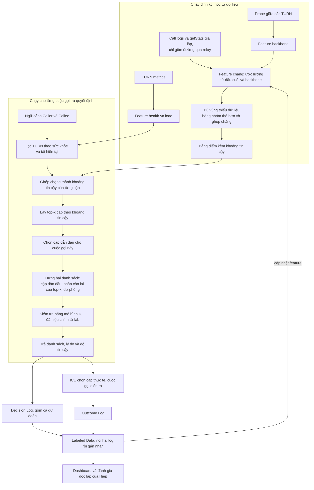
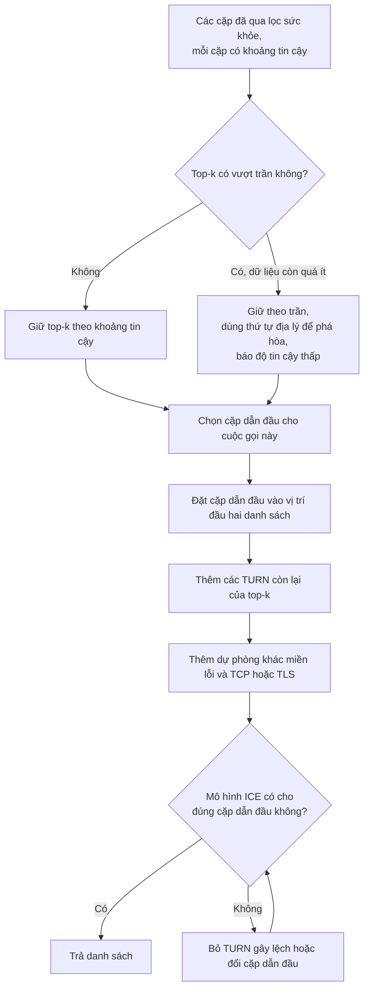

# Smart TURN Selector: Bản đồ hướng giải quyết

Tài liệu này phân tích đề bài, đánh giá các tài liệu đã tìm, chỉ ra phần còn thiếu và gợi ý hướng đi. Tài liệu không đưa ra công thức hay tham số chốt sẵn. Data Contract không thiết kế ở đây; mục 8.4 chỉ tóm tắt dữ liệu theo vòng đời, còn đề xuất nằm ở [De_xuat_Data_Contract_v0.5.0_cho_Hiep.md](De_xuat_Data_Contract_v0.5.0_cho_Hiep.md).

**Cập nhật 05/11.** Tài liệu đã bổ sung hai điều: kết quả lab ICE trên Chromium 156 và coturn (lab ICE (đã xóa khỏi main, xem lịch sử git)), và quyết định về hướng thuật toán: baseline giữ 8 TURN, thuật toán cải tiến dùng top-k theo khoảng tin cậy của VIA. Các số từ lab là bằng chứng về cơ chế trên một máy, không phải chất lượng production.

**Chốt phạm vi 05/11.** Đoàn đã trả lời 14 câu hỏi ở mục 11. Các phần dưới đây đã được chỉnh theo: chỉ dùng dữ liệu giả lập, chỉ xét đường qua relay, bám bài toán của VIA và không làm thêm ngoài đề bài. Bảng tổng hợp phạm vi nằm ở mục 2.5.

**Vòng đời dữ liệu (tạm thời):** call logs, getStats, TURN metrics và probe giữa các TURN đi vào feature (chặng, backbone, health, load); Ranking Engine và Selector API trả danh sách cho client và ICE; Decision Log nối với Outcome Log để phục vụ Dashboard, đánh giá và cập nhật feature. Phần ảnh hưởng đến Data Contract nằm ở [đề xuất cho Hiệp](De_xuat_Data_Contract_v0.5.0_cho_Hiep.md).

Quy ước tên gọi dùng xuyên suốt:

- **Chặng phía Caller:** từ Caller đến TURN mà Caller dùng.
- **Chặng giữa:** từ TURN phía Caller đến TURN phía Callee. Chặng này không tồn tại khi hai bên dùng chung một TURN.
- **Chặng phía Callee:** từ TURN mà Callee dùng đến Callee.
- **Nhóm mạng:** một tổ hợp quốc gia, vùng, ISP và loại mạng, ví dụ "Hồ Chí Minh, Viettel, 4G".
- **Mục:** một TURN server trong danh sách. Mentor đã xác nhận "8 TURN" là **8 TURN server** mỗi bên; UDP, TCP, TLS là thuộc tính transport của server, không chiếm thêm chỗ.

## Mục lục

1. [Kết luận chính](#1-kết-luận-chính)
2. [Hiểu đúng bài toán](#2-hiểu-đúng-bài-toán)
3. [Đánh giá tài liệu đã tìm](#3-đánh-giá-tài-liệu-đã-tìm)
4. [Đối chiếu yêu cầu với tài liệu](#4-đối-chiếu-yêu-cầu-với-tài-liệu)
5. [Phần còn thiếu và cách bù](#5-phần-còn-thiếu-và-cách-bù)
6. [Sơ đồ hướng giải quyết](#6-sơ-đồ-hướng-giải-quyết)
7. [Hướng tiếp cận cho 10 kịch bản](#7-hướng-tiếp-cận-cho-10-kịch-bản)
8. [Dữ liệu giả lập](#8-dữ-liệu-giả-lập)
9. [Cách kiểm chứng kết quả](#9-cách-kiểm-chứng-kết-quả)
10. [Lộ trình 6 tuần](#10-lộ-trình-6-tuần)
11. [Câu hỏi đã chốt](#11-câu-hỏi-đã-chốt)
12. [Rủi ro chính](#12-rủi-ro-chính)
13. [Danh mục đọc và mức độ kiểm chứng](#13-danh-mục-đọc-và-mức-độ-kiểm-chứng)

---

## 1. Kết luận chính

1. **VIA phù hợp làm khung xương, nhưng giải một bài toán khác ở điểm quan trọng nhất.** VIA gán đúng một đường đi cho mỗi cuộc gọi. Đề bài yêu cầu trả hai danh sách 8 TURN, rồi ICE trên thiết bị mới chọn cặp thực tế. Vì vậy phần chấm điểm đường đi và top-k có thể học từ VIA, còn phần chuyển top-k thành hai danh sách phải tự thiết kế (mục 6.3).
2. **Lab ICE cho thấy ICE không tự tìm đường tốt nhất trong danh sách.** ICE chọn cặp có priority cao nhất trong số các cặp kịp xuất hiện và kết nối được. RTT gần như không làm đổi lựa chọn. Do đó Selector phải đúng ngay ở cặp đứng đầu, và việc chọn trong top-k phải do Selector làm, không thể giao cho ICE (mục 2.2).
3. **Hướng thuật toán đã chọn gồm ba phiên bản.** Geo Baseline và Baseline lịch sử trả đúng 8 TURN server mỗi bên. Thuật toán cải tiến dùng top-k theo khoảng tin cậy, nên số mục thay đổi theo mức chắc chắn của dữ liệu, tối đa 8 (mục 6.2). Hiện không có Selector nào đang chạy, nên Geo Baseline là mốc so sánh.
4. **Phạm vi MVP đã chốt** (mục 2.5): chỉ dữ liệu giả lập, chỉ đường qua relay, không sửa SDK, không mô hình hóa đổ chuông và tín hiệu, không chạy trên traffic thật. Phương pháp bám VIA.
5. **Tài liệu hiện có đủ cho khung thuật toán. Phần phải tự làm gồm:** dựng danh sách đa dạng, TURN Health, Network Change, danh mục TURN, bộ giả lập và cách đánh giá.
6. **Một số thông tin trong danh sách tài liệu cần đính chính** (mục 3.8). Đáng chú ý nhất: chưa tìm thấy nguồn nào xác nhận "4 đến 8 TURN là con số vàng". Điều này không ảnh hưởng yêu cầu 8 mục của đề bài.
7. **Hướng đi đề xuất là xây theo tầng,** mỗi tầng có thể so sánh với tầng trước: Geo Baseline, điểm lịch sử theo chặng, chấm điểm cặp kèm khoảng tin cậy, lọc sức khỏe, top-k và dựng danh sách, độ tin cậy và dự phòng, chọn trong top-k, rồi API. Cách này khớp với các mốc mentor yêu cầu và luôn có một phiên bản chạy được để demo.
8. **Giả lập là bước sàng lọc, không phải kết luận.** Chỉ khi so với Geo Baseline có ý nghĩa, Data Contract mới được đưa cho BE và WebRTC core thu thập (mục 8.5). Kết quả giả lập vẫn không được dùng để khẳng định cải thiện production.

---

## 2. Hiểu đúng bài toán

### 2.1. Đầu vào, đầu ra và ràng buộc

| Thành phần | Nội dung |
|---|---|
| Đầu vào | Ngữ cảnh Caller và Callee (quốc gia, vùng, ISP, loại mạng), tình trạng TURN, lịch sử kết nối. Selector biết ngữ cảnh cả hai bên ngay khi trả danh sách |
| Đầu ra | Hai danh sách có thứ tự, kèm lý do, độ tin cậy và phiên bản thuật toán. Baseline trả đúng 8 mục mỗi bên. Thuật toán cải tiến trả số mục theo top-k, tối đa 8 |
| Ràng buộc từ đề bài | Việt Nam có nhiều TURN theo 3 miền và ISP; quốc tế chỉ có TURN ở một số nơi; phải có health filtering, fallback, diversity và confidence |
| Mục tiêu | Kết nối thành công, thiết lập nhanh, chất lượng cuộc gọi tốt, và giải thích được từng quyết định |
| Ràng buộc về kết luận | Kết quả trên dữ liệu giả lập không được dùng để khẳng định cải thiện production |

### 2.2. Selector không chọn đường đi, ICE mới chọn

Đây là điểm dễ bị bỏ qua nhất. Selector chỉ quyết định **tập lựa chọn** và **thứ tự**. Những gì đã đối chiếu được từ nguồn gốc:

| Cơ chế | Nội dung | Hệ quả với thuật toán |
|---|---|---|
| Ưu tiên của cặp candidate (RFC 8445, mục 6.1.2.3) | Ưu tiên của một cặp chủ yếu do candidate có ưu tiên thấp hơn trong hai phía quyết định | Thứ tự trong hai danh sách cùng tạo ra thứ tự kiểm tra các cặp. Selector không thể tùy ý nói "chỉ ghép TURN này với TURN kia" |
| Candidate relay (RFC 8445, mục 5.1.2.2) | Relay nên có type preference thấp nhất | Nếu cuộc gọi còn cho phép đi trực tiếp, các đường trực tiếp sẽ được ưu tiên hơn relay |
| Chọn cặp để nominate (RFC 8445, mục 8.1.1) | Tiêu chí chọn cặp do từng implementation quyết định | Cách trình duyệt chọn phải được đo, không thể suy ra từ chuẩn |
| Thứ tự TURN trong libwebrtc (`basic_port_allocator.cc`) | Độ ưu tiên giảm dần theo vị trí trong danh sách cấu hình | Vị trí trong danh sách là một quyết định thật, không chỉ để hiển thị |
| So sánh kết nối trong libwebrtc (`basic_ice_controller.cc`) | Xét trạng thái, nomination, chi phí mạng, rồi ưu tiên; RTT chỉ là bước phân định cuối và cần tốt hơn ít nhất 10 ms khi đổi đường | Không nên giả định ICE tự chọn TURN có RTT thấp nhất |
| Dừng thu candidate trong libwebrtc (`p2p_transport_channel.cc`, `stop_gather_on_strongly_connected`, mặc định bật) | Khi có một kết nối đủ tốt đầu tiên, phiên thu candidate dừng và candidate về sau bị bỏ | TURN cấp phát chậm có thể biến mất khỏi danh sách thực tế, dù Selector đã xếp nó ở đầu. MVP không mô hình hóa điều này (mục 2.5) |
| Giới hạn số cặp (RFC 8445, mục 6.1.2.5) | Mặc định tối đa 100 cặp, phải cấu hình được | Với tối đa 8 mục mỗi bên và chỉ xét relay, số cặp tối đa là 64, nằm trong giới hạn |
| Nhịp kiểm tra (RFC 8445, mục 14.2) | Mặc định 50 ms | libwebrtc có nhịp riêng, xem kết quả đo bên dưới |

**Kết quả đo trong lab:**

| Câu hỏi | Kết quả đo | Hệ quả với thuật toán |
|---|---|---|
| ICE có tìm TURN có RTT thấp nhất không? | Không. Khi vị trí đầu của Caller chậm hơn, cuộc gọi bị ghim ở RTT 64 đến 132 ms trong khi đường tốt nhất chỉ 23 ms. RTT tăng 300 ms giữa cuộc gọi, ICE vẫn không rời TURN trong 45 giây | Cặp đứng đầu quyết định chất lượng cả cuộc gọi. Top-k không tự phát huy tác dụng nếu chỉ đưa vào danh sách |
| Thứ tự trong danh sách có được tôn trọng không? | Có, nếu candidate về kịp. Đặt chéo và dùng chung đều cho đúng cặp đầu | Có thể điều khiển cặp đầu bằng cách đặt TURN |
| TURN chậm có bị loại không? | Có. TURN đầu của Callee bị loại khi cấp phát chậm hơn TURN nhanh nhất: với tín hiệu 50 ms, giữ đến 60 ms và mất từ 100 ms; với tín hiệu 300 ms, giữ đến 220 ms và mất từ 300 ms. Caller có thời gian đổ chuông nên giữ đủ danh sách | Caller và Callee không đối xứng. TURN nhanh ở vị trí sau có thể đẩy TURN đầu ra khỏi cuộc đua. MVP không mô hình hóa điều này (mục 2.5) |
| Danh sách dài có làm chậm không? | Khi TURN khỏe, 8 so với 4 chỉ thêm 7 đến 11 ms. TURN chết trước khi cấp phát không gây chậm. TURN chết sau khi cấp phát tốn khoảng 63 ms × (vị trí của TURN sống đầu tiên − 1)², xấu nhất là 777 ms với 4 TURN và 3.282 ms với 8 TURN | Vị trí của TURN dự phòng quan trọng hơn độ dài danh sách |
| Cặp không được chọn có RTT không? | Gần như không: 1 trên 32 cặp có RTT suốt 90 giây. Cặp dư bị cắt sớm rồi bị hủy | `getStats` không phải công cụ đo các TURN khác. Giả thuyết trước đây về điều này đã bị bác bỏ |
| Có cách nào đo từng TURN không? | Có. Thời điểm nhận candidate tăng 4,01 ms cho mỗi 1 ms độ trễ một chiều, R² = 0,99997 | Danh sách vẫn là công cụ đo, nhưng qua thời điểm nhận candidate, và chỉ đo RTT của chặng tới TURN. Cần SDK gửi thêm dữ liệu nên không dùng trong MVP |
| TURN hỏng giữa cuộc gọi thì sao? | Hỏng khi cuộc gọi dưới 7 giây: ICE tự chuyển trong 3,7 đến 4,0 giây. Từ 8 giây: không tự chuyển. Phát hiện `disconnected` sau 6,4 đến 7,7 giây; ICE restart mất 162 đến 193 ms | Phục hồi chính là ICE restart. Restart thu lại candidate từ cả danh sách, nên các vị trí sau vẫn có ích. Ứng dụng phải tự gọi restart, ICE không tự làm |
| Thiếu trickle ICE thì sao? | Một TURN chết làm thời gian thu đủ candidate lên 39,9 giây | Bắt buộc dùng trickle ICE |

**Giới hạn của các số trên:** chặng giữa hai TURN không có độ trễ thêm, mọi TURN dùng chung một relay IP, hai bên chạy trên cùng một máy, và mới đo Chromium. Firefox và Safari có thể khác.

### 2.3. Tách bài toán thành bốn câu hỏi

Bốn câu hỏi này có bản chất khác nhau và nên được đánh giá riêng:

| Câu hỏi | Bản chất | Nguồn tham khảo chính |
|---|---|---|
| Một cặp TURN cho hai nhóm mạng này sẽ tốt đến đâu, và chắc chắn đến đâu? | Dự đoán kèm khoảng tin cậy | VIA, CFA |
| Những cặp nào còn đáng cân nhắc? | Top-k theo khoảng tin cậy | VIA |
| Cuộc gọi này nên đi qua cặp nào? | Chọn trong top-k, có thể có khám phá | VIA, Pytheas |
| Những TURN nào, theo thứ tự nào, để ICE đi đúng cặp đó và vẫn có dự phòng? | Chọn một tập và điều khiển gián tiếp ICE | RFC 8445, libwebrtc, kết quả lab, mục 6.3 |

### 2.4. Hai chế độ dữ liệu trong một thuật toán

| | Việt Nam | Quốc tế |
|---|---|---|
| Số TURN | Nhiều | Ít, có nơi không có |
| Dữ liệu lịch sử (dự kiến) | Tương đối dày | Thưa, lệch theo một số quốc gia |
| Tín hiệu giải thích chính | ISP, miền, peering | Quốc gia, vùng, tuyến cáp, chất lượng thực đo |
| Cách ước lượng phù hợp | Học trực tiếp theo ISP và TURN | Suy luận từ chặng và từ nhóm thô hơn |

Nên giữ **một luồng xử lý chung** và để mức độ dữ liệu quyết định độ sâu fallback, thay vì viết hai thuật toán tách biệt. Cuộc gọi Việt Nam với quốc tế sẽ tự nhiên dùng cả hai chế độ, vì mỗi đầu thuộc một chế độ khác nhau.

### 2.5. Phạm vi MVP đã chốt

Bảng này tổng hợp các câu trả lời ở mục 11.

| Chủ đề | Trong MVP | Không làm trong MVP | Câu hỏi |
|---|---|---|---|
| Dữ liệu | Tự giả lập rồi so với Geo Baseline | Dữ liệu thật, chạy bóng, thử nghiệm trên traffic thật | 11, 12 |
| Loại đường | Cặp relay với relay, gồm cả dùng chung một TURN | P2P, STUN, đường chỉ có một đầu relay | 6, 9 |
| Độ dài danh sách | Tối đa 8 TURN server mỗi bên. Thuật toán cải tiến được trả ít hơn 8 | | 1, 2 |
| Thời điểm quyết định | Selector biết cả hai bên và trả hai danh sách trong một lần | Joint Ranking hai bước, gọi mù | 3 |
| Client | ICE chuẩn của WebRTC, trên web và mobile | Sửa SDK, gửi thêm dữ liệu từ SDK | 5, 7 |
| Đổ chuông và tín hiệu | Giả định candidate về kịp | Thời gian đổ chuông, độ trễ tín hiệu, bên tạo offer, TURN bị loại khỏi cuộc đua | 4 |
| Phương pháp | Bám VIA: dự đoán kèm khoảng tin cậy, top-k, chọn trong top-k | Bài học của Meta, chi phí băng thông, các thành phần đề bài không yêu cầu | 9, 13, 14 |
| Chặng và chặng giữa | Chặng là số ước lượng từ đầu cuối. Chặng giữa đo bằng probe, trong MVP do giả lập sinh, có công tắc bật tắt | Đo trực tiếp từng chặng từ client | 5, 7, 9, 13 |
| Hạ tầng | Danh mục TURN tự xây trong giả lập | | 10 |

**Các giới hạn phải nêu trong báo cáo:**

- **Kết quả chỉ nói về cuộc gọi đi qua relay.** Cuộc gọi thật vẫn có P2P và STUN, nên không suy ra tác động trên toàn bộ cuộc gọi.
- **Chỉ số khớp cặp dẫn đầu không phải thành tích.** Vì giả định candidate về kịp, khi TURN khỏe giả lập gần như luôn đi đúng cặp dẫn đầu. Lab cho thấy thực tế Callee có thể mất TURN đầu.
- **Tham số lab chỉ là điểm xuất phát.** Client gồm cả web và mobile, trong khi lab mới đo Chromium trên một máy.
- **ICE restart là một giả định.** ICE chuẩn không tự restart, ứng dụng phải gọi. Mốc gọi được thử như một tham số giả lập.

---

## 3. Đánh giá tài liệu đã tìm

### 3.1. Bảng tóm tắt

| Tài liệu | Giá trị cho bài toán | Vai trò đề xuất |
|---|---|---|
| VIA | Rất cao | Phương pháp chính, MVP bám theo bài này |
| Network Tomography (MSR-TR-2016-57; Castro và cộng sự; Sartzetakis và Varvarigos) | Cao, nhất là MSR-TR-2016-57 | Cách ghép chặng và cách đánh giá dự đoán (mục 3.9) |
| CFA | Cao | Cách chọn mức chi tiết của đặc trưng |
| Pytheas | Trung bình đến cao | Lý do cần khám phá; thiết kế cơ chế khám phá |
| RFC 8445 (ICE) | Rất cao | Luật chơi của danh sách |
| RFC 8656 (TURN) | Trung bình | Allocation, lỗi và tín hiệu Health |
| libwebrtc | Rất cao | Hành vi thực tế của trình duyệt |
| RFC 8155 | Thấp | Bối cảnh; không phải nguồn về chọn TURN |
| Meta, Improving International Calls | Tạm không dùng | Chỉ là bối cảnh về hai relay, không đưa vào thiết kế MVP |
| BlogGeek.me, Mozilla | Cao | Cảnh báo về danh sách dài |
| Cloudflare, LiveKit, Subspace | Trung bình đến thấp | Bối cảnh về anycast và backbone; nhiều nội dung mang tính quảng bá |

### 3.2. VIA

**Đã chốt bám theo VIA.** Theo nhận định của Đoàn, bài toán của VIA trùng khoảng 80% với đề bài. Phần khác nhau nằm ở bảng "Không giải quyết được" bên dưới, và chỉ làm trong phạm vi đề bài yêu cầu.

**Dùng được:**

- **Mô hình lựa chọn:** đi trực tiếp, nảy qua một relay, hoặc đi qua hai relay. Cách chia này tương ứng trực tiếp với việc TURN hai phía có thể giống hoặc khác nhau. MVP bỏ lựa chọn đi trực tiếp và coi nảy qua một relay là cặp hai relay có hai TURN trùng nhau.
- **Quy trình bốn bước:** thu thập lịch sử, mở rộng độ phủ bằng cách ghép chặng, lọc còn vài lựa chọn tốt nhất, rồi khám phá và khai thác trong nhóm đó.
- **Ghép chặng (mục 4.4 của VIA):** VIA không đo được từng chặng vì relay của Skype chỉ chuyển tiếp, nên dùng tomography tuyến tính trên số đầu cuối. Một đường gồm đoạn từ AS nguồn đến relay và từ AS đích đến relay. Hình 11 của bài dự đoán đường chưa thấy bằng cộng trừ các đường đã thấy qua cùng relay, không cần biết riêng từng chặng. Bộ dự đoán trả cả trung bình và sai số chuẩn để lấy top-k.
- **Số đo giữa các relay (mục 3.2 của VIA):** bài có dùng RTT, loss, jitter giữa các relay do Skype cung cấp để ước lượng đường transit. Vì vậy probe giữa các TURN không phải ngoại lệ so với VIA; khác biệt là Skype đã có số đo này trên mạng riêng, còn mình phải tự xây.
- **Phát hiện cốt lõi:** dự đoán không đủ để chỉ ra lựa chọn tốt nhất, nhưng đủ để khoanh vùng. Lựa chọn dự đoán tốt nhất chỉ trùng lựa chọn RTT thấp nhất trong 29% trường hợp; mở rộng ra 3 đến 4 lựa chọn thì tăng lên 60% đến 80%; dùng khoảng tin cậy để quyết định kích thước nhóm thì trên 90%. **Đây là cơ sở cho top-k động:** không chốt trước số lựa chọn, mà lấy nhóm nhỏ nhất sao cho mọi lựa chọn ngoài nhóm đều chắc chắn kém hơn các lựa chọn trong nhóm.
- **Nhóm thay đổi theo thời gian:** VIA dùng bandit để chọn trong nhóm cho từng cuộc gọi, và dành một phần nhỏ cuộc gọi khám phá ngoài nhóm để không bỏ lỡ khi mạng thay đổi.
- **Độ chi tiết:** thô hơn cặp ISP thì mất cơ hội, vì các ISP trong cùng quốc gia có quan hệ peering khác nhau; chi tiết hơn thì lợi ích giảm vì thiếu dữ liệu. Điều này ủng hộ việc phân tích theo ISP.
- **Hai relay có giá trị:** trên các cặp đã dùng cả hai loại, có cả hai lựa chọn giúp giảm khoảng 50% tỷ lệ mạng kém so với chỉ nảy qua một relay.
- **Ngưỡng mạng kém:** RTT từ 320 ms, loss từ 1,2%, jitter từ 12 ms, có thể dùng làm mốc tham chiếu ban đầu.
- **Cách đánh giá:** phát lại theo thứ tự thời gian, so với chiến lược mặc định và với chiến lược biết trước tương lai.

**Không giải quyết được:**

| Khác biệt | VIA | Bài toán của bạn |
|---|---|---|
| Đầu ra | Một lựa chọn cho một cuộc gọi | Hai danh sách TURN, ICE chọn cuối cùng theo priority |
| Ai chọn trong top-k | Controller, qua bandit | Selector phải tự chọn và đặt cặp đó lên đầu, vì ICE không so sánh chất lượng giữa các cặp |
| Đo các lựa chọn | Số liệu của lựa chọn đã dùng, và số đo giữa các relay có sẵn | Giống VIA: đầu cuối của cặp đã dùng và probe giữa các TURN, nhưng probe phải tự xây. Thời điểm nhận candidate có thể cho thêm RTT từng chặng, nhưng cần SDK nên để sau |
| Thất bại kết nối | Không phải trọng tâm; chỉ xét RTT, loss, jitter | Đề bài có Connection Success và CST. MVP báo cáo hai chỉ số này, còn top-k vẫn bám chất lượng mạng như VIA |
| Health | Controller không giám sát relay trực tiếp, dựa vào đo đầu cuối | Đề bài yêu cầu rõ health filtering và fallback |
| Tải | Chỉ có ngân sách tổng; giả định quyết định giữa các cuộc gọi độc lập | Đi qua lọc sức khỏe, không thêm bộ tối ưu tải (mục 5.9) |
| Dữ liệu | 430 triệu cuộc gọi, 1.900 AS, 126 quốc gia | Dữ liệu giả lập, ít hơn nhiều nên phải ưu tiên xử lý thiếu mẫu |
| Hạ tầng relay | Một AS, chặng giữa nằm trong mạng riêng | Danh mục TURN tự xây, chặng giữa có thể đi qua Internet công cộng và đo bằng probe; phải thử nhiều biến thể |
| Loại cuộc gọi | Âm thanh, số liệu trung bình theo cuộc gọi | Có thể có cả video; đề bài cần cả TTFM và Drop Rate |

**Lưu ý khi trích dẫn:**

- Con số 45% là mức giảm tốt nhất theo từng chỉ số. Mức giảm tính theo "có ít nhất một chỉ số kém" là 23%.
- Việc đánh giá chính là phát lại trên dữ liệu vết, sau khi lọc còn 32 triệu cuộc gọi. Triển khai thật chỉ có khoảng 1.000 cuộc gọi trên 18 cặp client.
- Dự đoán bằng ghép chặng đúng trong khoảng 20% cho 71% cuộc gọi, nhưng sai từ 50% trở lên ở 14% cuộc gọi.
- Dữ liệu relay của VIA có thiên lệch: relay chủ yếu được dùng khi không kết nối trực tiếp được. Dữ liệu relay thu sau này cũng sẽ có thiên lệch này.
- Thuật toán 1 trong PDF có vẻ đảo hai nhánh so với phần mô tả ở mục 4.5 của bài. Nên đọc theo phần mô tả.
- Kết quả tìm kiếm cho thấy trang giới thiệu của Microsoft Research ghi số liệu khác (88 triệu cuộc gọi, giảm đến 66%). Nên trích theo [bản PDF](https://cs.cmu.edu/~junchenj/via.pdf).

### 3.3. CFA và Pytheas

Hai bài này mới được kiểm chứng ở mức phần tóm tắt trên USENIX; cần đọc toàn văn trước khi trích dẫn chi tiết.

**[CFA](https://www.usenix.org/conference/nsdi16/technical-sessions/presentation/jiang)**

- **Ý chính:** chất lượng thường bị chi phối bởi một số ít đặc trưng quan trọng, và mức độ quan trọng này duy trì được vài chục phút. Hệ thống học đặc trưng quan trọng ở nhịp chậm và cập nhật dự đoán ở nhịp gần thời gian thực.
- **Áp dụng:** không nên dùng cùng một công thức đặc trưng cho mọi nhóm mạng. Có nhóm chất lượng phụ thuộc chủ yếu vào ISP; có nhóm phụ thuộc vào 4G hoặc Wi-Fi; có nhóm phụ thuộc vào tuyến quốc tế.
- **Giới hạn:** bài viết về video phát theo yêu cầu, không phải cuộc gọi hai chiều. Ý tưởng dùng được, số liệu không chuyển sang được.

**[Pytheas](https://www.usenix.org/conference/nsdi17/technical-sessions/presentation/jiang)**

- **Ý chính:** tối ưu chỉ bằng dự đoán từ dữ liệu cũ có thiên lệch vì không nhìn thấy các lựa chọn chưa dùng. Bài đề xuất nhóm các phiên có đặc trưng chung, rồi khám phá và khai thác theo từng nhóm.
- **Áp dụng:** cung cấp lý do cần một phần khám phá có kiểm soát và gợi ý nhóm là đơn vị học.
- **Giới hạn:** chỉ có triển khai minh chứng trên CloudLab. MVP không thử trên traffic thật, nên cơ chế khám phá chỉ chạy trong giả lập.
- **Nhận xét:** đây chủ yếu là bài về kiến trúc khám phá và khai thác, không hẳn là bài về feature engineering.

### 3.4. RFC 8445 và RFC 8656

**RFC 8445:** hai mục bạn chọn là đúng nhưng chưa đủ. Nên đọc thêm:

- Mục 5.1.2.1 và 5.1.2.2: công thức ưu tiên candidate và mức ưu tiên của relay
- Mục 5.1.3: loại bỏ candidate trùng
- Mục 6.1.2.3: ưu tiên của cặp và thứ tự cặp
- Mục 6.1.2.5: loại bỏ cặp ưu tiên thấp, giới hạn mặc định 100 cặp
- Mục 8.1.1: nominate cặp
- Mục 14.2: nhịp kiểm tra

**RFC 8656:** số mục trong ghi chú của bạn cần sửa lại:

| Nội dung | Mục đúng |
|---|---|
| Allocation | Mục 6 và 7 (mục 5 là General Behavior) |
| CreatePermission | Mục 10 |
| Send và Data | Mục 11 |
| Channels | Mục 12 (không phải mục 10 hoặc 11) |
| Lỗi 300, 486, 508 | Mục 7.4, rất hữu ích cho TURN Health |
| Happy Eyeballs cho TURN | Mục 3.9 |

Trường hợp TURN hai phía khác nhau không phải một chế độ riêng trong chuẩn: mỗi client tự cấp phát trên TURN của mình và coi địa chỉ relay của phía kia như một peer. **Chất lượng chặng giữa vì vậy nằm hoàn toàn ngoài phạm vi RFC** và phải lấy từ đo đạc.

### 3.5. libwebrtc

Hai đường dẫn bạn nêu là đúng. Nên đọc thêm:

| File | Lý do đọc |
|---|---|
| `p2p/client/basic_port_allocator.cc` | Độ ưu tiên TURN theo thứ tự; ưu tiên giao thức UDP, rồi TCP, rồi TLS; các chính sách cắt bớt cổng TURN |
| `p2p/base/basic_ice_controller.cc` | Tiêu chí chọn và đổi kết nối (file này không có trong danh sách của bạn và rất quan trọng) |
| `p2p/base/p2p_transport_channel.cc` | Dừng thu candidate khi có kết nối đủ tốt đầu tiên (`stop_gather_on_strongly_connected`) |
| `pc/ice_server_parsing.cc`, `api/candidate.h` | Nhánh `main` cắt danh sách còn 32 TURN, tính theo URL |

Các kiểm chứng trên dựa vào bản m125 của [một fork công khai](https://github.com/webrtc-sdk/webrtc) và nhánh `main` của libwebrtc. Hành vi chính đã được xác nhận trên Chromium 156 trong lab. Firefox và Safari có thể khác.

### 3.6. RFC 8155

[RFC 8155](https://www.rfc-editor.org/rfc/rfc8155.txt) có phạm vi khác với mô tả trong ghi chú của bạn:

- Tài liệu giúp client **phát hiện** TURN của doanh nghiệp hoặc ISP bằng S-NAPTR, DNS-SD hoặc anycast.
- Tài liệu **không đề cập** Geo-DNS hay bảng định tuyến tĩnh, không phân tích hạn chế khi đi qua mạng di động hoặc khác ISP.
- Mục 3 nói rõ tài liệu không đưa ra khuyến nghị về chọn server.
- Hai điểm có ích nhỏ: mục 6 về ràng buộc của anycast và mục 7.1 về việc đổi địa chỉ IP có thể làm kết quả phát hiện không còn đúng.

**Đề xuất:** chỉ đọc lướt. Để so sánh Geo-DNS, anycast và đo thực tế, dùng [bài của BlogGeek.me](https://bloggeek.me/webrtc-turn-geolocation/) và [bài của Cloudflare](https://blog.cloudflare.com/webrtc-turn-using-anycast) sẽ phù hợp hơn.

### 3.7. Blog kỹ thuật và tư liệu thực tế

Theo phạm vi đã chốt, các tư liệu của Meta chỉ là bối cảnh, không dùng làm căn cứ thiết kế trong MVP.

| Nguồn | Điều đã xác nhận | Giới hạn |
|---|---|---|
| [Meta: Improving International Calls](https://atscaleconference.com/improving-international-calls/) | Bỏ cách chọn relay ở khoảng giữa; dùng hai relay gần mỗi người, nối bằng mạng riêng. Giảm khoảng 40% thời gian phản hồi trên cuộc gọi quốc tế, giảm 15% video đứng hình và 4% gián đoạn âm thanh ở một số sản phẩm. Quan trọng: **không phải tuyến nào cũng tốt hơn, bật đại trà có thể gây giảm chất lượng** | Không công bố thuật toán quyết định. Meta có backbone riêng và cơ chế truyền lại tại relay, nên kết quả không chuyển trực tiếp sang TURN thuê |
| [Meta: Calling Relay Infrastructure at WhatsApp scale](https://atscaleconference.com/?p=520814) | Chọn cụm relay từ dữ liệu độ trễ lịch sử; tính lại khi đổi Wi-Fi sang di động; hạn chế cuộc gọi mới khi quá tải để bảo vệ cuộc gọi đang chạy | Dùng giao thức riêng WASP, không phải TURN chuẩn |
| [RTC Relay Server Infrastructure Study](https://datatracker.ietf.org/meeting/126/materials/slides-126-anrw-measurement-rtc-relay-00) (đo 8/2025 đến 3/2026) | WhatsApp cấp 3 relay ứng viên rồi chọn theo độ trễ đầu cuối, dùng cả UDP và TCP; Zoom Business và Discord chọn theo phía Caller; WhatsApp có dự phòng tốt nhất trong các ứng dụng được đo. [Công cụ đo được mở mã nguồn](https://github.com/KaiserV2/RTC_relay_server_infra) | Mới đọc slide; chỉ đo từ 13 vùng Azure và thiết bị iPhone |
| [BlogGeek.me: WebRTC, TURN and Geolocation](https://bloggeek.me/webrtc-turn-geolocation/) | Khuyên không để WebRTC tự chọn vùng bằng danh sách dài: nhiều candidate hơn, tín hiệu nhiều hơn và có thể đổi TURN giữa cuộc gọi. GeoIP có thể sai. Có gợi ý chọn trước 3 ứng viên rồi đo | Không đưa ra số TURN chuẩn |
| [Mozilla Bugzilla 1322659](https://bugzilla.mozilla.org/show_bug.cgi?id=1322659) | Có cảnh báo về số STUN/TURN nhiều, báo lỗi từ 5 server, với lý do số cặp candidate tăng nhanh | Là thảo luận cũ, cần kiểm tra lại trên Firefox hiện tại |
| [Cloudflare TURN FAQ](https://developers.cloudflare.com/realtime/turn/faq/) | Anycast tự đưa client đến điểm gần nhất; khi cả hai phía relay có thể đi qua backbone. Lợi ích về độ trễ phụ thuộc địa lý, lợi ích về loss ổn định hơn | Tài liệu của nhà cung cấp |
| [WebRTC.ventures: Self-hosted TURN và Subspace](https://webrtc.ventures/2022/03/self-hosted-turn-and-subspace/) | Mạng riêng tốt hơn ở đường dài; coturn tự vận hành tốt hơn trong vùng nhỏ | Một thử nghiệm đơn lẻ, năm 2022 |

### 3.8. Những điểm cần đính chính

| Nội dung trong ghi chú | Kết quả kiểm tra | Đề xuất |
|---|---|---|
| 4 đến 8 TURN đa dạng là "con số vàng" | Không tìm thấy nguồn xác nhận. Nguồn tìm được khuyên danh sách ngắn hoặc không nêu con số. Lab cho thấy khi TURN khỏe, độ dài gần như không ảnh hưởng thời gian kết nối | Không trích dẫn con số này. Dùng kết quả đo ở mục 2.2 |
| Bài "Building Indexing and Routing for Messenger/WhatsApp RTC" | Không tìm thấy bài với tên này | Dùng hai tư liệu Meta ở mục 3.7 |
| Meta đo RTT giữa người dùng với relay và giữa relay với relay để giải Joint Ranking | Có nói về chọn relay từ độ trễ lịch sử và về hai relay, nhưng không mô tả thuật toán Joint Ranking | Chỉ dùng làm bằng chứng về kiến trúc |
| Bài "Global Mesh Network for WebRTC" về peering châu Á, RTT giảm một nửa | Không tìm thấy bài này hay con số này | Coi là giả thuyết. Lập luận về peering khác nhau theo ISP có thể dựa vào VIA, còn số liệu Việt Nam phải tự đo |
| RFC 8155 phân tích hạn chế của Geo-DNS và bảng định tuyến tĩnh | Không đề cập | Xem mục 3.6 |
| Số mục trong RFC 8656 | Một phần chưa đúng | Xem mục 3.4 |
| WebRTC tự chọn TURN có RTT thấp nhất (quan niệm phổ biến, ví dụ trên Stack Overflow) | Mã libwebrtc cho thấy RTT chỉ là tiêu chí phân định cuối. Lab xác nhận ICE không rời cặp có RTT cao hơn nhiều | Không dùng lập luận "ICE sẽ tự chọn TURN nhanh nhất" |

### 3.9. Network Tomography

Bản PDF của ba tài liệu nằm ở máy của Đoàn, gửi riêng khi cần. Đây là phần của Feature Engineering, không thêm yêu cầu thu thập ngoài việc mỗi quan sát phải biết đúng đường đi.

| Tài liệu | Nên lấy | Không cần lấy |
|---|---|---|
| Rødbro, Chou, Dogan, MSR-TR-2016-57: 7 triệu cuộc gọi Skype, Philip Chou cũng là đồng tác giả VIA | Chuyển trọng tâm từ tách được sang dự đoán được. Đánh giá trên tập giữ lại, theo số lần đường xuất hiện khi học. Least squares đủ cho số trung bình. `log(1 − loss)` cộng được. Gộp nhóm hiếm khi ít mẫu | Phân phối bằng FFT, bandwidth, gộp mọi relay thành một thành phần |
| Castro và cộng sự, Statistical Science 2004 | Ma trận đường không đủ hạng thì chỉ giải được tổ hợp tuyến tính hoặc phải regularize. Giả định dừng và độc lập là giới hạn. Đo một chiều khó vì đồng bộ đồng hồ | Multicast, cấu trúc cây |
| Sartzetakis và Varvarigos, JNSM 2023 | Biết đủ topology thì nghịch đảo ma trận đã tốt nhất cho độ trễ, nên chưa cần ML. Định tuyến đổi thì thêm đặc trưng hai đầu | Neural network; mô phỏng chỉ 12 đến 14 nút, không thấy mô tả nhiễu đo |

**Áp dụng:**

- **RTT làm trước.** MSR-TR-2016-57 cho thấy mô hình giúp loss khá ít, và jitter nhiều mẫu còn thua nhẹ lịch sử trực tiếp, nên hai chỉ số này ưu tiên lịch sử trực tiếp.
- **Chọn nguồn theo số mẫu.** Đường nhiều mẫu dùng lịch sử trực tiếp, đường ít mẫu mới ghép chặng.
- **Coi probe là số đo có sai số.** Trên dữ liệu tổng hợp, khi đã đủ mẫu thì probe chỉ thêm khoảng 1 ms trở xuống, và probe lệch còn tệ hơn không có probe.
- **Probe không thay được khám phá.** Chỉ chọn TURN gần nhất thì có probe vẫn không dự đoán được đường chưa dùng.
- **Về tính cộng được:** MSR-TR-2016-57 có bằng chứng trên dữ liệu thật của Skype, nhưng chưa phải cho chặng TURN với TURN hay mạng Việt Nam, nên vẫn phải kiểm tra.

---

## 4. Đối chiếu yêu cầu với tài liệu

| Yêu cầu của đề bài | Mức độ tài liệu đáp ứng | Tài liệu hỗ trợ | Phần phải tự làm |
|---|---|---|---|
| Geo Baseline | Đủ | BlogGeek.me | Định nghĩa baseline cụ thể |
| Xếp hạng theo vùng và ISP Việt Nam | Một phần | VIA về độ chi tiết | Toàn bộ dữ liệu Việt Nam |
| Quốc tế theo quốc gia, khoảng cách, hiệu suất | Một phần | VIA | Cách xử lý dữ liệu thưa |
| Quốc gia không có TURN | Một phần | VIA về ghép chặng | Tập ứng viên thay thế |
| Joint Ranking Caller và Callee | Khá tốt cho một cặp | VIA, kết quả lab | Chuyển từ top-k cặp sang hai danh sách |
| Historical Scoring | Khá tốt | VIA, CFA | Xử lý ít mẫu và thay đổi theo thời gian |
| Danh sách 8 mục cho baseline; danh sách theo top-k cho thuật toán cải tiến | Một phần | RFC 8445, libwebrtc và kết quả lab (về ràng buộc), VIA (về top-k) | Quy tắc dựng danh sách, mục 6.3 |
| TURN Health | Thiếu | RFC 8656 mục 7.4 | Mô hình trạng thái và ngưỡng |
| Confidence | Một phần | VIA về khoảng tin cậy | Định nghĩa khi dữ liệu ít, khi top-k phình to |
| Fallback và phân bổ dự phòng | Một phần | Nghiên cứu IETF, kết quả lab | Dự phòng theo miền lỗi và đặt sớm trong danh sách |
| Cold-start | Một phần | CFA, Pytheas, VIA | Chuỗi fallback, trần cho top-k |
| Network Change | Một phần | RFC 8445, kết quả lab về ICE restart | Quy tắc chọn lại khi đổi mạng |
| API prototype | Không cần nghiên cứu | | Kỹ thuật thông thường |
| Đánh giá không có production | Thiếu | Xem mục 5.8 | Thiết kế cách đánh giá |

---

## 5. Phần còn thiếu và cách bù

### 5.1. Từ chọn một đường sang dựng danh sách

**Vì sao thiếu:** VIA chọn một đường cho một cuộc gọi. Xếp theo điểm rồi lấy 8 mục đầu có nguy cơ cao trả về các TURN cùng miền, cùng ISP, cùng hỏng một lúc.

**Nguồn có thể bổ sung, không bắt buộc trong MVP:**

- [Cascading Bandits](https://proceedings.mlr.press/v37/kveton15.html): mô hình danh sách được xét lần lượt đến khi gặp lựa chọn phù hợp, khá gần với fallback của ICE.
- [Off-policy evaluation for slate recommendation](https://papers.nips.cc/paper/6954-off-policy-evaluation-for-slate-recommendation): đánh giá một chính sách trả danh sách có thứ tự từ dữ liệu đã ghi.
- Các hướng về đa dạng hóa như Maximal Marginal Relevance và tối ưu hàm submodular (kiến thức nền, chưa kiểm chứng trong đợt này).

**Hướng bắt đầu:** với thuật toán cải tiến, tập ứng viên đến từ top-k (mục 6.3). Sau đó định nghĩa **giá trị của cả danh sách** là chất lượng kỳ vọng sau khi ICE chọn, tính trên các tình huống sự cố có thể xảy ra, thay vì xếp theo điểm rồi lấy phần đầu. Mỗi TURN trong danh sách nên có một vai trò nêu được thành lời: lựa chọn dẫn đầu, lựa chọn còn lại trong top-k, dự phòng khác miền lỗi, dự phòng khi UDP bị chặn. Cách này đồng thời giúp giải thích quyết định theo từng kịch bản.

### 5.2. Hành vi ICE trên trình duyệt thật

**Đã làm được:** lab trên Chromium 156 và coturn đã trả lời phần lớn câu hỏi, xem mục 2.2 và lab ICE (đã xóa khỏi main, xem lịch sử git).

**Chưa đo, không làm thêm trong MVP và cần ghi vào giới hạn của báo cáo:**

1. Firefox, Safari và client mobile, nhất là khi hai bên dùng client khác nhau.
2. TURN ở các IP khác nhau, có độ trễ thật ở chặng giữa. Permission tính theo IP nên kết quả cuộc đua có thể thay đổi.
3. Hairpin khi dùng chung TURN trên hạ tầng thật, nhất là NAT 1:1.
4. Chất lượng xấu đi khi cuộc gọi đã qua giây thứ 7.
5. Thời điểm nhận candidate trên mạng thật, với TCP và TLS. Lab mới đo UDP trong điều kiện sạch.
6. Đổi Wi-Fi sang 4G thật.

### 5.3. Dữ liệu mạng Việt Nam và peering

**Vì sao thiếu:** không tài liệu nào có số liệu theo miền và ISP tại Việt Nam. MVP không có dữ liệu thật, nên nguồn công khai chỉ dùng để chọn mức hợp lý cho tham số giả lập.

**Nguồn công khai:**

| Nguồn | Dùng để | Lưu ý |
|---|---|---|
| [M-Lab NDT](https://www.measurementlab.net/data) trên BigQuery | Độ trễ và loss theo ASN, quốc gia | Đo TCP đến server M-Lab, server được chọn theo địa lý; không phải đường đến TURN của bạn |
| [RIPE Atlas](https://www.ripe.net/analyse/internet-measurements/ripe-atlas/about-ripe-atlas/) | Dữ liệu đo mở; có thể tự đặt phép đo | Cần kiểm tra số probe thực tế ở Việt Nam |
| [Ookla Open Data](https://github.com/teamookla/ookla-open-data) | Bức tranh theo khu vực | Kiểm tra điều khoản sử dụng và các trường có sẵn |
| PeeringDB, CAIDA AS Relationships, RIPEstat | Quan hệ giữa các ISP, tra ASN | Kiến thức nền, chưa kiểm chứng trong đợt này. Tài liệu này không ghi số ASN cụ thể vì chưa đối chiếu |

**Nếu vẫn thiếu:** MVP không tự đo. Tham số không có nguồn được ghi là giả định và đưa vào phân tích độ nhạy.

### 5.4. TURN Health

**Vì sao thiếu:** VIA tránh vấn đề này bằng cách dựa vào đo đầu cuối. Không có chuẩn về trạng thái sức khỏe của TURN.

**Nguồn có thể bổ sung:** RFC 8656 mục 7.4 (lỗi 486 và 508, chuyển hướng 300); tài liệu vận hành coturn (cần tìm thêm). Trong MVP, các tín hiệu Health đến từ giả lập.

**Hướng bắt đầu:** tách ba tình trạng, vì cách xử lý khác nhau:

| Tình trạng | Tín hiệu gợi ý | Cách xử lý gợi ý |
|---|---|---|
| Không khả dụng | Không phản hồi, allocation lỗi liên tục | Loại khỏi danh sách |
| Quá tải | Tải cao, lỗi 486 hoặc 508 | Hạ ưu tiên và giảm lượng phân bổ, không loại đột ngột |
| Suy giảm chất lượng | Chất lượng thực đo xấu đi so với chính TURN đó | Giảm điểm, tăng trọng số dữ liệu mới |

Cần có độ trễ khi đổi trạng thái để tránh dao động và có đường quay lại khi TURN hồi phục. Đồng thời cần xử lý khi **chính dữ liệu Health bị cũ**: không có dữ liệu không đồng nghĩa với khỏe mạnh.

### 5.5. Độ tin cậy và Cold-start

**Vì sao thiếu:** VIA dùng khoảng tin cậy nhưng đã lọc ra chỉ các nhóm có ít nhất 10 cuộc gọi trên ít nhất 5 lựa chọn. Kịch bản Cold-start lại chính là phần bị lọc bỏ đó.

**Nguồn có thể bổ sung:** CFA, Pytheas, thống kê Bayes phân cấp (hierarchical shrinkage), khoảng tin cậy Wilson cho tỷ lệ thành công (kiến thức thống kê cơ bản).

**Hướng bắt đầu:** tạo chuỗi từ chi tiết đến thô, ví dụ quốc gia, ISP và loại mạng; rồi quốc gia và ISP; rồi quốc gia; rồi khu vực; cuối cùng là khoảng cách địa lý. Thay vì chuyển bậc đột ngột khi đủ một số mẫu, nên pha trộn dần theo số mẫu. **Độ tin cậy nên nêu được thành lời**, ví dụ: "dựa trên 12 cuộc gọi cùng ISP và 800 cuộc gọi cùng quốc gia", và có thể phân mức Cao, Trung bình, Thấp thay vì đưa ra một phần trăm thiếu căn cứ.

**Liên hệ với top-k:** khi dữ liệu ít, khoảng tin cậy rộng và các khoảng chồng lên nhau, nên top-k có thể phình gần bằng toàn bộ tập lựa chọn. Khi đó top-k không còn mang thông tin và cần một trần cho số lựa chọn, kèm thứ tự địa lý để phá hòa. Kích thước top-k cũng là một tín hiệu độ tin cậy dễ giải thích: "còn 2 lựa chọn đáng cân nhắc" khác với "còn 30 lựa chọn đáng cân nhắc". Công thức cộng dồn độ tin cậy giữa các bậc cũng dễ bão hòa.

### 5.6. Quốc gia không có TURN

**Vì sao thiếu:** tài liệu không nói ứng viên nào nên được xét. Khoảng cách địa lý không phản ánh tuyến cáp và peering, ví dụ TURN gần nhất với người dùng Đài Loan chưa chắc là TURN tốt nhất.

**Nguồn có thể bổ sung:** cách ghép chặng của VIA; TeleGeography Submarine Cable Map; RIPE Atlas để đo từ quốc gia đó đến các vị trí có TURN. Dữ liệu mượn từ quốc gia có đường truyền quốc tế tương tự chỉ nên dùng với độ tin cậy thấp.

**Hướng bắt đầu:** lập **tập ứng viên theo khu vực** rộng hơn mức cần thiết, để dữ liệu thực đo loại dần. Trong danh sách luôn giữ TURN quốc tế đa dạng vị trí.

### 5.7. Network Change

**Vì sao thiếu:** VIA quyết định một lần khi bắt đầu cuộc gọi, nên không có phần này.

**Nguồn có thể bổ sung:** RFC 8445 mục về ICE restart; WebRTC Statistics API về số lần đổi cặp. Khả năng web biết loại mạng còn hạn chế, cần kiểm tra Network Information API trên từng trình duyệt.

**Điều lab đã cho biết:** sau khoảng 7 giây, ICE không còn cặp dự phòng để tự chuyển, nên đổi mạng gần như chắc chắn đi qua ICE restart. Restart thu lại candidate từ cả danh sách và mất 162 đến 193 ms trong lab, chưa tính thời gian phát hiện mất kết nối (6,4 đến 7,7 giây) và tín hiệu thật. Lab chưa thử đổi interface thật.

**Theo phạm vi đã chốt:** client dùng ICE chuẩn và không sửa SDK. Ứng dụng gọi ICE restart bằng API chuẩn, với danh sách có sẵn hoặc danh sách mới do Selector trả.

**Các câu hỏi cần quyết định:**

- Client có gọi lại Selector khi đổi mạng không, hay restart ngay với danh sách có sẵn rồi mới hỏi Selector nếu vẫn lỗi?
- Có nên giữ TURN phía bên kia để giảm số thứ phải thay đổi, và chỉ thay chặng của bên vừa đổi mạng?
- Danh sách có nên chứa trước vài TURN phù hợp cho cả Wi-Fi và 4G không?

**Cách kiểm tra:** trong giả lập, đổi nhóm mạng của một bên giữa cuộc gọi rồi tính thời gian phục hồi theo tham số lab. Thời gian phát hiện và mốc gọi restart là giả định.

### 5.8. Đánh giá khi chưa có production

**Vì sao thiếu:** MVP không có dữ liệu thật và không chạy trên traffic, nên toàn bộ đánh giá dựa vào giả lập, vốn có thể phản ánh giả định của chính người viết.

**Nguồn có thể bổ sung:**

- [Puffer](https://www.usenix.org/conference/nsdi20/presentation/yan): các phương pháp tốt trong môi trường giả lập đã gặp khó khi lên thực tế. Đây là lập luận tốt để giải thích giới hạn của giả lập trong báo cáo.
- Khi đã có dữ liệu thật: [CausalSim](https://usenix.org/conference/nsdi23/presentation/alomar) để phát lại dữ liệu vết bị thiên lệch bởi chính thuật toán lúc thu dữ liệu, và [Off-policy evaluation for slate recommendation](https://papers.nips.cc/paper/6954-off-policy-evaluation-for-slate-recommendation), cần dữ liệu có ghi lại xác suất lựa chọn.

**Hướng bắt đầu:** xem mục 8.3, 8.5 và 9.

### 5.9. Tác động qua lại về tải

**Vì sao thiếu:** VIA giả định các quyết định độc lập nhau và chỉ giới hạn ngân sách tổng. Trong thực tế, nếu mọi người cùng được đưa đến TURN có điểm cao nhất, TURN đó sẽ quá tải.

**Trong MVP:** tải chỉ đi qua lọc sức khỏe (mục 5.4), không thêm bộ tối ưu tải riêng. Nếu giả lập có vòng phản hồi về tải thì dùng để kiểm tra lưu lượng có dồn về một TURN không, và báo cáo mức độ.

---

## 6. Sơ đồ hướng giải quyết

### 6.1. Sơ đồ tổng thể

### 6.2. Ba phiên bản thuật toán

| Phiên bản | Cách xếp hạng | Số mục mỗi bên | Vai trò |
|---|---|---|---|
| Geo Baseline | Khoảng cách, miền, quốc gia, ISP | Đúng 8 | Mốc so sánh chính, vì hiện không có Selector nào đang chạy |
| Baseline lịch sử | Điểm lịch sử theo chặng, xếp riêng cho từng bên, chưa tối ưu cặp | Đúng 8 | Cho biết riêng dữ liệu lịch sử đem lại bao nhiêu |
| Thuật toán cải tiến | Điểm theo cặp, top-k theo khoảng tin cậy, chọn trong top-k | Theo top-k, tối đa 8 | Phần đóng góp chính của đề tài |

Hai baseline dùng chung bộ quy tắc đa dạng tối thiểu và cùng một lớp lọc sức khỏe với thuật toán cải tiến, để khi so sánh, khác biệt đến từ cách xếp hạng chứ không đến từ những phần này.

Hai baseline cũng chịu cùng hành vi ICE: lab cho thấy vị trí đầu quyết định chất lượng cuộc gọi, nên phần lớn khác biệt nhiều khả năng đến từ **cặp đứng đầu**, không đến từ độ dài danh sách. Mục 9.2 có cách tách riêng hai yếu tố này.

Cả ba phiên bản đếm giống nhau: 8 TURN server mỗi bên. Transport (UDP, TCP, TLS) là thuộc tính của server nên không làm giảm số server khác nhau.

### 6.3. Top-k theo khoảng tin cậy và cách chuyển thành danh sách

**Cách VIA định nghĩa top-k:** lấy nhóm nhỏ nhất sao cho cận dưới khoảng tin cậy của mọi lựa chọn ngoài nhóm đều xấu hơn cận trên của các lựa chọn trong nhóm. Số lựa chọn trong nhóm không chốt trước: dữ liệu rõ thì nhóm nhỏ, còn nghi ngờ thì nhóm lớn.

**Hai cách hiểu sai cần tránh:**

1. **Đưa top-k vào danh sách rồi để ICE chọn cái tốt nhất.** Lab cho thấy ICE đi theo priority, nên cặp đặt đầu sẽ thắng. Trong VIA, controller mới là bên chọn trong top-k, nên ở đây Selector phải làm việc đó.
2. **Coi top-k là số TURN mỗi bên.** Lựa chọn của VIA là cả đường đi, nên top-k nên đếm theo **cặp TURN Caller và TURN Callee** (hai TURN có thể trùng nhau). Số TURN mỗi bên là kết quả suy ra từ các cặp đó. Dùng chung một TURN chỉ là cặp (A, A), nằm cùng tập lựa chọn và không cần nhánh xử lý riêng.

**Quy trình gợi ý:**

**Các ràng buộc từ lab khi dựng danh sách:**

| Ràng buộc | Cách tính vào danh sách |
|---|---|
| ICE đi theo priority của cặp | Cặp dẫn đầu nằm ở vị trí đầu cả hai bên và phải là UDP ở cả hai đầu |
| Đặt chéo tạo ra phương án một relay | Khi cặp dẫn đầu gồm hai TURN khác nhau, đặt TURN của bên kia ở vị trí 2 để có sẵn phương án một relay. Chỉ nên dựa vào thứ tự của cặp đầu, vì các cặp sau đổi thứ tự khi NIC preference hai bên khác nhau |
| Ghép chéo tạo cặp ngoài ý muốn | Danh sách tạo ra mọi tổ hợp, không chỉ các cặp trong top-k. Cặp ngoài ý muốn có thể đứng trên cặp mong muốn, nên phải kiểm tra điểm của toàn bộ tổ hợp theo thứ tự priority |
| TURN dự phòng đặt càng sau càng đắt | Chi phí khi TURN chết sau cấp phát tăng theo bình phương vị trí, nên TURN khác miền lỗi nên đặt sớm, không để cuối danh sách |
| TCP và TLS luôn đứng sau UDP | Vị trí của chúng không đổi được thứ tự này, và không chiếm thêm chỗ trong 8 server. Chúng ghép được với UDP của bên kia, nên nên đặt trên server khác với các TURN UDP chính |
| Hairpin chưa được xác nhận trên hạ tầng thật | Trong mô hình, cặp (A, A) xử lý như mọi cặp khác. Lab mới xác nhận hairpin trên một máy, nên khả năng này là một giả định của danh mục TURN và phải ghi vào giới hạn báo cáo |
| Danh sách còn dùng khi ICE restart | Giá trị dự phòng phải tính cả lúc thiết lập lẫn lúc restart, không chỉ lúc thiết lập |

**Không đưa vào MVP:** ràng buộc TURN nhanh đẩy TURN đầu ra khỏi cuộc đua. Lab cho thấy ràng buộc này có thật, nhưng nó phụ thuộc đổ chuông và độ trễ tín hiệu, là phần không làm trong MVP.

**Biến thể đệm đủ 8:** thuật toán cải tiến được phép trả ít hơn 8, nên biến thể này chỉ dùng để so sánh ở mục 9.2. Khi đệm thêm, vẫn phải kiểm tra TURN đệm không tạo cặp xấu đứng trên cặp dự phòng.

**Dữ liệu giúp thu hẹp khoảng tin cậy:**

- Mỗi cuộc gọi cho **một** đường đầy đủ, từ cặp được chọn. Đây là nguồn chính trong MVP, giống VIA.
- Ghép chặng từ đường đầy đủ của nhiều cuộc gọi để suy ra các cặp chưa chạy, giống VIA.
- Probe giữa các TURN cho chặng giữa, giúp rõ nhất khi dữ liệu thưa.
- Khám phá trong giả lập.

**Giả định về client trong MVP:** ICE chuẩn của WebRTC, có trickle ICE, không sửa SDK. Việc ứng dụng gọi ICE restart ở mốc nào là tham số giả lập.

**Để dành cho bước thu dữ liệu thật:**

- Gửi thời điểm nhận từng relay candidate, kèm giao thức tới TURN. Nguồn này cho RTT từng chặng mà VIA không có, nhưng không cho biết loss, jitter hay chặng giữa.
- Ghi lại dòng thời gian đổi cặp, các trạng thái ICE và lý do.
- Tự kích hoạt ICE restart khi `disconnected`, không chờ `failed`.
- Tự theo dõi chất lượng, vì ICE không rời TURN khi RTT tăng mạnh hoặc mất 30% gói.

**Cần tự quyết:**

- **Đại lượng dùng để lấy top-k.** Bám VIA: làm riêng RTT, loss và jitter, bắt đầu từ RTT. Tỷ lệ kết nối dùng làm điều kiện lọc. MVP không cần đại lượng tổng hợp.
- **Cách tính khoảng tin cậy.** Bắt đầu như VIA: trung bình cộng trừ 1,96 sai số chuẩn. VIA dùng trên dữ liệu rất lớn, nên khi ít mẫu phải lùi về nhóm thô hơn (mục 5.5). RTT phân phối lệch, nên có thể tính trên thang log nếu kiểm tra độ phủ cho thấy khoảng bị lệch. Đường không ước lượng được thì không có khoảng tin cậy, nên cần quy tắc riêng: để ngoài top-k, hoặc coi là lựa chọn khám phá.
- **Trần của top-k** và cách xử lý khi tập lựa chọn lớn, nhất là ở Việt Nam. Giới hạn 8 mục mỗi bên cũng là một trần.
- **Nhịp làm mới.** VIA làm mới top-k mỗi 24 giờ và chọn trong nhóm theo từng cuộc gọi.

### 6.4. Tám tầng xây dựng

Mỗi tầng được so sánh với tầng trước để biết tầng đó có đem lại giá trị hay không.

#### Tầng 1: Geo Baseline

- **Câu hỏi:** nếu không dùng lịch sử, cách chọn hợp lý nhất là gì?
- **Hướng gợi ý:** trả đúng 8 mục mỗi bên, chọn theo khoảng cách, miền và quốc gia, có giới hạn đa dạng tối thiểu. Baseline cần đủ tốt để việc thắng nó có ý nghĩa.
- **Cần tự quyết:** khoảng cách đường chim bay hay khoảng cách theo tuyến; ưu tiên cùng ISP ra sao; thứ tự đặt TURN khác miền lỗi; bao nhiêu mục UDP, TCP và TLS. Tọa độ TURN lấy từ danh mục tự xây.
- **Xong khi:** chạy được đủ 10 kịch bản và giải thích được từng kết quả.

#### Tầng 2: Điểm lịch sử theo từng chặng và Baseline lịch sử

- **Câu hỏi:** một nhóm mạng đến một TURN cho chất lượng thế nào?
- **Hướng gợi ý:** học theo chặng thay vì theo đường đầy đủ, vì số cặp nhóm mạng và TURN nhỏ hơn rất nhiều so với số đường đầy đủ. Tách riêng khả năng kết nối, tốc độ thiết lập và chất lượng media, vì mỗi loại có cách tổng hợp khác nhau. Xếp theo điểm này cho từng bên, lấy 8 mục, ta có Baseline lịch sử.
- **Cần tự quyết:** độ dài cửa sổ thời gian, cách giảm trọng số dữ liệu cũ, có dùng trung vị và phân vị cao hay chỉ dùng trung bình; từ bao nhiêu mẫu thì dùng lịch sử trực tiếp thay cho ghép chặng.
- **Lưu ý:** thuật toán đọc feature chặng và backbone. Chặng là số ước lượng từ đầu cuối, vì getStats không đo từng chặng; backbone đo bằng probe, thiếu probe thì chỉ ước lượng được khi có mẫu dùng chung TURN. Chặng là tham số để dự đoán đường, nên đánh giá bằng sai số dự đoán đường, không phải bằng số chặng tách được.
- **Xong khi:** có sai số dự đoán trên dữ liệu thuộc giai đoạn sau, và so sánh được Baseline lịch sử với Geo Baseline.

#### Tầng 3: Chấm điểm cặp TURN kèm khoảng tin cậy (Joint Ranking)

- **Câu hỏi:** với Caller và Callee cụ thể, nên dùng chung một TURN hay hai TURN, và cặp nào, chắc chắn đến đâu?
- **Hướng gợi ý:** ghép ba chặng thành ước lượng đường đi **kèm khoảng tin cậy**. RTT có thể cộng được; loss và jitter cần cách kết hợp phù hợp hơn. Bắt buộc so sánh với "mỗi bên tự chọn TURN gần nhất" vì đó chính là điều đề bài muốn vượt qua.
- **Cần tự quyết:** gom các tiêu chí thành một điểm hay giữ riêng; xử lý chặng giữa ra sao khi tắt probe; cách truyền độ bất định của từng chặng sang cả đường.
- **Dùng chung một TURN:** là cặp (A, A), xử lý như mọi cặp khác. Một relay hay hai relay tốt hơn phải đến từ dữ liệu từng tuyến, không phải quy tắc cố định.
- **Xong khi:** với kịch bản quốc tế, giải thích được vì sao cặp được chọn tốt hơn cặp gần nhất, hoặc xác nhận rằng cặp gần nhất là tốt nhất. Khoảng tin cậy phải được kiểm tra: khoảng 95% có chứa giá trị thực tế khoảng 95% số lần không.

#### Tầng 4: Lọc sức khỏe

- **Câu hỏi:** TURN nào không nên có mặt lúc này?
- **Hướng gợi ý:** xem mục 5.4. Lọc ở thời điểm yêu cầu dựa trên trạng thái cập nhật ngắn hạn, tách biệt với điểm lịch sử cập nhật chậm hơn.
- **Cần tự quyết:** ngưỡng, độ trễ khi đổi trạng thái, xử lý khi quá nhiều TURN cùng xấu.
- **Xong khi:** kịch bản TURN Failure đổi danh sách đúng, và danh sách không dao động liên tục.

#### Tầng 5: Top-k và dựng danh sách

- **Câu hỏi:** cặp nào còn đáng cân nhắc, và tổ hợp TURN nào đưa ICE đến đúng cặp đó mà vẫn chịu lỗi tốt?
- **Hướng gợi ý:** xem mục 6.3 và 5.1. Đa dạng theo các chiều: ISP hoặc nhà cung cấp của TURN, miền, quốc gia, transport và **miền lỗi chung**, ví dụ cùng dựa vào một tuyến cáp quốc tế.
- **Thành phần nên làm sớm:** một **mô hình ICE** nhận hai danh sách, liệt kê các cặp theo priority rồi suy ra cặp được chọn trong từng tình huống sự cố. Mô hình này được đối chiếu với kết quả lab, và dùng chung cho kiểm tra danh sách lẫn giả lập.
- **Cần tự quyết:** xem cuối mục 6.3; hai danh sách được tối ưu đồng thời hay lần lượt.
- **Xong khi:** mô hình ICE tái hiện được các kết quả đặt chéo và dùng chung của lab; khi loại bỏ một miền hoặc một ISP trong giả lập, danh sách vẫn có lựa chọn dùng được; so sánh được giữa các độ dài danh sách.

#### Tầng 6: Độ tin cậy và fallback

- **Câu hỏi:** khi dữ liệu không đủ hoặc hệ thống lỗi thì trả về gì?
- **Hướng gợi ý:** xem mục 5.5. Phân biệt rõ các loại fallback: dữ liệu thô hơn, thiếu dữ liệu Health, và lỗi của chính Selector. Trường hợp cuối cùng nên có danh sách tĩnh dự phòng để cuộc gọi vẫn thực hiện được.
- **Xong khi:** mỗi phản hồi cho biết đang ở mức fallback nào và vì sao.

#### Tầng 7: Chọn trong top-k và khám phá có kiểm soát

- **Câu hỏi:** trong top-k, cuộc gọi này nên đi qua cặp nào, và làm sao thu được thông tin mới mà không làm hại cuộc gọi?
- **Vì sao cần:** đây chính là phần ICE không làm thay được. Mỗi lần thử một cặp là một cuộc gọi thật, vì chỉ cặp đứng đầu mới có số liệu media.
- **Hướng gợi ý:** bản đơn giản nhất là luôn chọn cặp có ước lượng tốt nhất, nhưng VIA cho thấy chỉ dự đoán thì kém rõ so với có khám phá. Bám VIA: dùng UCB đã giảm hệ số thăm dò của bài làm phương án chính. Thompson Sampling và GWA-UCB1 chỉ là đối chứng nếu còn thời gian; UCB1 gốc thăm dò quá nhiều.
- **Khám phá ngoài top-k:** VIA dành một phần nhỏ cuộc gọi cho việc này để không bỏ lỡ khi mạng thay đổi. Việc xoay vòng một vị trí sau trong danh sách chỉ cho RTT chặng, không cho số liệu media.
- **Lưu ý:** MVP không chạy trên traffic thật, nên khám phá chỉ chạy trong giả lập. Vẫn **nên ghi lại xác suất lựa chọn ngay từ đầu** nếu có yếu tố ngẫu nhiên, để sau này có thể đánh giá ngoại tuyến. Khi rất ít mẫu, công thức thăm dò ít tạo khác biệt, nên ưu tiên làm tốt ước lượng trước.

#### Tầng 8: API và Decision Trace

- **Câu hỏi:** bên ngoài cần gì để dùng và kiểm tra quyết định?
- **Hướng gợi ý:** phản hồi gồm hai danh sách, vai trò từng TURN, lý do chính, kích thước top-k, cặp dẫn đầu, mức tin cậy, mức fallback, phiên bản thuật toán và mã quyết định. Để so sánh được, API nên có tham số chọn phiên bản thuật toán. Mã quyết định là cầu nối để Dashboard của Hiệp theo dõi từ lựa chọn đến kết quả ICE và cuộc gọi.
- **Đã chốt:** Selector biết ngữ cảnh Callee ngay từ đầu, nên một lần gọi trả cả hai danh sách.
- **Xong khi:** API trả đủ kết quả trong mức `selector_api_p95` của Data Contract (hiện ≤ 50 ms) và vẫn hoạt động khi nguồn dữ liệu chậm hoặc mất.

### 6.5. Thứ tự phụ thuộc

- Lab ICE đã có kết quả cho Chromium, nên mô hình ICE có thể làm ngay.
- Tầng 1 không phụ thuộc gì và nên có sớm để có mốc so sánh.
- Tầng 3 phụ thuộc Tầng 2. Tầng 5 phụ thuộc Tầng 3 và Tầng 4.
- Tầng 6 và Tầng 8 có thể làm song song với các tầng khác theo dạng đơn giản rồi hoàn thiện dần.
- Tầng 7 có hai phần. Bản chọn cặp có ước lượng tốt nhất là bắt buộc để top-k chạy được. Phần khám phá trong giả lập có thể cắt trước tiên nếu thiếu thời gian.

---

## 7. Hướng tiếp cận cho 10 kịch bản

Bảng này gợi ý điều cần làm rõ ở mỗi kịch bản, không phải đáp án. Câu trả lời cuối cùng phải đến từ dữ liệu.

| # | Kịch bản | Câu hỏi khó nhất | Tầng giữ vai trò chính | Cần chứng minh |
|---|---|---|---|---|
| 1 | Hồ Chí Minh Viettel với Hồ Chí Minh Viettel | Có nên dùng chung một TURN nội mạng? Dự phòng đặt ở đâu nếu TURN này lỗi? | Tầng 3, Tầng 5 | Lựa chọn đầu tốt và danh sách vẫn đa dạng |
| 2 | Hồ Chí Minh Viettel với Hà Nội VNPT | Một TURN ở giữa, một TURN ở mỗi đầu, hay TURN có peering tốt với cả hai ISP? | Tầng 3 | So sánh với chọn gần nhất cho từng bên |
| 3 | Hồ Chí Minh Viettel với Hồ Chí Minh FPT | Cùng miền nhưng khác ISP có đi vòng không? | Tầng 2, Tầng 3 | Thuật toán phát hiện được khác biệt theo ISP từ dữ liệu. Nếu không có khác biệt, cần báo cáo rằng Geo Baseline đã đủ tốt cho nhóm này |
| 4 | Hồ Chí Minh Viettel với Singapore Singtel | TURN Việt Nam và Singapore, hay chỉ một TURN Singapore? | Tầng 3 | Tác động của chặng giữa |
| 5 | Hồ Chí Minh VNPT với Đài Loan (di động) | Ứng viên cho phía Đài Loan là gì khi không có TURN tại đó? | Tầng 3, Tầng 6, mục 5.6 | Ứng viên được chọn vì dữ liệu, độ tin cậy phản ánh đúng mức dữ liệu |
| 6 | Singapore với Nhật Bản | Cả hai đầu quốc tế và dữ liệu thưa, liệu có nên đi qua TURN Việt Nam? | Tầng 3, Tầng 6 | Không dùng nhầm TURN Việt Nam nếu không có lợi |
| 7 | Nhật Bản với Đức | Đường dài: một hay hai relay, đặt ở đâu, chặng giữa ra sao? | Tầng 3 | So sánh một relay và hai relay |
| 8 | TURN Failure | Phân biệt không khả dụng, quá tải và suy giảm. Khi cả một vùng lỗi thì sao? | Tầng 4, Tầng 5, Tầng 6 | Tách ba thời điểm hỏng: trước khi cấp phát, sau khi cấp phát, và giữa cuộc gọi (cần ICE restart). Thời gian phục hồi; tải không dồn sang một TURN khác |
| 9 | Historical Cold-start | Dựa vào đâu khi không có dữ liệu, và khi nào tin dữ liệu mới? | Tầng 6, mục 5.5 | Độ tin cậy thấp; kết quả không tệ hơn Geo Baseline; hội tụ dần khi có dữ liệu |
| 10 | Network Change | Chọn lại thế nào và thay đổi tối thiểu ra sao? | Mục 5.7 | Thời gian phục hồi trong giả lập theo tham số lab, gồm cả thời gian phát hiện |

**Giả thuyết về top-k theo kịch bản** (cần kiểm tra bằng dữ liệu, chưa phải kết quả):

| Nhóm kịch bản | Top-k dự kiến | Điều cần quan sát |
|---|---|---|
| Trong nước, dữ liệu dày (1, 2, 3) | Nhỏ, trừ khi nhiều TURN gần như nhau | Nếu các TURN chênh nhau rất ít, top-k có thể lớn dù dữ liệu dày. Đó là bình thường, vì chọn cặp nào cũng được |
| Việt Nam với quốc tế có TURN (4) | Trung bình | Một relay hay hai relay có nằm cùng trong top-k không |
| Không có TURN tại quốc gia (5) | Lớn | Có chạm trần không, mức tin cậy có phản ánh đúng không |
| Quốc tế với quốc tế (6, 7) | Lớn nhưng tập lựa chọn ít | Top-k có loại được TURN rõ ràng không phù hợp không |
| TURN Failure (8) | Thu hẹp sau lọc sức khỏe | Dự phòng có còn nằm ngoài miền lỗi không |
| Cold-start (9) | Chạm trần | Kết quả không tệ hơn Geo Baseline, và top-k có thu hẹp dần khi có dữ liệu không |
| Network Change (10) | Tính lại theo nhóm mạng mới | Có giữ được TURN cũ khi nó vẫn trong top-k không |

**Mẫu giải thích cho mỗi kịch bản:** để thống nhất cho phần báo cáo, mỗi kịch bản có thể trình bày theo cùng một khung: ngữ cảnh, danh sách và vai trò từng TURN, lý do xếp hạng, mức tin cậy, phương án khi TURN đầu lỗi, kết quả so với Geo Baseline, và nguồn dữ liệu (thế giới giả lập nào).

---

## 8. Dữ liệu giả lập

### 8.1. Nguồn dữ liệu trong MVP

1. **Giả lập:** nguồn chính để so sánh các phiên bản, kiểm tra logic, kịch bản hiếm và độ bền của thuật toán.
2. **Lab ICE đã có:** cung cấp tham số cho mô hình ICE trong giả lập.
3. **Dữ liệu công khai:** dùng để chọn mức hợp lý cho tham số mạng.

Dữ liệu thật từ hệ thống Call là nguồn duy nhất dùng được để nói về production và hiện chưa lấy được, nên MVP không kết luận về production.

### 8.2. Giả lập cần có gì

Đề bài đã yêu cầu dữ liệu giả lập có TURN theo miền và ISP, kết nối tốt và kém, TURN lỗi, mạng yếu, thiếu lịch sử, biến động theo thời gian và nhất quán từ Selection đến Call Outcome. Các yếu tố dưới đây cần có thêm:

| Yếu tố | Vì sao cần |
|---|---|
| Danh mục TURN tự xây | Chưa có danh mục thật. Cần TURN theo 3 miền và ISP tại Việt Nam, TURN quốc tế ở một số nơi, quốc gia không có TURN, giao thức, tọa độ và miền lỗi. Danh mục cần có version và nhiều biến thể, vì kết quả phụ thuộc vào nó |
| Chỉ có đường qua relay | Cuộc gọi chạy với `ice_transport_policy = relay`, nên không có P2P và STUN, còn cuộc gọi thất bại vẫn nằm trong dữ liệu |
| Peering không suy ra hoàn toàn từ khoảng cách | Nếu không, Geo Baseline luôn thắng hoặc thuật toán thắng do giả định |
| Vòng phản hồi về tải | Để phát hiện lưu lượng dồn về một TURN |
| Mô hình ICE dựa trên kết quả lab | Để chuyển từ danh sách sang cặp thực tế. Cần có: thứ tự theo priority, chi phí khi TURN chết sau cấp phát, cửa sổ tự chuyển đường khoảng 7 giây và ICE restart. Không có: đổ chuông, độ trễ tín hiệu, TURN bị loại khỏi cuộc đua. Mỗi tham số ghi rõ nguồn là lab |
| Probe giữa các TURN | Đầu vào của feature backbone. Cần công tắc bật tắt để so sánh, và phải có cả sai số lẫn độ lệch so với đường media, vì khi đã đủ mẫu thì probe lệch còn tệ hơn không có probe |
| Sự cố đồng thời theo miền lỗi | Để đánh giá giá trị thật của việc đa dạng |
| Lịch sử sinh ra bởi Geo Baseline | Hiện không có Selector nào, nên lịch sử ban đầu lấy từ Geo Baseline. Khi đó chỉ các cặp Geo Baseline từng dùng mới có dữ liệu, giống thiên lệch của dữ liệu thật. Không có khám phá thì không dự đoán được đường chưa dùng, dù có probe |

### 8.3. Tránh tự chứng minh theo giả định của mình

Rủi ro lớn nhất của giả lập là thuật toán thắng chỉ vì người viết giả lập cũng là người viết thuật toán. Một số biện pháp:

- **Tách thế giới khỏi thuật toán.** Thuật toán chỉ đọc dữ liệu quan sát được, không đọc trạng thái thật của mạng.
- **Thử nhiều thế giới có giả định khác nhau,** trong đó có một thế giới mà khoảng cách quyết định gần hết và Geo Baseline nên thắng. Nếu thuật toán vẫn "thắng lớn" ở đó, khả năng cao là có lỗi.
- **Phân tích độ nhạy:** thay đổi các giả định chính và báo cáo kết luận có còn đúng không.
- **Tách theo thời gian:** học trên giai đoạn trước, đánh giá trên giai đoạn sau.
- **Hiệu chỉnh và ghi nguồn cho từng tham số:** mỗi tham số được đánh dấu là từ dữ liệu thật, dữ liệu công khai hay giả định.
- **Đánh dấu nguồn dữ liệu** trên mọi bảng, biểu đồ và báo cáo.
- **Nhờ Hiệp đánh giá độc lập.** Vai trò này đã có trong đề bài và là một lớp kiểm soát tốt.

### 8.4. Dữ liệu theo vòng đời

Phần này chia theo các bước của vòng đời. Danh sách trường cụ thể nằm ở [YAML contract](data_contract_v0.5.0_de_xuat.schema.yaml) và [YAML các lớp sau thu thập](dac_ta_sau_thu_thap_v0.5.0_de_xuat.schema.yaml). Trong MVP, toàn bộ dữ liệu này do giả lập sinh ra.

**Raw, thuộc Data Contract thu thập:**

- **Call logs:** ngữ cảnh mỗi phía (quốc gia, vùng, ISP, loại mạng, loại client), các mốc của cuộc gọi, tín hiệu kết thúc.
- **getStats và sự kiện ICE:** trạng thái ICE, cặp được chọn và dòng thời gian đổi cặp, RTT, loss, jitter đầu cuối theo cuộc gọi, các lần ICE restart.
- **TURN metrics:** khả dụng, tải, lỗi allocation theo mã khi có log.
- **Probe giữa các TURN:** RTT, loss, jitter của chặng giữa.
- **Danh mục TURN:** vị trí, ISP hoặc nhà cung cấp, transport, dung lượng, miền lỗi.

**Feature, thuộc Feature Engineering:** chặng, backbone, health, load, lịch sử theo cặp.

**Decision Log:** phiên bản thuật toán, danh sách đã trả, thứ tự, lý do, mức tin cậy, các cặp trong top-k kèm khoảng tin cậy, cặp dẫn đầu, xác suất lựa chọn nếu có ngẫu nhiên. Dự đoán phải ghi lúc quyết định.

**Outcome Log:** thành công hay thất bại và lý do, CST, TTFM, RTT, loss, jitter, drop. Đây là view sau pipeline, tính từ raw.

**Labeled Data:** nối Decision Log với Outcome Log rồi gắn nhãn, không tạo thêm dự đoán.

Cần giữ cả cuộc gọi thất bại. Thiếu nhóm này, thuật toán sẽ chỉ học từ các cuộc gọi đã thành công. Vì vậy không được xác định dữ liệu relay bằng cách lọc "đường được chọn là relay", vì cuộc gọi thất bại không có đường được chọn.

**Để sau MVP:** thời điểm nhận từng relay candidate, TURN nào không về kịp, thời gian đổ chuông và độ trễ tín hiệu.

### 8.5. Từ kết quả giả lập đến Data Contract

**Quy trình đã chốt:** tự giả lập, so với Geo Baseline; nếu có ý nghĩa thì đưa Data Contract cho BE và WebRTC core thu thập.

**Cần định nghĩa "có ý nghĩa" trước khi chạy,** nếu không sẽ dễ tự chứng minh. Các điều kiện gợi ý:

- Thuật toán cải tiến tốt hơn Geo Baseline trên nhiều thế giới giả lập, không chỉ một.
- Trong thế giới mà khoảng cách quyết định gần hết, thuật toán không thắng lớn.
- Không có nhóm mạng nào bị giảm chất lượng rõ rệt.
- Khi dữ liệu thưa, kết quả không tệ hơn Geo Baseline.
- Mức chênh lệch lớn hơn độ dao động giữa các lần chạy.

"Có ý nghĩa" ở đây chỉ có nghĩa là đáng thu dữ liệu, không phải đã cải thiện production.

**Phải giả lập đúng cách sinh dữ liệu khi thu thật.** Chỉ thu từ danh sách tĩnh hoặc Geo Baseline không khám phá thì không dự đoán được đường chưa dùng, dù có probe, trong khi câu 12 chưa cho thử trên traffic thật. Vì vậy kết luận "có ý nghĩa" phải kèm câu trả lời: với cách thu dự kiến, dữ liệu có đủ để kiểm chứng feature không. Đây là câu cần hỏi mentor trước khi đưa Data Contract cho BE và WebRTC core.

**Giả lập còn giúp rút gọn Data Contract.** Tắt từng nguồn dữ liệu (mục 9.2) cho biết nguồn nào thật sự đem lại giá trị. Trường thuộc nguồn không đem lại giá trị thì không cần yêu cầu BE và WebRTC core thu.

**Khi chuyển sang thu thật cần lưu ý:**

- Dữ liệu thật có P2P, nên phải định nghĩa rõ cuộc gọi nào thuộc phạm vi relay mà không làm mất cuộc gọi thất bại.
- Cuộc gọi đi relay thường là cuộc gọi không nối trực tiếp được, nên phân bố mạng sẽ khác với giả lập.
- Các phần đã hoãn, như cuộc đua candidate và độ trễ tín hiệu, phải được kiểm tra lại.

---

## 9. Cách kiểm chứng kết quả

### 9.1. Các mức bằng chứng

Trong báo cáo nên nói rõ từng kết quả nằm ở mức nào.

| Mức | Cách làm | Được phép kết luận | Không được kết luận |
|---|---|---|---|
| 1 | Kiểm thử logic theo kịch bản | Thuật toán làm đúng theo thiết kế | Chất lượng tốt hơn |
| 2 | Giả lập nhiều thế giới | Thuật toán bền vững dưới các giả định đã nêu | Cải thiện production |
| 3 | Lab mạng thật có điều khiển | Cơ chế hoạt động trên trình duyệt thật | Hiệu quả trên người dùng thật |
| 4 | Phát lại trên dữ liệu thật | Có tín hiệu tích cực trên các lựa chọn đã từng được quan sát | Hiệu quả trên các lựa chọn chưa từng dùng |
| 5 | Chạy bóng: tính kết quả song song mà không áp dụng | Khác biệt so với Geo Baseline và độ ổn định | Tác động thực đến chất lượng |
| 6 | Thử nghiệm ngẫu nhiên trên một phần nhỏ traffic | Cải thiện thật, trong phạm vi thử nghiệm | Không có |

**Đã chốt:** MVP dừng ở mức 1 đến 3. Mức 4 chỉ làm được sau khi BE và WebRTC core thu được dữ liệu. Mức 5 và 6 tạm thời không làm.

### 9.2. Các phương án để so sánh

**So sánh chính:**

- Geo Baseline, 8 mục
- Baseline lịch sử, 8 mục
- Thuật toán cải tiến, số mục theo top-k
- Chiến lược biết trước (chỉ làm được trong giả lập, dùng làm giới hạn trên)

**Tách ảnh hưởng của cách xếp hạng và độ dài danh sách.** Thuật toán cải tiến khác baseline ở cả hai yếu tố, nên nếu chỉ so sánh trực tiếp sẽ không biết phần nào tạo ra kết quả. Cần thêm hai biến thể:

| Biến thể | Trả lời câu hỏi |
|---|---|
| Thuật toán cải tiến, đệm đủ 8 mục | So với Baseline lịch sử: riêng cách xếp hạng đem lại bao nhiêu |
| Thuật toán cải tiến, đệm đủ 8 mục, so với bản theo top-k | Độ dài danh sách ảnh hưởng thế nào, nhất là khi TURN chết sau cấp phát |

**Tắt từng thành phần:**

- Mỗi bên tự chọn TURN gần nhất, không tối ưu cặp
- Top-k cố định so với top-k theo khoảng tin cậy
- Luôn chọn cặp tốt nhất so với có khám phá
- Xếp theo điểm nhưng không đa dạng hóa
- Bỏ từng nguồn dữ liệu, để biết trường nào đáng đưa vào Data Contract cho bước thu thật
- Có và không có probe, kể cả probe lệch so với đường media

Việc này cho biết thành phần nào thật sự đem lại giá trị, đây là nội dung rất phù hợp với báo cáo. Trong VIA, chính top-k động kết hợp với cách chuẩn hóa mới đã nâng mức giảm từ 15% lên 24% so với top-2 cố định, nên cũng cần kiểm tra xem ở đây top-k động có hơn top-k cố định không.

### 9.3. Các nhóm chỉ số

| Nhóm | Chỉ số gợi ý |
|---|---|
| Kết nối | Tỷ lệ kết nối thành công, CST, TTFM. Không mô hình hóa đổ chuông nên TTFM phụ thuộc nhiều vào tham số giả lập |
| Chất lượng | RTT, loss, jitter theo trung vị và phân vị 95, drop rate, tỷ lệ cuộc gọi kém theo KPI của Data Contract. Ngưỡng mạng kém của VIA (320 ms, 1,2%, 12 ms) đến từ Skype và khác ngưỡng của Data Contract v0.4.0 (300 ms, 3%, 30 ms), nên báo cáo phải nêu rõ đang dùng ngưỡng nào |
| Chất lượng danh sách | Khoảng cách so với lựa chọn tốt nhất; thời gian phục hồi khi loại bỏ một TURN; cặp thực tế có đúng là cặp dẫn đầu không, với lưu ý ở mục 2.5 |
| Chất lượng top-k | Phân bố kích thước top-k theo nhóm; tỷ lệ chạm trần; trong giả lập, top-k có chứa lựa chọn tốt nhất không (VIA báo trên 90%) |
| Chất lượng dự đoán | Độ phủ đường chưa dùng; sai số trên tập giữ lại, theo số lần đường xuất hiện khi học; mức chênh so với cặp tốt nhất. Số chặng tách được chỉ để chẩn đoán |
| An toàn hệ thống | Tỷ lệ fallback, độ phân bố tải giữa các TURN, mức độ dao động của danh sách |
| Độ tin cậy | Khoảng 95% có chứa giá trị thực tế khoảng 95% số lần không; mức tin cậy có phản ánh đúng sai số dự đoán thực tế không |

Tất cả được chia theo Country, Region, ISP, Network và kịch bản, vì một kết quả trung bình tốt có thể che giấu một nhóm bị giảm chất lượng.

---

## 10. Lộ trình 6 tuần

Lộ trình bám theo mốc mentor giao: tuần 1 là 04 đến 10/11, báo cáo Sprint 1 trước 18/11, demo MVP ngày 02/12, demo Final ngày 15/12.

| Tuần | Câu hỏi chính | Việc chính | Có thể demo |
|---|---|---|---|
| Tuần 1 (04 đến 10/11) | Luật chơi là gì? Dữ liệu có gì? | Lab ICE trên Chromium đã xong. Đọc VIA và các phần RFC; chốt câu hỏi (mục 11); thiết kế input, output và cùng Hiệp thống nhất Data Contract | Kết quả lab và bản phác thảo kiến trúc |
| Tuần 2 (11 đến 17/11) | Lịch sử có thắng địa lý không? | Geo Baseline và Baseline lịch sử, cùng 8 mục; danh mục TURN và giả lập; mô hình ICE | So sánh hai baseline ở cả Việt Nam và quốc tế |
| Tuần 3 (18 đến 24/11) | Tối ưu hai đầu có lợi hơn không? | Chấm điểm cặp kèm khoảng tin cậy; top-k; xử lý nội địa, quốc tế, khác ISP và quốc gia không có TURN | Giải thích từng kịch bản 1 đến 7, kèm top-k |
| Tuần 4 (25/11 đến 01/12) | Danh sách có chịu được sự cố không? | Dựng danh sách từ top-k; Health, confidence, fallback; bản chọn cặp tốt nhất trong top-k; API; tích hợp với Dashboard | MVP ngày 02/12: kịch bản 8, 9 và luồng quyết định đến Dashboard |
| Tuần 5 (02 đến 08/12) | Kết quả có đáng tin không? | So sánh theo mục 9.2, phân tích ca kết nối kém, kiểm tra thế giới có giả định khác nhau, Network Change; thử khám phá trong giả lập; đối chiếu với điều kiện "có ý nghĩa" ở mục 8.5 | Bảng so sánh đầy đủ |
| Tuần 6 (09 đến 15/12) | Bàn giao gì và còn thiếu gì? | Tinh chỉnh, mã nguồn, tài liệu, báo cáo gồm kết quả và giới hạn; Data Contract rút gọn cho bước thu thật nếu kết quả có ý nghĩa | Demo Final |

**Nếu thiếu thời gian, nên cắt theo thứ tự:** cơ chế khám phá, tối ưu tự động tham số. Không nên cắt: hai baseline, top-k, mô hình ICE, đa dạng hóa và phần giải thích quyết định.

---

## 11. Câu hỏi đã chốt

Đoàn trả lời ngày 05/11. Phạm vi tổng hợp nằm ở mục 2.5.

| # | Câu hỏi | Trả lời | Hệ quả |
|---|---|---|---|
| 1 | Baseline giữ 8 TURN, còn thuật toán cải tiến trả số TURN theo top-k, tối đa 8: có chấp nhận được không? | Chấp nhận được | Biến thể đệm đủ 8 chỉ dùng để so sánh |
| 2 | "8 TURN" là 8 server hay 8 mục trong `iceServers`? | **Mentor xác nhận: 8 TURN server** | Tối đa 64 cặp server; transport là thuộc tính, không chiếm chỗ |
| 3 | Selector có biết thông tin Callee khi trả danh sách cho Caller không? | Có | Chấm điểm cặp và trả hai danh sách trong một lần |
| 4 | Thực tế có thời gian đổ chuông không, độ trễ tín hiệu khoảng bao nhiêu, bên nào tạo offer? | Không làm trong MVP | Giả định candidate về kịp, không mô hình hóa TURN bị loại khỏi cuộc đua |
| 5 | Client có được tự kích hoạt ICE restart và gửi thời điểm nhận candidate không? | Tuân theo ICE hiện tại của WebRTC | Không thêm yêu cầu riêng cho client, không dùng thời điểm nhận candidate |
| 6 | Cuộc gọi luôn đi qua relay hay vẫn cho phép P2P? | Cuộc gọi bình thường có đủ P2P, STUN và TURN. Selector xếp hạng TURN trước khi ICE chạy, nên chỉ thu và giả lập dữ liệu có thông tin relay | Kết quả chỉ nói về cuộc gọi đi qua relay |
| 7 | Client là web, mobile hay cả hai? Có thể sửa SDK không? | Cả web và mobile. Phần dữ liệu về SDK không làm trong MVP | Không đo trước cuộc gọi, không kiểm soát việc chọn cặp từ client |
| 8 | Selector hiện tại hoạt động thế nào? Có log quyết định không? | Hiện không có thuật toán Selector. Geo Baseline là baseline | Lịch sử ban đầu trong giả lập lấy từ Geo Baseline |
| 9 | Các TURN kết nối với nhau thế nào? Có đo TURN với TURN không? Có nằm sau NAT 1:1 không? | Tạm không dùng bài học của Meta. Dùng chung một TURN quy về bài toán hai relay với TURN A trùng TURN B | Chung một tập lựa chọn. Đường nối giữa các TURN đo bằng probe; NAT 1:1 vẫn là giả định của danh mục |
| 10 | Danh mục TURN thực tế gồm những gì? | Phải tự xây dựng | Xem mục 8.2 |
| 11 | Có được lấy dữ liệu thật không, khi nào và ở mức độ nào? | Tạm thời không. Tự giả lập, so với baseline, có ý nghĩa rồi mới đưa Data Contract cho BE và WebRTC core thu thập | Xem mục 8.5 |
| 12 | Có được chạy bóng hoặc thử nghiệm trên traffic thật không? | Tạm thời không | Khám phá chỉ chạy trong giả lập. MVP dừng ở mức bằng chứng 3 |
| 13 | Giới hạn thời gian phản hồi của API và ưu tiên giữa thành công, CST và chất lượng là gì? | Bám bài toán của VIA, không đi quá phạm vi đề bài | Top-k bám chất lượng mạng như VIA, không gộp thành một điểm. Thành công và CST đi qua lọc và báo cáo. Probe không trái với câu này, vì VIA cũng dùng số đo giữa các relay |
| 14 | Chi phí băng thông có phải yếu tố cần tối ưu không? | Đề bài không nêu thì không xét | Không đưa vào thuật toán |

**Các cách hiểu tài liệu đang dùng, cần sửa nếu chưa đúng:**

- **Đường chỉ có một đầu relay** nằm ngoài MVP, suy từ câu 6 và 9.
- **Thuật toán đọc feature chặng và backbone,** theo vòng đời dữ liệu. Chặng là số ước lượng từ đầu cuối, vì getStats không đo từng chặng. Backbone đo bằng probe; thiếu probe thì chỉ ước lượng được khi có mẫu dùng chung TURN.
- **Mốc gọi ICE restart** chưa có câu trả lời vì ICE chuẩn không tự restart. Tài liệu thử cả `disconnected` và `failed` trong giả lập.
- **Thời gian phản hồi API** chưa có con số từ mentor. Tài liệu tạm theo `selector_api_p95` của Data Contract, hiện ≤ 50 ms.

**Còn cần hỏi mentor:** khi thu thật, danh sách có được biến thiên không? Không có biến thiên thì dữ liệu không dự đoán được đường chưa dùng (mục 8.5).

---

## 12. Rủi ro chính

| Rủi ro | Dấu hiệu | Cách giảm |
|---|---|---|
| Top-k phình to, không còn mang thông tin | Phần lớn nhóm mạng chạm trần | Lùi về nhóm thô hơn khi ít mẫu; ghép chặng; đặt trần và báo độ tin cậy thấp |
| Khoảng tin cậy quá hẹp so với thực tế | Top-k nhỏ nhưng thường không chứa lựa chọn tốt nhất; mẫu trong một ngày tương quan với nhau | Kiểm tra độ phủ của khoảng; tính theo dữ liệu đã giảm trọng số; làm giả lập có biến động |
| Chỉ số khớp cặp dẫn đầu quá lạc quan trong giả lập | Tỷ lệ khớp gần như tuyệt đối, vì MVP không mô hình hóa cuộc đua candidate | Không dùng làm thành tích; ghi rõ giả định; kiểm tra lại khi có dữ liệu thật |
| Tham số lab không đúng trên mạng thật hoặc client khác | Kết luận đổi khi đổi tham số ICE | Giữ tham số lab dễ thay đổi; phân tích độ nhạy; ghi vào giới hạn báo cáo |
| TURN chết sau cấp phát làm thiết lập chậm | CST tăng khi TURN đầu hỏng sau cấp phát | Đặt TURN khác miền lỗi sớm; lọc sức khỏe tốt; so sánh 8 TURN và top-k |
| Thuật toán tốt trên giả lập nhưng vô giá trị thực tế | Kết quả phụ thuộc vào vài giả định, nhất là danh mục TURN tự xây | Mục 8.3, 8.5 và 9.1; thử nhiều biến thể danh mục |
| Lịch sử chỉ phản ánh Geo Baseline | Nhiều tổ hợp không có dữ liệu | Ghép chặng; khám phá trong giả lập; giả lập đúng cách thu thật và hỏi mentor về biến thiên của danh sách (mục 8.5) |
| Probe lệch so với đường media | Khi đã đủ mẫu, kết quả có probe tệ hơn không có probe | Coi probe là số đo có sai số; đối chiếu với đầu cuối; thử probe lệch trong giả lập |
| Kết quả relay bị hiểu thành kết quả cho mọi cuộc gọi | Báo cáo không nêu phạm vi | Nêu rõ MVP chỉ xét đường qua relay (mục 2.5) |
| GeoIP sai vị trí hoặc ISP | Kết quả mâu thuẫn trong cùng một nhóm | Dùng ISP và đo đạc làm tín hiệu chính; xem xét độ tin cậy của nguồn GeoIP |
| Dồn tải vào TURN tốt nhất | Một TURN tăng tải rồi xấu đi theo chu kỳ | Mục 5.9 |
| Mô hình quá phức tạp so với lượng dữ liệu | Khó giải thích, chênh lệch nhỏ so với baseline | Bắt đầu đơn giản; mỗi thành phần phải chứng minh giá trị |
| Lệch với Hiệp do Data Contract | Spec và Data Contract v0.4.0 còn theo giả định khác mục 11, như gọi mù, hai bước và `k = 4` | Đối chiếu Data Contract với mục 11 trước khi chốt |

---

## 13. Danh mục đọc và mức độ kiểm chứng

### Nên đọc theo thứ tự này

| Thứ tự | Tài liệu | Phần cần tập trung | Mức đã kiểm chứng trong đợt này |
|---|---|---|---|
| 0 | Kết quả lab ICE (đã xóa khỏi main, xem lịch sử git) | Toàn bộ | Đo trên Chromium 156 và coturn, trên một máy |
| 1 | [VIA](https://cs.cmu.edu/~junchenj/via.pdf) | Mục 3.1, 3.2 về số đo giữa các relay, 4, đặc biệt 4.4 về ghép chặng và top-k, 4.5 về chọn trong nhóm; 5.1, 5.3, 5.4 | Đã đọc phần chính của toàn văn |
| 2 | MSR-TR-2016-57, bản PDF gửi riêng khi cần | Mục 1.2, 3, 4 | Đã đọc toàn văn |
| 3 | [RFC 8445](https://www.rfc-editor.org/rfc/rfc8445.txt) | Các mục ở mục 3.4 | Đã đối chiếu số mục và các đoạn liên quan |
| 4 | libwebrtc: [`basic_ice_controller.cc`](https://raw.githubusercontent.com/webrtc-sdk/webrtc/m125_release/p2p/base/basic_ice_controller.cc), [`basic_port_allocator.cc`](https://raw.githubusercontent.com/webrtc-sdk/webrtc/m125_release/p2p/client/basic_port_allocator.cc) | Chọn kết nối, ưu tiên TURN | Đã đối chiếu trên bản m125 của fork và nhánh `main` |
| 5 | [RTC Relay Server Infrastructure Study](https://datatracker.ietf.org/meeting/126/materials/slides-126-anrw-measurement-rtc-relay-00) | Targeting và Fallback | Đã đọc slide; chưa đọc bài đầy đủ |
| 6 | [BlogGeek.me: TURN và Geolocation](https://bloggeek.me/webrtc-turn-geolocation/) | Lý do không nên dùng danh sách dài | Đã đọc nội dung |
| 7 | [CFA](https://www.usenix.org/conference/nsdi16/technical-sessions/presentation/jiang), [Pytheas](https://www.usenix.org/conference/nsdi17/technical-sessions/presentation/jiang) | Cách chọn đặc trưng; nhóm và khám phá | Chỉ đọc phần tóm tắt |
| 8 | [RFC 8656](https://www.rfc-editor.org/rfc/rfc8656.txt) | Mục 6, 7, 7.4, 10, 12 | Đã đối chiếu số mục |
| 9 | [Puffer](https://www.usenix.org/conference/nsdi20/presentation/yan), [CausalSim](https://usenix.org/conference/nsdi23/presentation/alomar) | Giới hạn của giả lập và phát lại | Chỉ đọc phần tóm tắt |

### Tham khảo khi cần

- Castro và cộng sự, *Network Tomography: Recent Developments*; Sartzetakis và Varvarigos, *Network Tomography with Partial Topology Knowledge and Dynamic Routing*: bản PDF gửi riêng khi cần
- [Meta: Improving International Calls](https://atscaleconference.com/improving-international-calls/): tạm không dùng trong MVP
- [Cascading Bandits](https://proceedings.mlr.press/v37/kveton15.html), [Slate Off-policy Evaluation](https://papers.nips.cc/paper/6954-off-policy-evaluation-for-slate-recommendation): khung tư duy cho danh sách, mới đọc phần tóm tắt
- [Meta: Calling Relay Infrastructure at WhatsApp scale](https://atscaleconference.com/?p=520814)
- [RFC 8155](https://www.rfc-editor.org/rfc/rfc8155.txt)
- [Cloudflare: TURN and anycast](https://blog.cloudflare.com/webrtc-turn-using-anycast), [Cloudflare TURN FAQ](https://developers.cloudflare.com/realtime/turn/faq/)
- [LiveKit Cloud Architecture](https://docs.livekit.io/home/cloud/architecture): mới xem qua kết quả tìm kiếm, kiến trúc này là SFU mesh chứ không phải TURN
- [WebRTC.ventures: Self-hosted TURN và Subspace](https://webrtc.ventures/2022/03/self-hosted-turn-and-subspace/)
- [Mozilla Bugzilla 1322659](https://bugzilla.mozilla.org/show_bug.cgi?id=1322659)
- [Odin của Microsoft](https://www.usenix.org/conference/nsdi18/presentation/calder)
- [GWA-UCB1](https://arxiv.org/abs/2308.14350): đối chứng cho phần chọn trong top-k. Bài chưa có phân tích lý thuyết, và tham số của bài không dùng lại được khi tỷ lệ thành công sát nhau, theo một mô phỏng nhanh chưa phải kết quả chính thức
- [M-Lab](https://www.measurementlab.net/data), [RIPE Atlas](https://www.ripe.net/analyse/internet-measurements/ripe-atlas/about-ripe-atlas/), [Ookla Open Data](https://github.com/teamookla/ookla-open-data)
- [Subtel Forum: sự cố cáp biển Việt Nam](https://subtelforum.com/vietnam-cable-faults-cut-international-capacity/)

### Chưa kiểm chứng trong đợt này

Những mục sau đến từ kiến thức nền, cần đọc nguồn gốc trước khi đưa vào báo cáo:

- WebRTC Return API (bản nháp IETF riêng, khác với RFC 8155)
- PeeringDB, CAIDA AS Relationships, RIPEstat, TeleGeography Submarine Cable Map
- Maximal Marginal Relevance và tối ưu hàm submodular
- Hierarchical shrinkage và khoảng tin cậy Wilson
- Tài liệu vận hành coturn, ngoài phần đã chạy trong lab
- Thompson Sampling
- Mức hỗ trợ Network Information API trên các trình duyệt
