# Sơ đồ database của Data Contract v0.5.0

Sơ đồ sinh tự động từ [data_contract_v0.5.0.schema.yaml](data_contract_v0.5.0.schema.yaml) và [dac_ta_sau_thu_thap_v0.5.0.schema.yaml](dac_ta_sau_thu_thap_v0.5.0.schema.yaml). Giải thích từng bảng, từng cột và giá trị enum nằm ở [Bang_du_lieu_Data_Contract_v0.5.0.md](Bang_du_lieu_Data_Contract_v0.5.0.md). Khi các file khác nhau thì tin YAML.

## Mục lục

1. [Cách đọc](#1-cách-đọc)
2. [Danh sách bảng](#2-danh-sách-bảng)
3. [Contract thu thập](#3-contract-thu-thập)
4. [Các lớp sau thu thập](#4-các-lớp-sau-thu-thập)

---

## 1. Cách đọc

- Mỗi khung là một bảng, mỗi dòng trong khung là `kiểu tên_cột`. Kiểu được quy về dạng SQL: `varchar`, `int`, `float`, `bool`, `datetime`, `date`, `uuid`, `enum`, `json`.
- `PK` là khóa chính, `FK` là khóa ngoại. Cột ghi `"null"` là được null; các cột còn lại bắt buộc.
- `enum` là danh sách giá trị cố định; `json` là object hoặc mảng, ví dụ ngữ cảnh `ctx` hay danh sách `entries`. Giá trị cụ thể xem ở file giải thích.
- Đường nối là khóa ngoại khai báo trong YAML, nhãn là tên cột dùng để nối. Quan hệ do pipeline tra, như IP sang máy TURN, được nêu riêng dưới sơ đồ.
- Sơ đồ dùng mermaid. GitHub hiển thị trực tiếp; trong VS Code cần extension hỗ trợ mermaid cho Markdown Preview.

**Cột chung của mọi bảng event**, không vẽ lại trong từng khung:

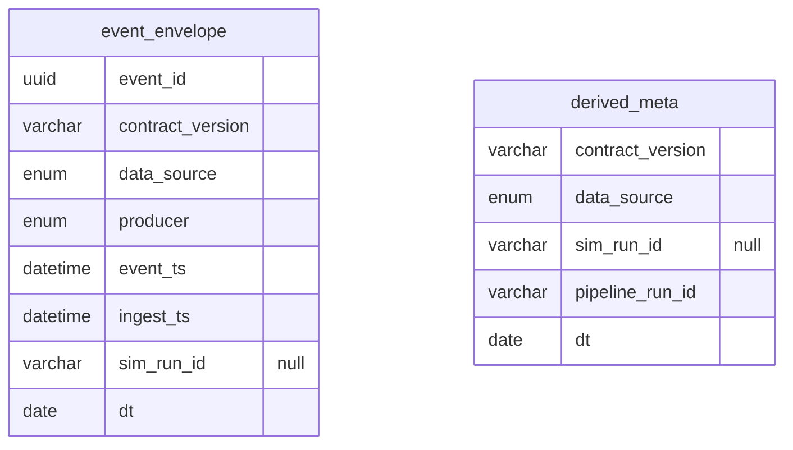

Bảng do pipeline dựng dùng `derived_meta` thay cho `event_envelope`.

---

## 2. Danh sách bảng

| Lớp | Bảng | Một dòng | Khóa chính | Trạng thái |
|---|---|---|---|---|
| Contract, Tham chiếu | [`dim_turn`](Bang_du_lieu_Data_Contract_v0.5.0.md#dim_turn) | Một phiên bản hiệu lực của một turn_id | turn_id, valid_from | Dùng |
| Contract, Tham chiếu | [`dim_turn_endpoint`](Bang_du_lieu_Data_Contract_v0.5.0.md#dim_turn_endpoint) | Một quan hệ IP, turn_id, vai trò trong một khoảng hiệu lực | mapping_id | Dùng |
| Contract, Tham chiếu | [`dim_asn`](Bang_du_lieu_Data_Contract_v0.5.0.md#dim_asn) | Một ASN | asn | Dùng |
| Contract, Tham chiếu | [`dim_country_area`](Bang_du_lieu_Data_Contract_v0.5.0.md#dim_country_area) | Một quốc gia trong một phiên bản bảng | country, area_map_version | Dùng |
| Contract, Call logs | [`call_session`](Bang_du_lieu_Data_Contract_v0.5.0.md#call_session) | Một cuộc gọi | call_id | Dùng |
| Contract, Call logs | [`client_applied_config`](Bang_du_lieu_Data_Contract_v0.5.0.md#client_applied_config) | Một lần áp dụng cấu hình trên một PC và generation | applied_config_id | Dùng |
| Contract, getStats và ICE | [`ice_event`](Bang_du_lieu_Data_Contract_v0.5.0.md#ice_event) | Một sự kiện quan sát trên một endpoint | event_id | Dùng |
| Contract, Call logs | [`endpoint_network_context`](Bang_du_lieu_Data_Contract_v0.5.0.md#endpoint_network_context) | Một call_id × side × device_id × network_epoch × context_version | call_id, side, device_id, network_epoch, context_version | Dùng (#6) |
| Contract, getStats và ICE | [`call_stats_epoch`](Bang_du_lieu_Data_Contract_v0.5.0.md#call_stats_epoch) | Một call_id × endpoint_side × device_id × media_kind × network_epoch × sequence_no | call_id, endpoint_side, device_id, media_kind, network_epoch, sequence_no | Dùng |
| Contract, getStats và ICE | [`call_stats_5s`](Bang_du_lieu_Data_Contract_v0.5.0.md#call_stats_5s) | Một call_id × endpoint_side × device_id × media_kind × window_idx | call_id, endpoint_side, device_id, media_kind, window_idx | Dùng |
| Contract, TURN metrics | [`turn_health_1m`](Bang_du_lieu_Data_Contract_v0.5.0.md#turn_health_1m) | Một turn_id × minute_ts | turn_id, minute_ts | Dùng |
| Contract, TURN metrics | [`turn_allocation`](Bang_du_lieu_Data_Contract_v0.5.0.md#turn_allocation) | Một session allocation trong log của một TURN, với kết quả cuối | turn_id, server_session_id | Dùng |
| Contract, Probe | [`turn_probe`](Bang_du_lieu_Data_Contract_v0.5.0.md#turn_probe) | Một cặp TURN có hướng × cửa sổ đo × phương pháp × giao thức | src_turn_id, dst_turn_id, window_start_ts, method_version, protocol | Dùng |
| Contract, Decision Log | [`selector_decision`](Bang_du_lieu_Data_Contract_v0.5.0.md#selector_decision) | Một decision_id × side × device_id | decision_id, side, device_id | Dùng |
| Contract, Decision Log | [`selector_decision_request`](Bang_du_lieu_Data_Contract_v0.5.0.md#selector_decision_request) | Một decision_id (header cấp call) | decision_id | Dùng |
| Contract, Decision Log | [`selector_decision_pair`](Bang_du_lieu_Data_Contract_v0.5.0.md#selector_decision_pair) | Một decision_id × cặp × metric | decision_id, turn_caller, turn_callee, transport_caller, transport_callee, metric | Dùng |
| Contract, Đầu vào Outcome Log | [`call_outcome`](Bang_du_lieu_Data_Contract_v0.5.0.md#call_outcome) | Một cuộc gọi | call_id | Dùng |
| Contract, Đầu vào Outcome Log | [`client_call_report`](Bang_du_lieu_Data_Contract_v0.5.0.md#client_call_report) | Một call_id × side × device_id | call_id, side, device_id | Dùng |
| Contract, Hoãn | [`candidate_observation`](Bang_du_lieu_Data_Contract_v0.5.0.md#candidate_observation) | Một candidate quan sát được, hoặc một dòng not_observed cho một mục cấu hình trong một chu kỳ thu | observation_id | Hoãn |
| Contract, Hoãn | [`ice_candidate_pair`](Bang_du_lieu_Data_Contract_v0.5.0.md#ice_candidate_pair) | Một cặp trong một attempt | call_id, attempt_seq, pair_id | Hoãn |
| Pipeline làm sạch | [`outcome_log`](Bang_du_lieu_Data_Contract_v0.5.0.md#outcome_log) | Một phiên bản outcome của một cuộc gọi; view hiện hành có một dòng | call_id, outcome_version | Dùng |
| Pipeline làm sạch | [`ice_attempt`](Bang_du_lieu_Data_Contract_v0.5.0.md#ice_attempt) | Một call_id × attempt_seq | call_id, attempt_seq | Dùng |
| Pipeline làm sạch | [`ice_attempt_endpoint`](Bang_du_lieu_Data_Contract_v0.5.0.md#ice_attempt_endpoint) | Một call_id × attempt_seq × side × device_id | call_id, attempt_seq, side, device_id | Dùng |
| Pipeline làm sạch | [`telemetry_coverage`](Bang_du_lieu_Data_Contract_v0.5.0.md#telemetry_coverage) | Một nguồn × phạm vi × khoảng thời gian |  | Dùng |
| Pipeline làm sạch | [`dq_results`](Bang_du_lieu_Data_Contract_v0.5.0.md#dq_results) | Một lần chạy × check × bảng | pipeline_run_id, check_id, table | Dùng |
| Pipeline làm sạch | [`clean_clock_columns`](Bang_du_lieu_Data_Contract_v0.5.0.md#clean_clock_columns) | Đi kèm dòng event |  | Dùng |
| Pipeline làm sạch | [`clean_stats_columns`](Bang_du_lieu_Data_Contract_v0.5.0.md#clean_stats_columns) | Đi kèm dòng call_stats_5s hoặc call_stats_epoch |  | Dùng |
| Pipeline làm sạch | [`clean_ice_event_columns`](Bang_du_lieu_Data_Contract_v0.5.0.md#clean_ice_event_columns) | Đi kèm dòng ice_event |  | Dùng |
| Pipeline làm sạch | [`clean_allocation_columns`](Bang_du_lieu_Data_Contract_v0.5.0.md#clean_allocation_columns) | Đi kèm dòng event |  | Dùng |
| Pipeline làm sạch | [`clean_leg_columns`](Bang_du_lieu_Data_Contract_v0.5.0.md#clean_leg_columns) | Đi kèm dòng event |  | Dùng |
| Feature Engineering | [`feature_snapshot`](Bang_du_lieu_Data_Contract_v0.5.0.md#feature_snapshot) | Một snapshot | snapshot_id | Dùng |
| Feature Engineering | [`feat_leg_stats`](Bang_du_lieu_Data_Contract_v0.5.0.md#feat_leg_stats) | Một snapshot × segment × TURN × hướng × metric × giờ | snapshot_id, segment_level, segment_key, turn_id, direction, metric, hour_bucket | Dùng |
| Feature Engineering | [`feat_turn_turn`](Bang_du_lieu_Data_Contract_v0.5.0.md#feat_turn_turn) | Một snapshot × cặp TURN có hướng × metric × giờ | snapshot_id, src_turn, dst_turn, metric, hour_bucket | Dùng |
| Feature Engineering | [`feat_turn_health`](Bang_du_lieu_Data_Contract_v0.5.0.md#feat_turn_health) | Một snapshot × TURN | snapshot_id, turn_id | Dùng |
| Feature Engineering | [`feat_path_history`](Bang_du_lieu_Data_Contract_v0.5.0.md#feat_path_history) | Một snapshot × hai segment × cặp TURN | snapshot_id, caller_segment_key, callee_segment_key, turn_caller, turn_callee | Dùng |
| Feature Engineering | [`health_snapshot`](Bang_du_lieu_Data_Contract_v0.5.0.md#health_snapshot) | Một health_snapshot_id × TURN | health_snapshot_id, turn_id | Dùng |
| Feature Engineering | [`dim_user`](Bang_du_lieu_Data_Contract_v0.5.0.md#dim_user) | Một user_hash | user_hash | Dùng |
| Feature Engineering | [`feat_callee_prior`](Bang_du_lieu_Data_Contract_v0.5.0.md#feat_callee_prior) | Một snapshot × segment Caller × nơi Callee | snapshot_id, caller_segment_key, callee_country, callee_vn_region | Hoãn |
| Feature Engineering | [`feat_turn_alloc_latency`](Bang_du_lieu_Data_Contract_v0.5.0.md#feat_turn_alloc_latency) | Một snapshot × segment × TURN × transport | snapshot_id, segment_key, turn_id, transport | Hoãn |
| Feature Engineering | [`feat_estimated_user_turn_rtt`](Bang_du_lieu_Data_Contract_v0.5.0.md#feat_estimated_user_turn_rtt) | Một snapshot × segment × TURN × transport × đại lượng | snapshot_id, segment_level, segment_key, turn_id, client_turn_transport, estimand | Hoãn |
| Labeled Data và Evaluation | [`fact_call`](Bang_du_lieu_Data_Contract_v0.5.0.md#fact_call) | Một call_id trong cohort | call_id | Đủ cột (#8); bản hiện hành theo as_of_ts, fact_version |
| Labeled Data và Evaluation | [`fact_call_endpoint`](Bang_du_lieu_Data_Contract_v0.5.0.md#fact_call_endpoint) | Một call_id × side × device_id | call_id, side, device_id | Dùng (#8) |
| Labeled Data và Evaluation | [`fact_pair_evaluation`](Bang_du_lieu_Data_Contract_v0.5.0.md#fact_pair_evaluation) | Một decision_id × metric × cặp, bản hiện hành | decision_id, metric, turn_caller, transport_caller, turn_callee, transport_callee | Dùng (#8) |
| Labeled Data và Evaluation | [`metric_config`](Bang_du_lieu_Data_Contract_v0.5.0.md#metric_config) | Một metric × phiên bản định nghĩa | metric_name, metric_definition_version | Dùng |
| Giả lập | [`sim_decision_oracle`](Bang_du_lieu_Data_Contract_v0.5.0.md#sim_decision_oracle) | Một decision_id × metric (đáp án tối ưu theo truth, chỉ synthetic) | decision_id, metric | Dùng (I34) |
| Giả lập | [`truth_leg_5m`](Bang_du_lieu_Data_Contract_v0.5.0.md#truth_leg_5m) | Một ts_bucket × chặng × hướng × mạng |  | Dùng |
| Giả lập | [`incident_truth`](Bang_du_lieu_Data_Contract_v0.5.0.md#incident_truth) | Một sự cố | incident_id | Dùng |
| Giả lập | [`dirt_log`](Bang_du_lieu_Data_Contract_v0.5.0.md#dirt_log) | Một event bị tiêm lỗi |  | Dùng |
| Giả lập | [`run_manifest`](Bang_du_lieu_Data_Contract_v0.5.0.md#run_manifest) | Một lần chạy | sim_run_id | Dùng |
| Giả lập | [`benchmark_manifest`](Bang_du_lieu_Data_Contract_v0.5.0.md#benchmark_manifest) | Một benchmark | benchmark_id | Dùng |
| Giả lập | [`sim_call_tag`](Bang_du_lieu_Data_Contract_v0.5.0.md#sim_call_tag) | Một cuộc gọi trong một lần chạy | sim_run_id, call_id | Dùng |
| API và vận hành Selector | [`select_request`](Bang_du_lieu_Data_Contract_v0.5.0.md#select_request) | Một request tới POST /v1/turn/select |  | Dùng |
| API và vận hành Selector | [`select_response`](Bang_du_lieu_Data_Contract_v0.5.0.md#select_response) | Một response của Selector |  | Dùng |
| API và vận hành Selector | [`service_health_1m`](Bang_du_lieu_Data_Contract_v0.5.0.md#service_health_1m) | Một minute_ts × service × instance | minute_ts, service, instance | Dùng |

---

## 3. Contract thu thập

### 3.1. Cuộc gọi, Decision Log và Outcome

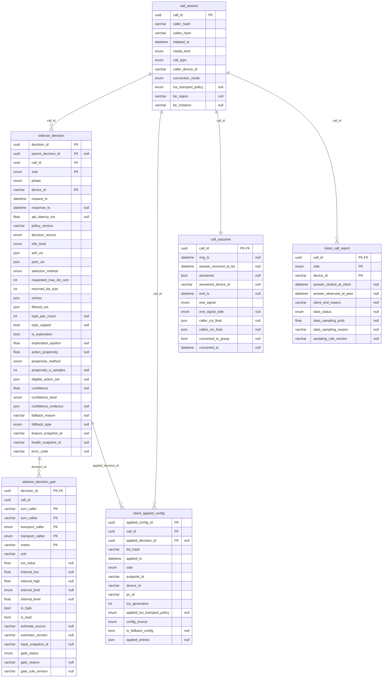

`ctx`, `entries`, `filtered_out` là `json`; cấu trúc của chúng nằm ở mục 1.9 của file giải thích.

### 3.1b. Bảng bổ sung sau phản hồi #5–#8

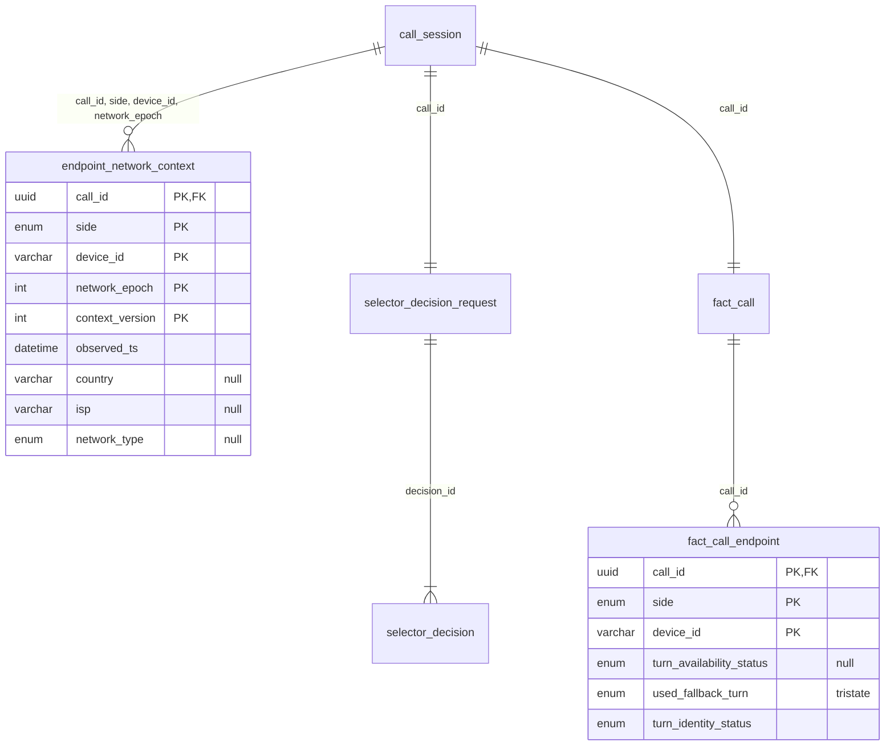

Chi tiết cột nằm ở [Bang_du_lieu](Bang_du_lieu_Data_Contract_v0.5.0.md). `turn_availability_status` và `used_fallback_turn` theo issue #5; `inventory_scope` nằm ở `run_manifest`.

### 3.2. getStats và sự kiện ICE

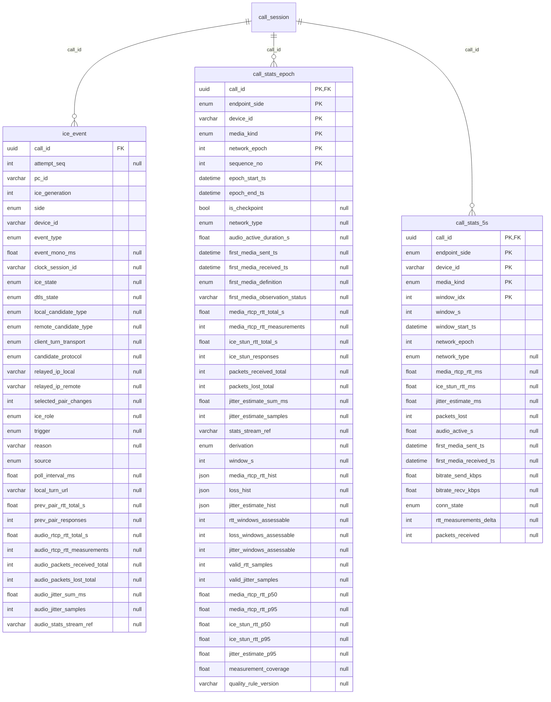

`call_session` đã vẽ đủ cột ở mục 3.1.

### 3.3. Danh mục TURN, TURN metrics và probe

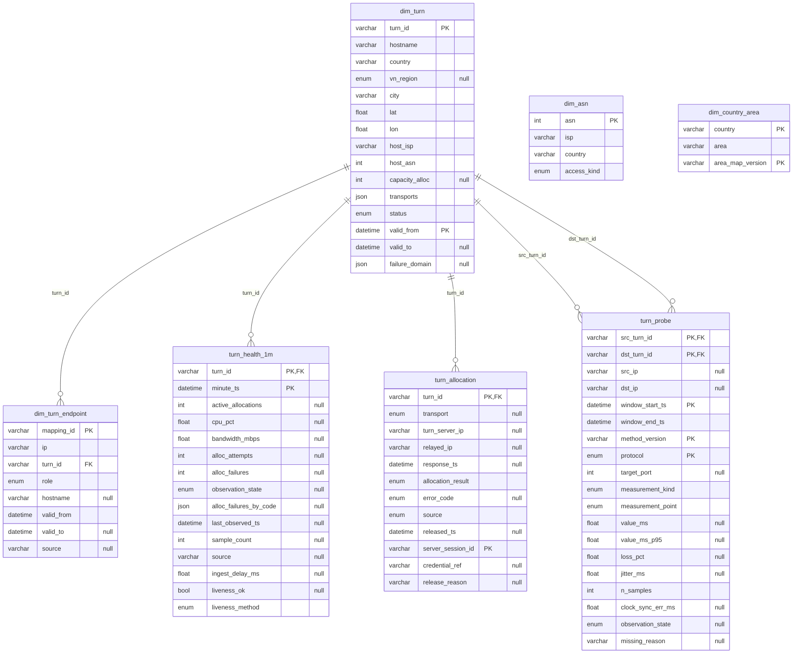

**Quan hệ do pipeline tra hoặc nối, không có khóa ngoại trực tiếp:**

- `ice_event.relayed_ip_local`, `relayed_ip_remote` và thời điểm → `dim_turn_endpoint.ip` → `dim_turn.turn_id`.
- `ice_event.local_turn_url` → mục trong `selector_decision.entries`.
- `turn_allocation.credential_ref` → `call_session.call_id`, nếu credential gắn theo cuộc gọi.
- `turn_probe.src_turn_id`, `dst_turn_id` → hai TURN của một cặp trong `selector_decision_pair`.

### 3.4. Bảng hoãn

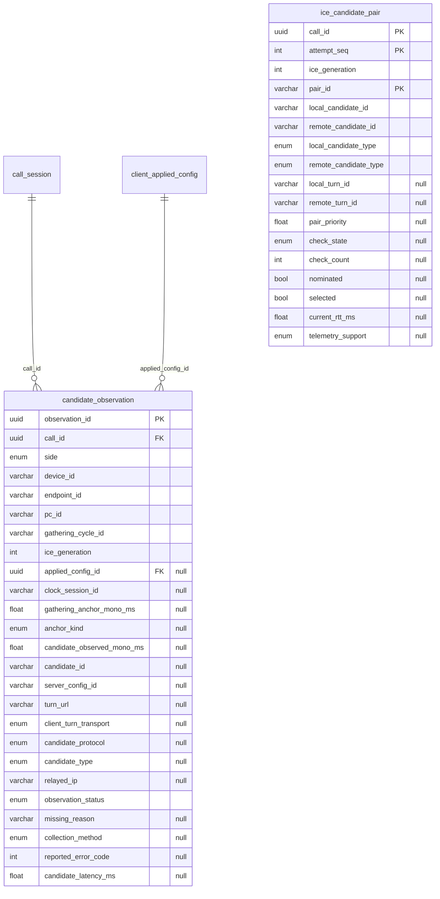

---

## 4. Các lớp sau thu thập

Đây là bản chuyển tiếp, giữ nội dung để không mất khi tách contract. Bảng `call_session`, `client_applied_config` ở các sơ đồ dưới thuộc contract, chỉ vẽ tên.

### 4.1. Pipeline làm sạch

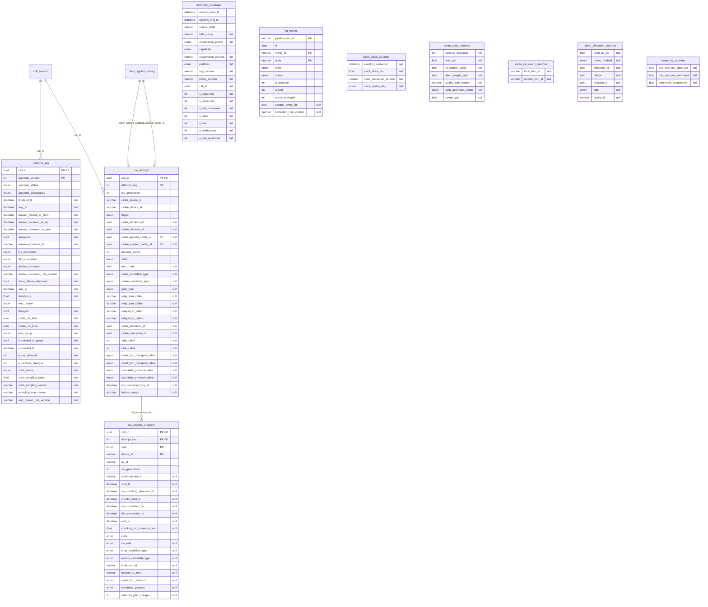

### 4.2. Feature Engineering

```mermaid
erDiagram

    feature_snapshot {
        varchar snapshot_id PK
        datetime cutoff_ts
        datetime published_ts
        varchar pipeline_version
        varchar content_hash
        varchar parent_snapshot_id "null"
    }
    feat_leg_stats {
        varchar snapshot_id PK
        enum segment_level PK
        varchar segment_key PK
        varchar turn_id PK
        enum direction PK
        enum metric PK
        varchar hour_bucket PK
        int n_raw
        float n_eff
        float p50 "null"
        float p95 "null"
        float loss_mean "null"
        float jitter_p95 "null"
        float p50_shrunk "null"
        json source_mix "null"
        datetime last_observed_ts "null"
        float sum_w "null"
        float sum_w2 "null"
        int n_calls_independent "null"
        int n_endpoints "null"
        int n_windows "null"
        float log_mean "null"
        float log_sd "null"
        float coverage "null"
        varchar value_kind
        varchar estimator_version "null"
    }
    feat_turn_turn {
        varchar snapshot_id PK
        varchar src_turn PK
        varchar dst_turn PK
        enum metric PK
        varchar hour_bucket PK
        int n_raw
        float n_eff
        float p50 "null"
        float p95 "null"
        float loss_mean "null"
        float jitter_p95 "null"
        json source_mix "null"
        datetime last_observed_ts "null"
        float sum_w "null"
        float sum_w2 "null"
        int n_calls_independent "null"
        int n_endpoints "null"
        int n_windows "null"
        float log_mean "null"
        float log_sd "null"
        float coverage "null"
        enum value_kind
        varchar estimator_version "null"
    }
    feat_turn_health {
        varchar snapshot_id PK
        varchar turn_id PK
        enum health_status
        float health_score "null"
        float utilization_p95_24h "null"
        float alloc_success_24h "null"
        float ci_low "null"
        float ci_high "null"
        int incidents_detected_7d "null"
        float stability_cv_24h "null"
    }
    feat_path_history {
        varchar snapshot_id PK
        varchar caller_segment_key PK
        varchar callee_segment_key PK
        enum segment_level "null"
        varchar turn_caller PK
        varchar turn_callee PK
        int n_calls
        float n_eff
        float poor_rate "null"
        float poor_rate_ci_low "null"
        float poor_rate_ci_high "null"
        float drop_rate "null"
        float setup_fail_rate "null"
        datetime last_observed_ts "null"
        float rtt_p50 "null"
        float rtt_p95 "null"
        float loss_mean "null"
        float jitter_p95 "null"
        float sum_w "null"
        float sum_w2 "null"
        int n_calls_independent "null"
        int n_endpoints "null"
        int n_windows "null"
        float log_mean "null"
        float log_sd "null"
        float coverage "null"
    }
    health_snapshot {
        varchar health_snapshot_id PK
        datetime cutoff_ts
        datetime published_ts
        varchar turn_id PK
        enum health_status
        float health_score "null"
        float utilization_pct_5m "null"
        float alloc_fail_rate_5m "null"
        datetime last_observed_ts "null"
        varchar source "null"
        varchar health_rule_version "null"
        enum observation_state "null"
        varchar assigned_by "null"
    }
    dim_user {
        varchar user_hash PK
        varchar home_country
        enum home_vn_region "null"
        varchar home_city
        varchar home_isp
        int home_asn "null"
        enum primary_network
        enum cohort
        datetime created_at
    }
    feat_callee_prior {
        varchar snapshot_id PK
        varchar caller_segment_key PK
        varchar callee_country PK
        enum callee_vn_region PK
        int n
        float share
    }
    feat_turn_alloc_latency {
        varchar snapshot_id PK
        varchar segment_key PK
        varchar turn_id PK
        enum transport PK
        int n
        int n_known "null"
        int n_unknown "null"
        float alloc_ms_p50 "null"
        float alloc_ms_p95 "null"
        float alloc_success_rate "null"
        float alloc_success_ci_low "null"
        float alloc_success_ci_high "null"
    }
    feat_estimated_user_turn_rtt {
        varchar snapshot_id PK
        enum segment_level PK
        varchar segment_key PK
        varchar turn_id PK
        enum client_turn_transport PK
        enum estimand PK
        varchar unit
        float estimated_user_turn_rtt_ms "null"
        float interval_low "null"
        float interval_high "null"
        enum interval_kind "null"
        float interval_level "null"
        varchar estimate_source
        varchar estimator_version
        varchar input_snapshot_id "null"
        enum validation_status
        enum gate_status
        varchar gate_reason "null"
        varchar gate_rule_version "null"
    }
```

### 4.3. Labeled Data và Evaluation

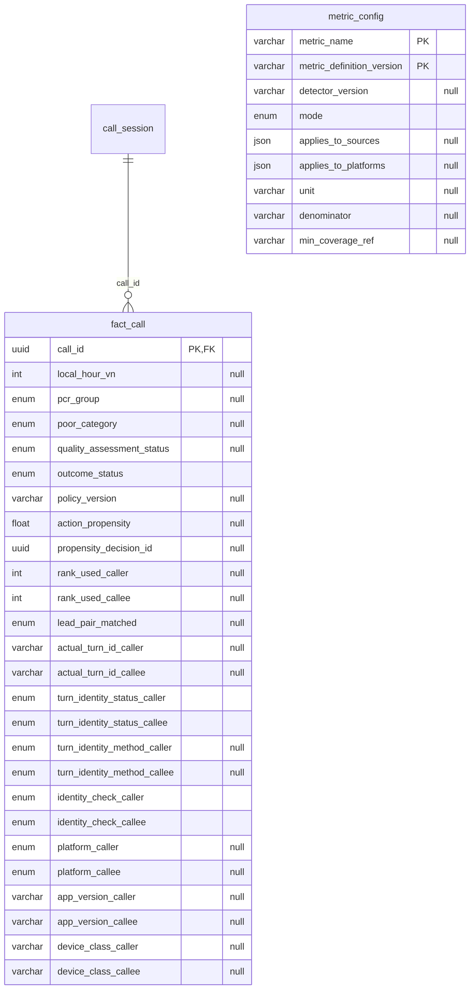

### 4.4. Giả lập

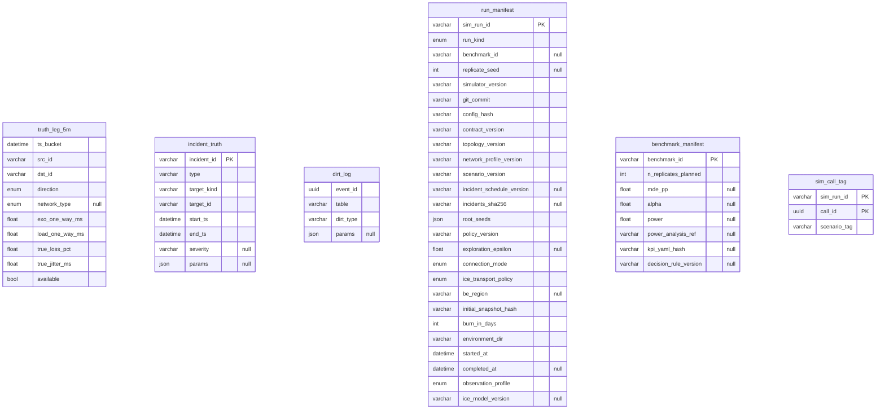

### 4.5. API và vận hành Selector

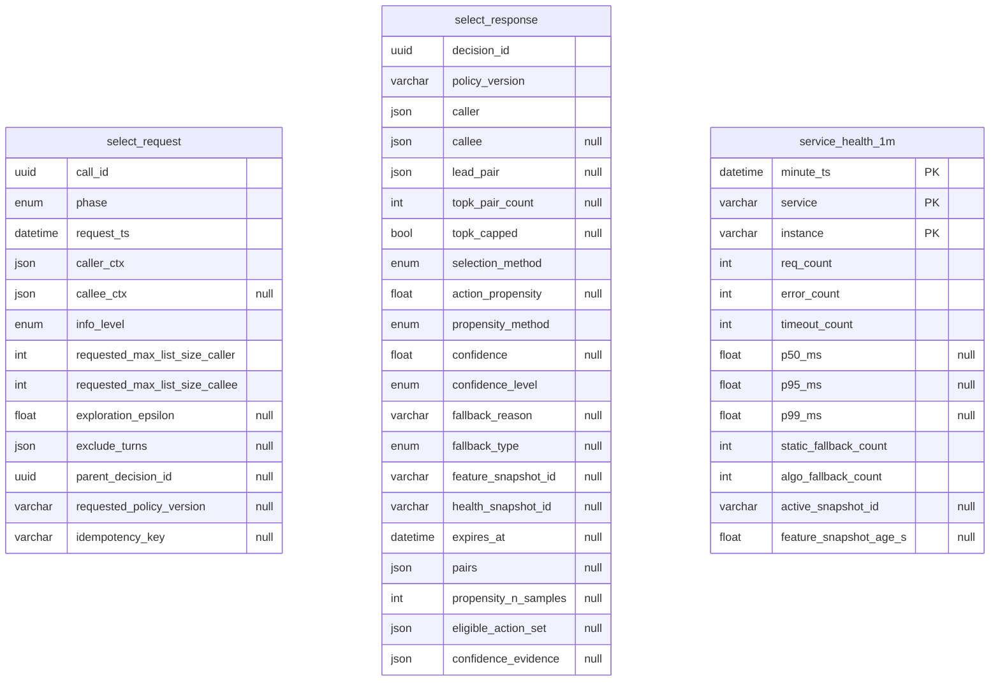
